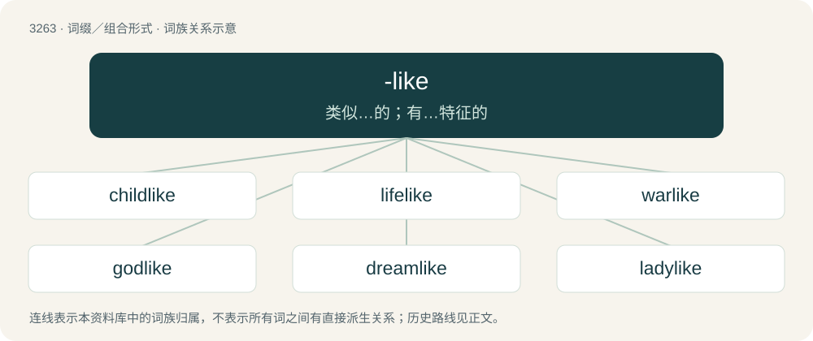

# 3355 · -like — 类似…的；有…特征的

[总目录](../00_总目录_按常用程度.md)

**类型**：词缀／组合形式　｜　**来源语言**：见词源记录

## 核心含义与来源

- 核心含义：类似…的；有…特征的
- 英文含义：Resembling, having some of the characteristics of (used to form adjectives from nouns).
- 词形：-like

**来源记录 1**（后缀／后置成分；Resembling, having some of the characteristics of (used to form adjectives from nouns).）

From Middle English -like, -lik, from Middle English like, lik (“same, similar, alike”), from Old English ġelīc and Old Norse líkr (“same, similar, alike”). Reinforced by like (preposition). Doublet of -ly. Compare also Dutch -lijk (“-ly, -like”).

## 词族图

## 单词速览（常用到不常用）

| 单词 | 音标 | 释义 |
|---|---|---|
| [childlike](#w-1) | /ˈt͡ʃaɪldlaɪk/ | a. 孩子似的, 天真烂漫的 |
| [lifelike](#w-2) | /ˈlaɪflaɪk/ | a. 栩栩如生的, 逼真的, 酷象实物的 |
| [warlike](#w-3) | 英 /ˈwɔːlaɪk/；美 /ˈwɔɹlaɪk/ | a. 准备战斗的, 好战的, 尚武的, 勇于作战的, 军事的；\[法\] 好战的, 军事的 |
| [godlike](#w-4) | 英 /ˈɡɒdlaɪk/；美 /ˈɡɑdlaɪk/ | a. 似神的, 庄严的 |
| [dreamlike](#w-5) | 美 /ˈdɹimlaɪk/ | a. 梦一般的, 梦幻的 |
| [ladylike](#w-6) | /ˈleɪ.di.laɪ̯k/ | a. 娴淑的, 如淑女的, 高雅的 |
| [businesslike](#w-7) | /ˈbiznislaik/ | a. 有条理的, 有效率的 |
| [workmanlike](#w-8) | /ˈwɜː(ɹ)kmənlaɪk/ | a. 工作熟练的, 有技巧的, 精巧的 |
| [roguelike](#w-9) | 美 /ˈɹoʊɡlaɪk/ | 【英文】Any of a genre of computer role playing games loosely characterized by various characteristics such as randomised environment generation, permadeath, turn-based movement, text-based or primitive tile-based graphics,  |

## 逐词详解

### 1. childlike

**词性**：形容词　｜　**音标**：/ˈt͡ʃaɪldlaɪk/

**中文释义**：a. 孩子似的, 天真烂漫的

**英文义项**：Innocent and trustful; credulous; artless. / Of, like, or suitable for a child.

**构词拆分**：child + -like

**词源与演化**：

From child + -like.

**例句**：

> I spent five years in university, which seemed like 500 childlike years.

### 2. lifelike

**词性**：形容词　｜　**音标**：/ˈlaɪflaɪk/

**中文释义**：a. 栩栩如生的, 逼真的, 酷象实物的

**英文义项**：Like a living being; resembling life; being an accurate representation.

**构词拆分**：life + -like

**词源与演化**：

From life + -like. First attested in the 1610s.

**例句**：

> The robot was so lifelike, Jack could hardly tell it apart from his sister.

该用例对应义项：Like a living being; resembling life; being an accurate representation.

### 3. warlike

**词性**：形容词　｜　**音标**：英 /ˈwɔːlaɪk/；美 /ˈwɔɹlaɪk/

**中文释义**：a. 准备战斗的, 好战的, 尚武的, 勇于作战的, 军事的；\[法\] 好战的, 军事的

**英文义项**：Hostile and belligerent. / Martial, bellicose or militaristic.

**构词拆分**：war + -like

**词源与演化**：

From war + -like. Compare the older warly.

**例句**：

> A warlike people, or one that likes warlike rulers, is probably mentally unwell.

### 4. godlike

**词性**：形容词　｜　**音标**：英 /ˈɡɒdlaɪk/；美 /ˈɡɑdlaɪk/

**中文释义**：a. 似神的, 庄严的

**英文义项**：Having the characteristics of a god. / Characteristic of a god.

**构词拆分**：god + -like

**词源与演化**：

From god + -like.

**例句**：

> A man of godlike sagacity.

该用例对应义项：appropriate to or befitting a god

### 5. dreamlike

**词性**：形容词　｜　**音标**：美 /ˈdɹimlaɪk/

**中文释义**：a. 梦一般的, 梦幻的

**英文义项**：Like something from a dream; having a sense of vagueness, insubstantiality, or incongruousness.

**构词拆分**：dream + -like

**词源与演化**：

From dream + -like.

**例句**：

> Her kiss sent me into a dreamlike state of bliss.

该用例对应义项：Like something from a dream; having a sense of vagueness, insubstantiality, or incongruousness.

### 6. ladylike

**词性**：形容词　｜　**音标**：/ˈleɪ.di.laɪ̯k/

**中文释义**：a. 娴淑的, 如淑女的, 高雅的

**英文义项**：Of or related to the appearance or behaviour of a well-mannered woman.

**构词拆分**：lady + -like

**词源与演化**：

From lady + -like.

**例句**：

> How can I sound more ladylike?

### 7. businesslike

**词性**：形容词　｜　**音标**：/ˈbiznislaik/

**中文释义**：a. 有条理的, 有效率的

**英文义项**：Methodical and efficient, in a way that would be advantageous to a business or businessperson. / Earnest and practical without being distracted or enthusiastic.

**构词拆分**：business + -like

**词源与演化**：

From business + -like.

**例句**：

> The prime minister's businesslike approach to welfare reform earned him accolades among the upper class.

### 8. workmanlike

**词性**：形容词　｜　**音标**：/ˈwɜː(ɹ)kmənlaɪk/

**中文释义**：a. 工作熟练的, 有技巧的, 精巧的

**英文义项**：Resembling or characteristic of a workman. / Done competently but without flair.

**构词拆分**：workman + -like

**词源与演化**：

From workman + -like.

**例句**：

> The book is a workmanlike job with chronology and bibliography and index.

该用例对应义项：worthy of a good workman

### 9. roguelike

**词性**：名词　｜　**音标**：美 /ˈɹoʊɡlaɪk/

**英文义项**：Any of a genre of computer role playing games loosely characterized by various characteristics such as randomised environment generation, permadeath, turn-based movement, text-based or primitive tile-based graphics, and hack-and-slash gameplay.

**词源与演化**：

From Rogue (the name of a 1980 computer game which introduced the genre, from rogue) + -like.
