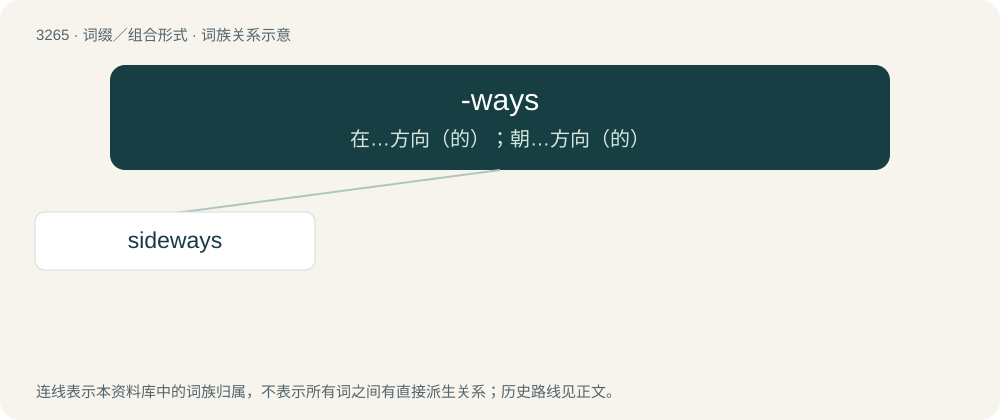

# 3357 · -ways — 在…方向（的）；朝…方向（的）

[总目录](../00_总目录_按常用程度.md)

**类型**：词缀／组合形式　｜　**来源语言**：见词源记录

## 核心含义与来源

- 核心含义：在…方向（的）；朝…方向（的）
- 英文含义：Towards, in the direction towards.
- 词形：-ways

**来源记录 1**（后缀／后置成分；Towards, in the direction towards.）

From way + -s (adverbial suffix).

## 词族图

## 单词速览（常用到不常用）

| 单词 | 音标 | 释义 |
|---|---|---|
| [sideways](#w-1) | /ˈsaɪdweɪz/ | adv. 向旁边, 向侧面地；a. 旁边的, 向侧面的 |

## 逐词详解

### 1. sideways

**词性**：形容词　｜　**音标**：/ˈsaɪdweɪz/

**中文释义**：adv. 向旁边, 向侧面地；a. 旁边的, 向侧面的

**英文义项**：Moving or directed toward one side. / Positioned sideways (with a side to the front).

**构词拆分**：side + -ways

**词源与演化**：

From side + -ways.

**例句**：

> There was a stack of papers in front of each seat at the table, but each stack was sideways.

该用例对应义项：Positioned sideways (with a side to the front).
