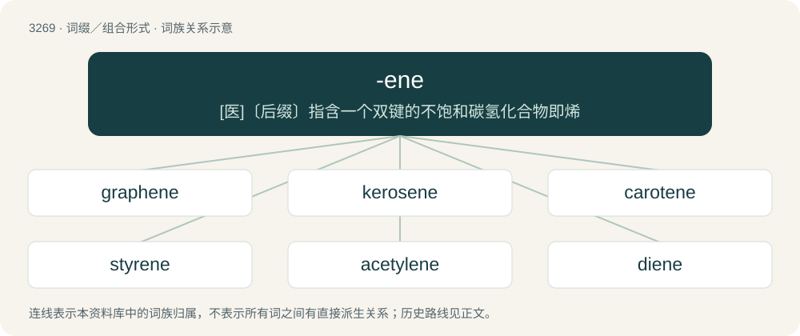

# 3362 · -ene — \[医\]〔后缀〕指含一个双键的不饱和碳氢化合物即烯

[总目录](../00_总目录_按常用程度.md)

**类型**：词缀／组合形式　｜　**来源语言**：见词源记录

## 核心含义与来源

- 核心含义：\[医\]〔后缀〕指含一个双键的不饱和碳氢化合物即烯
- 英文含义：Forms adjectives relating to places and nouns for their inhabitants.
- 词形：-ene

**多个词源／构词路径**：同一拼写可能有不同来源；以下按词性和含义分别列出。

**来源记录 1**（后缀／后置成分；Forms adjectives relating to places and nouns for their inhabitants.）

Borrowed from Latin -ēnus, from Ancient Greek -ηνός (-ēnós), forming adjectives from place names.

**来源记录 2**（后缀／后置成分；An unsaturated hydrocarbon having at least one double bond; an alkene.）

Borrowed from French -ène, chosen by French chemist Jean-Baptiste Dumas to avoid confusion with chemicals in -ine.

**来源记录 3**（后缀／后置成分；A single-atom thick two-dimensional layer of atoms.）

Derived from graphene, expressing its monolayer characteristic.

## 词族图

## 单词速览（常用到不常用）

| 单词 | 音标 | 释义 |
|---|---|---|
| [graphene](#w-1) | /ˈɡɹæf.iːn/ | n. 石墨的单原子层 |
| [kerosene](#w-2) | /ˈkɛɹəsiːn/ | n. 煤油, 火油, 灯油；\[化\] 煤油 |
| [carotene](#w-3) | 英 /ˈkæɹ.əˌtiːn/；美 /ˈkæɹ.əˌtin/ | n. 胡萝卜素；\[化\] 胡萝卜素; 叶红素 |
| [styrene](#w-4) | /ˈstaɪriːn/ | n. 苯乙烯；\[化\] 苯乙烯; 苏合香烯; 苯亚乙基 |
| [acetylene](#w-5) | /əˈsɛtəlˌin/ | n. 乙炔, 电石气；\[化\] 乙炔; 双亚乙基 |
| [diene](#w-6) | /ˈdaɪ.iːn/ | \[化\] 双烯; 二烯烃 |
| [naphthalene](#w-7) | /ˈnæfθəliːn/ | \[化\] 萘；\[医\] 萘 |
| [xylene](#w-8) | /ˈzaɪliːn/ | n. 二甲苯；\[化\] 二甲苯 |

## 逐词详解

### 1. graphene

**词性**：名词　｜　**音标**：/ˈɡɹæf.iːn/

**中文释义**：n. 石墨的单原子层

**英文义项**：Any polycyclic aromatic hydrocarbon having the structure of part of a layer of graphite. / An arbitrarily large-scale, one-atom-thick layer of graphite, an allotrope of carbon, that has remarkable electric characteristics.

**构词拆分**：graphite + -ene

**词源与演化**：

From graph(ite) + -ene.

**例句**：

> Could graphene be used to make a cable for a space elevator?

### 2. kerosene

**词性**：名词　｜　**音标**：/ˈkɛɹəsiːn/

**中文释义**：n. 煤油, 火油, 灯油；\[化\] 煤油

**英文义项**：A thin, often colorless or blue or straw-colored petroleum-based fuel, heavier than gasoline/petrol or naphtha but lighter than diesel, used primarily as jet fuel but also for heating and lighting in some remote or impoverished areas.

**构词拆分**：Ancient Greek κηρός (kērós, “wax”) + -ene

**词源与演化**：

From Ancient Greek κηρός (kērós, “wax”) + -ene; a name trademarked in 1854. An older term for kerosene was carbon oil.

**例句**：

> The kerosene lasted all winter, so the furnace kept us always warm.

该用例对应义项：A thin, often colorless or blue or straw-colored petroleum-based fuel, heavier than gasoline/petrol or naphtha but lighter than diesel, used primarily as jet fuel but also for heating and lighting in some remote or impoverished areas.

### 3. carotene

**词性**：名词　｜　**音标**：英 /ˈkæɹ.əˌtiːn/；美 /ˈkæɹ.əˌtin/

**中文释义**：n. 胡萝卜素；\[化\] 胡萝卜素; 叶红素

**英文义项**：A class of tetraterpene plant pigments; they vary in colour from yellow, through orange to red, this colour originating in a chain of alternating single and double bonds. / Specifically, a number of isomers of tetraterpene hydrocarbons, C₄₀H₅₆, (especially beta-carotene), present in carrots etc, which are converted into vitamin A in the liver.

**构词拆分**：carrot + -ene

**词源与演化**：

From car(r)ot + -ene.

### 4. styrene

**词性**：名词　｜　**音标**：/ˈstaɪriːn/

**中文释义**：n. 苯乙烯；\[化\] 苯乙烯; 苏合香烯; 苯亚乙基

**英文义项**：An aromatic hydrocarbon; a colourless, oily liquid, used in the manufacture of polymers such as polystyrene.

**词源与演化**：

From Latin styrax (or storax) + -ene.

### 5. acetylene

**词性**：名词　｜　**音标**：/əˈsɛtəlˌin/

**中文释义**：n. 乙炔, 电石气；\[化\] 乙炔; 双亚乙基

**英文义项**：Any organic compound having one or more carbon–carbon triple bonds; an alkyne. / Ethyne; the simplest alkyne, a hydrocarbon of formula HC≡CH. It is a colourless, odourless, extremely flammable, explosive gas, formerly used as an illuminating gas, but now used in welding and metallurgy.

**构词拆分**：acetyl + -ene

**词源与演化**：

Borrowed from French acétylène, coined by French chemist Marcellin Berthelot, from acetyl + -ene.

**例句**：

> Thankfully, electrical lighting has virtually eliminated the need for acetylene headlamps.

### 6. diene

**词性**：名词　｜　**音标**：/ˈdaɪ.iːn/

**中文释义**：\[化\] 双烯; 二烯烃

**英文义项**：An organic compound, especially a hydrocarbon, containing two double bonds.

**构词拆分**：di- + -ene

**词源与演化**：

From di- + -ene.

### 7. naphthalene

**词性**：名词　｜　**音标**：/ˈnæfθəliːn/

**中文释义**：\[化\] 萘；\[医\] 萘

**英文义项**：A white crystalline hydrocarbon manufactured from coal tar; used in mothballs. / An aromatic bicyclic hydrocarbon, C₁₀H₈; an acene containing two fused benzene rings.

**构词拆分**：naphtha + -al + -ene

**词源与演化**：

From naphth(a) + -al + -ene.

### 8. xylene

**词性**：名词　｜　**音标**：/ˈzaɪliːn/

**中文释义**：n. 二甲苯；\[化\] 二甲苯

**英文义项**：Any of a group of three isomeric aromatic hydrocarbons, found in coal and wood tar.

**构词拆分**：xyl- + -ene

**词源与演化**：

From xyl- + -ene.
