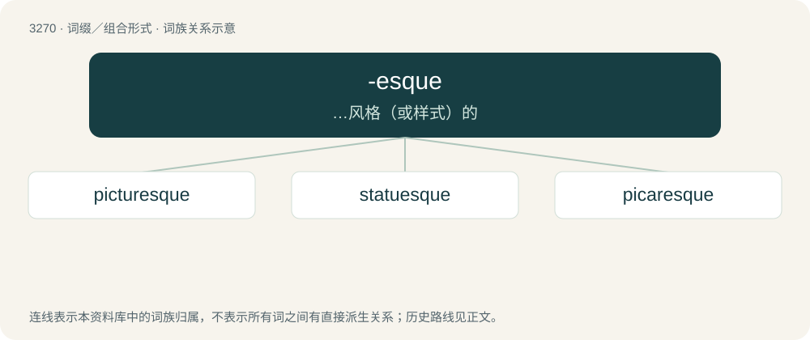

# 3363 · -esque — …风格（或样式）的

[总目录](../00_总目录_按常用程度.md)

**类型**：词缀／组合形式　｜　**来源语言**：见词源记录

## 核心含义与来源

- 核心含义：…风格（或样式）的
- 英文含义：In the style or manner of; appended to nouns, especially proper nouns, and forming adjectives.
- 词形：-esque

**来源记录 1**（后缀／后置成分；In the style or manner of; appended to nouns, especially proper nouns, and forming adjectives.）

Borrowed from French -esque (“-ish, -ic, -esque”), from Italian -esco, from Latin -iscus, of Germanic origin, from Lombardic -isc (“-ish”), from Proto-West Germanic \*-isk, from Proto-Germanic \*-iskaz (“-ish”), from Proto-Indo-European \*-iskos. Cognate with Old High German -isc (German -isch), Old English -isċ, Old Norse -iskr, Gothic -𐌹𐍃𐌺𐍃 (-isks). Doublet of -ish and -ski.

## 词族图

## 单词速览（常用到不常用）

| 单词 | 音标 | 释义 |
|---|---|---|
| [picturesque](#w-1) | /ˌpɪkt͡ʃəˈɹɛsk/ | a. 生动的, 如画的, 独特的, 别致的, 栩栩如生的 |
| [statuesque](#w-2) | 英 /statjʊˈɛsk/ | a. 雕像一般的, 均称的, 轮廓优美的 |
| [picaresque](#w-3) | 英 /pɪkəˈɹɛsk/ | a. 以无赖和流浪汉的冒险事迹徒为题材的；n. 关于流浪汉及其冒险事迹的小说或其它作品 |

## 逐词详解

### 1. picturesque

**词性**：形容词　｜　**音标**：/ˌpɪkt͡ʃəˈɹɛsk/

**中文释义**：a. 生动的, 如画的, 独特的, 别致的, 栩栩如生的

**英文义项**：Resembling or worthy of a picture or painting; having the qualities of a picture or painting; pleasingly beautiful. / Strikingly graphic or vivid; having striking and vivid imagery.

**构词拆分**：picture + -esque

**词源与演化**：

From picture + -esque, a calque of French pittoresque, from picture (“a picture, painting”).

**例句**：

> We looked down onto a beautiful, picturesque sunset over the ocean.

该用例对应义项：Resembling or worthy of a picture or painting; having the qualities of a picture or painting; pleasingly beautiful.

### 2. statuesque

**词性**：形容词　｜　**音标**：英 /statjʊˈɛsk/

**中文释义**：a. 雕像一般的, 均称的, 轮廓优美的

**英文义项**：Resembling or characteristic of a statue. / Immobile; motionless.

**构词拆分**：By surface analysis, statu(e) + -esque

**词源与演化**：

Unadapted borrowing from French statuesque. By surface analysis, statu(e) + -esque.

**例句**：

> Christy Turlington is a statuesque supermodel famous for her fashion ads.

该用例对应义项：Elegantly tall, graceful, and attractive.

### 3. picaresque

**词性**：形容词　｜　**音标**：英 /pɪkəˈɹɛsk/

**中文释义**：a. 以无赖和流浪汉的冒险事迹徒为题材的；n. 关于流浪汉及其冒险事迹的小说或其它作品

**英文义项**：Of or pertaining to adventurers or rogues. / Characteristic of a genre of Spanish satiric novel dealing with the adventures of a roguish hero.

**词源与演化**：

From picaro (“adventurer, rogue”) + -esque (suffix meaning ‘in the style or manner of’ forming adjectives), modelled after Spanish picaresco (“in the style or manner of a picaro; picaresque”), from pícaro (“rogue”) + -esco (suffix forming adjectives indicating a relation). Compare French picaresque (attested later than the English word), Italian picaresco, Portuguese picaresco.

**例句**：

> Waifs of the picaresque tradition.

该用例对应义项：involving clever rogues or adventurers especially as in a type of fiction
