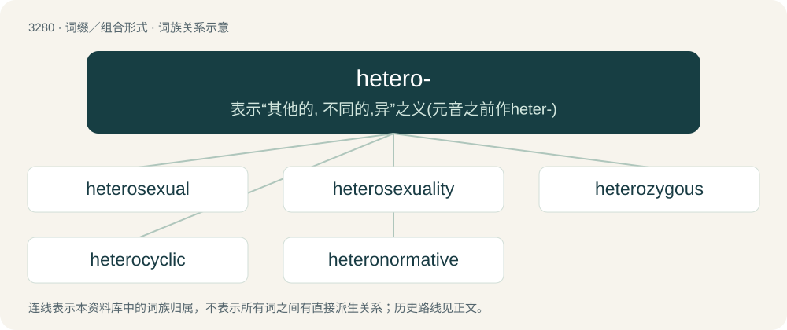

# 3369 · hetero- — 表示“其他的, 不同的,异”之义(元音之前作heter-)

[总目录](../00_总目录_按常用程度.md)

**类型**：词缀／组合形式　｜　**来源语言**：见词源记录

## 核心含义与来源

- 核心含义：表示“其他的, 不同的,异”之义(元音之前作heter-)
- 英文含义：Varied, heterogeneous; a set that has variety with respect to the root.
- 词形：hetero-

## 词族图

## 单词速览（常用到不常用）

| 单词 | 音标 | 释义 |
|---|---|---|
| [heterosexual](#w-1) | 英 /ˌhɛtəɹəˈsɛkʃuəl/；美 /ˌhɛtəɹəˈsɛkʃuəl/ | a. 异性的, 异性爱的；n. 异性恋的人 |
| [heterosexuality](#w-2) | /,hetərəu,seksjuˈæliti/ | n. 异性爱；\[医\] 异性性欲 |
| [heterozygous](#w-3) | /,hetərəuˈzai^əs/ | a. \[生\]杂合的 |
| [heterocyclic](#w-4) | /.hetərəuˈsaiklik/ | a. 杂环的, 不同环式的；\[医\] 杂环的 |
| [heteronormative](#w-5) | 英 /ˌhɛtəɹəʊˈnɔːmətɪv/；美 /ˌhɛtəɹoʊˈnoɹmətɪv/ | 【英文】Of or relating to the institutions and practices that privilege or value heterosexuality, heterosexual relationships, and traditional gender roles as fundamental and "natural" within society. |

## 逐词详解

### 1. heterosexual

**词性**：形容词　｜　**音标**：英 /ˌhɛtəɹəˈsɛkʃuəl/；美 /ˌhɛtəɹəˈsɛkʃuəl/

**中文释义**：a. 异性的, 异性爱的；n. 异性恋的人

**英文义项**：Sexually attracted to members of the opposite sex. / Between two people of different sex.

**构词拆分**：hetero- + -sexual

**词源与演化**：

From hetero- + -sexual. Earliest citation from 1892, in C.G. Craddock's translation of Krafft-Ebbing's Psychopathia Sexualis.

**例句**：

> Bonobos often use sexual behavior, sometimes homosexual, sometimes heterosexual, for social negotiation.

### 2. heterosexuality

**词性**：名词　｜　**音标**：/,hetərəu,seksjuˈæliti/

**中文释义**：n. 异性爱；\[医\] 异性性欲

**英文义项**：The state of being sexually and romantically attracted primarily or exclusively to persons of the opposite sex. / Sexual activity with a person of the opposite sex.

**构词拆分**：heterosexual + -ity；hetero- + sexuality

**词源与演化**：

From heterosexual + -ity or hetero- + sexuality.

**例句**：

> Since traditional gender roles include enforced heterosexuality, gay and trans people are natural allies.

### 3. heterozygous

**词性**：形容词　｜　**音标**：/,hetərəuˈzai^əs/

**中文释义**：a. \[生\]杂合的

**英文义项**：Of an organism: having two different alleles in a given gene.

**构词拆分**：hetero- + -zygous

**词源与演化**：

From hetero- + -zygous.

**例句**：

> Heterozygous for eye color.

该用例对应义项：having dissimilar alleles at corresponding chromosomal loci

### 4. heterocyclic

**词性**：形容词　｜　**音标**：/.hetərəuˈsaiklik/

**中文释义**：a. 杂环的, 不同环式的；\[医\] 杂环的

**英文义项**：Having atoms of two or more different elements in at least one of its rings. / Having one or more atoms other than carbon in at least one of its rings.

**构词拆分**：hetero- + cyclic

**词源与演化**：

From hetero- + cyclic.

### 5. heteronormative

**词性**：形容词　｜　**音标**：英 /ˌhɛtəɹəʊˈnɔːmətɪv/；美 /ˌhɛtəɹoʊˈnoɹmətɪv/

**英文义项**：Of or relating to the institutions and practices that privilege or value heterosexuality, heterosexual relationships, and traditional gender roles as fundamental and "natural" within society.

**构词拆分**：hetero- + normative

**词源与演化**：

From hetero- + normative. The word was popularized by the American social theorist Michael Warner (born 1958) in a 1991 journal article: see the quotation.

**例句**：

> Much of the language used when discussing wedding planning is heteronormative, which can alienate homosexual couples.

该用例对应义项：Of or relating to the institutions and practices that privilege or value heterosexuality, heterosexual relationships, and traditional gender roles as fundamental and "natural" within society.
