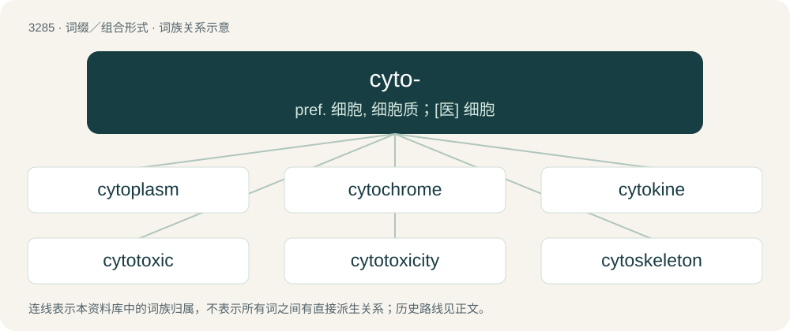

# 3373 · cyto- — pref. 细胞, 细胞质；\[医\] 细胞

[总目录](../00_总目录_按常用程度.md)

**类型**：词缀／组合形式　｜　**来源语言**：见词源记录

## 核心含义与来源

- 核心含义：pref. 细胞, 细胞质；\[医\] 细胞
- 英文含义：cell.
- 词形：cyto-

**来源记录 1**（前缀／前置成分；cell.）

Learned borrowing from Ancient Greek κύτος (kútos, “container, receptacle”).

## 词族图

## 单词速览（常用到不常用）

| 单词 | 音标 | 释义 |
|---|---|---|
| [cytoplasm](#w-1) | 英 /ˈsaɪtəʊˌplæzəm/；美 /ˈsaɪtoʊˌplæzəm/ | n. 细胞质；\[医\] \[细\]胞质, \[细\]胞浆 |
| [cytochrome](#w-2) | /ˈsaɪtəkɹəʊm/ | n. 细胞色素；\[化\] 细胞色素 |
| [cytokine](#w-3) | 英 /ˈsaɪ.tə(ʊ)(ˌ)kaɪn/；美 /ˈsaɪ.təˌkaɪn/ | 细胞活素 |
| [cytotoxic](#w-4) | /,saitəˈtɔksik/ | a. 细胞毒素的；\[医\] 细胞毒素的 |
| [cytotoxicity](#w-5) | /,saitəutɔkˈsisiti/ | n. 细胞毒性 |
| [cytoskeleton](#w-6) |  | \[医\] 细胞支架 |
| [cytosol](#w-7) | /ˈsaitəusɔl/ | n. \[生\]细胞溶质,胞液 |
| [cytometry](#w-8) | /saiˈtɔmətri/ | n. 血细胞计数 |
| [cytology](#w-9) | 英 /saɪˈtɒləd͡ʒi/；美 /saɪˈtɑləd͡ʒi/ | n. 细胞学；\[医\] 细胞学 |
| [cytomegalovirus](#w-10) | 美 /ˌsaɪ.toʊˈmɛ.ɡə.loʊˌvaɪ.rəs/ | n. 巨细胞病毒 |
| [cytogenetic](#w-11) | /ˌsaɪtoʊd͡ʒəˈnɛtɪk/ | a. \[生\]细胞发生的, 细胞生成的 |
| [cytoskeletal](#w-12) |  | n. 细胞骨架 |

## 逐词详解

### 1. cytoplasm

**词性**：名词　｜　**音标**：英 /ˈsaɪtəʊˌplæzəm/；美 /ˈsaɪtoʊˌplæzəm/

**中文释义**：n. 细胞质；\[医\] \[细\]胞质, \[细\]胞浆

**英文义项**：The contents of a cell except for the nucleus. It includes cytosol, organelles, vesicles, and the cytoskeleton.

**构词拆分**：cyto- (“cell”) + -plasm (“contents of a cell”)

**词源与演化**：

Borrowed from German Zytoplasma, Cytoplasma. Equivalent to cyto- (“cell”) + -plasm (“contents of a cell”).

**例句**：

> The cytoplasm consists of proteins, the nucleus of nucleic acids.

### 2. cytochrome

**词性**：名词　｜　**音标**：/ˈsaɪtəkɹəʊm/

**中文释义**：n. 细胞色素；\[化\] 细胞色素

**英文义项**：Any of various related hemoproteins found in the cells of most organisms, which are an important part of cell respiration.

**构词拆分**：cyto- + -chrome

**词源与演化**：

From cyto- + -chrome.

### 3. cytokine

**词性**：名词　｜　**音标**：英 /ˈsaɪ.tə(ʊ)(ˌ)kaɪn/；美 /ˈsaɪ.təˌkaɪn/

**中文释义**：细胞活素

**英文义项**：Any of various small regulatory proteins that regulate the cells of the immune system.

**构词拆分**：cyto- + -kine

**词源与演化**：

From cyto- + -kine from Ancient Greek κίνησις (kínēsis, “movement”).

### 4. cytotoxic

**词性**：形容词　｜　**音标**：/,saitəˈtɔksik/

**中文释义**：a. 细胞毒素的；\[医\] 细胞毒素的

**英文义项**：Of, relating to, or being a cytotoxin. / Of or relating to cytotoxicity.

**构词拆分**：cyto- + toxic

**词源与演化**：

From cyto- + toxic.

**例句**：

> The spikes on a stonefish's fins contain glands that inject neurotoxic and cytotoxic venom.

### 5. cytotoxicity

**词性**：名词　｜　**音标**：/,saitəutɔkˈsisiti/

**中文释义**：n. 细胞毒性

**英文义项**：The property of being toxic to a cell.

**构词拆分**：cyto- + toxicity

**词源与演化**：

From cyto- + toxicity.

### 6. cytoskeleton

**词性**：名词

**中文释义**：\[医\] 细胞支架

**英文义项**：A matrix of intercellular protein, in the forms of microfilaments and microtubules, that provide some rigidity to cells

**构词拆分**：cyto- + skeleton

**词源与演化**：

From cyto- + skeleton.

### 7. cytosol

**词性**：名词　｜　**音标**：/ˈsaitəusɔl/

**中文释义**：n. \[生\]细胞溶质,胞液

**英文义项**：The aqueous solution of a cell's cytoplasm, consisting of water, organic molecules and inorganic ions.

**构词拆分**：cyto- + sol

**词源与演化**：

From cyto- + sol.

### 8. cytometry

**词性**：名词　｜　**音标**：/saiˈtɔmətri/

**中文释义**：n. 血细胞计数

**英文义项**：The measurement or the counting and classification of cells

**构词拆分**：cyto- + -metry

**词源与演化**：

From cyto- + -metry.

**例句**：

> I used cytometry to examine my girlfriend's blood and tissue samples and determined she could not be easily killed.

### 9. cytology

**词性**：名词　｜　**音标**：英 /saɪˈtɒləd͡ʒi/；美 /saɪˈtɑləd͡ʒi/

**中文释义**：n. 细胞学；\[医\] 细胞学

**英文义项**：The study of cells. / Cytopathology.

**构词拆分**：cyto- (“cell”) + -logy

**词源与演化**：

From cyto- (“cell”) + -logy.

### 10. cytomegalovirus

**词性**：名词　｜　**音标**：美 /ˌsaɪ.toʊˈmɛ.ɡə.loʊˌvaɪ.rəs/

**中文释义**：n. 巨细胞病毒

**英文义项**：Any of several herpes viruses, of the genus Cytomegalovirus, that infect the salivary glands of certain primates, including humans.

**构词拆分**：cyto- + megalo- + virus

**词源与演化**：

Internationalism. Borrowed from taxonomic name Cytomegalovirus, equivalent to cyto- + megalo- + virus.

### 11. cytogenetic

**词性**：形容词　｜　**音标**：/ˌsaɪtoʊd͡ʒəˈnɛtɪk/

**中文释义**：a. \[生\]细胞发生的, 细胞生成的

**英文义项**：Of or pertaining to the origin and development of cells. / Of or pertaining to cytogenetics.

**构词拆分**：cytogenesis + -ic；cyto- + genetic

**词源与演化**：

From cytogenesis + -ic (compare genetic § Etymology) = cyto- + genetic.

### 12. cytoskeletal

**词性**：形容词

**中文释义**：n. 细胞骨架

**英文义项**：Of or pertaining to a cytoskeleton.

**构词拆分**：cyto- + skeletal

**词源与演化**：

From cyto- + skeletal.
