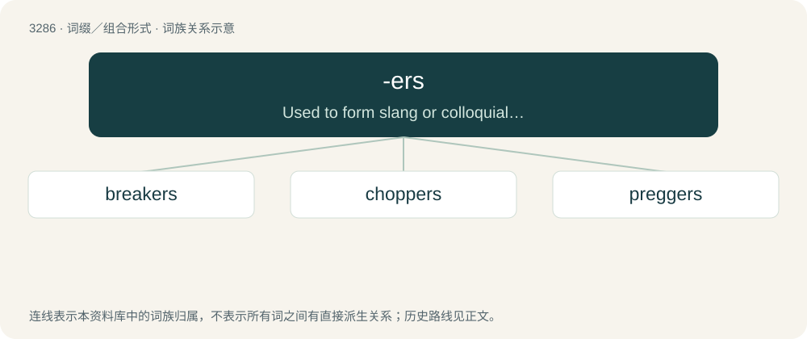

# 3374 · -ers — Used to form slang or colloquial equivalents of words.

[总目录](../00_总目录_按常用程度.md)

**类型**：词缀／组合形式　｜　**来源语言**：见词源记录

## 核心含义与来源

- 核心含义：Used to form slang or colloquial equivalents of words.
- 英文含义：Used to form slang or colloquial equivalents of words.
- 词形：-ers

**来源记录 1**（后缀／后置成分；Used to form slang or colloquial equivalents of words.）

From -er.

## 词族图

## 单词速览（常用到不常用）

| 单词 | 音标 | 释义 |
|---|---|---|
| [breakers](#w-1) | 英 /ˈbɹeɪ̯kəs/ | n. 爆烈人（一款街机游戏的名称）；碎浪区；碎浪 |
| [choppers](#w-2) | /ˈtʃɔpəz/ | n. 斧子, 斧头( chopper的复数形式 ); 直升机 |
| [preggers](#w-3) | 英 /ˈpɹɛ.ɡəs/；美 /ˈpɹɛ.ɡəɹs/ | a. &lt;英俚&gt;怀孕的,怀胎的 |

## 逐词详解

### 1. breakers

**词性**：形容词　｜　**音标**：英 /ˈbɹeɪ̯kəs/

**中文释义**：n. 爆烈人（一款街机游戏的名称）；碎浪区；碎浪

**英文义项**：Outstandingly pleasing, breaking out oneˈs excitement.

**构词拆分**：break + -ers

**词源与演化**：

From break + -ers.

**例句**：

> Medical experts worry returning spring breakers could bring COVID-19 home with them.

### 2. choppers

**词性**：名词　｜　**音标**：/ˈtʃɔpəz/

**中文释义**：n. 斧子, 斧头( chopper的复数形式 ); 直升机

**英文义项**：chopsticks

**构词拆分**：chopstick + -ers

**词源与演化**：

From chop(stick) + -ers.

### 3. preggers

**词性**：形容词　｜　**音标**：英 /ˈpɹɛ.ɡəs/；美 /ˈpɹɛ.ɡəɹs/

**中文释义**：a. &lt;英俚&gt;怀孕的,怀胎的

**英文义项**：Pregnant; carrying developing offspring within one's body.

**构词拆分**：pregnant + -ers

**词源与演化**：

Shortening of pregnant + -ers.
