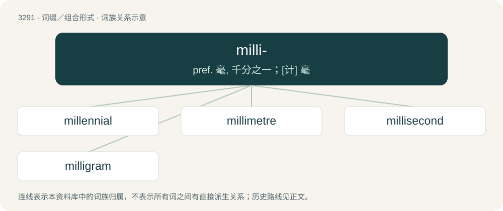

# 3376 · milli- — pref. 毫, 千分之一；\[计\] 毫

[总目录](../00_总目录_按常用程度.md)

**类型**：词缀／组合形式　｜　**来源语言**：见词源记录

## 核心含义与来源

- 核心含义：pref. 毫, 千分之一；\[计\] 毫
- 英文含义：In the International System of Units and other metric systems of units, one-thousandth of the unit to which it is prefixed; that is, multiplying the unit to which it is attached by 10⁻³. Symbol: m.
- 词形：milli-

**来源记录 1**（前缀／前置成分；In the International System of Units and other metric systems of units, one-thousandth of the unit to which it is prefixed; that is, multiplying the unit to which it is attached by 10⁻³. Symbol: m.）

From Latin mille (“thousand”), via French.

## 词族图

## 单词速览（常用到不常用）

| 单词 | 音标 | 释义 |
|---|---|---|
| [millennial](#w-1) | 英 /mɪˈlɛn.ɪ.əl/；美 /məˈlɛn.i.əl/ | a. 一千年的, 千福年的 |
| [millimetre](#w-2) | /ˈmilimiːtə/ | n. 毫米；\[机\] 公厘 |
| [millisecond](#w-3) | 英 /ˈmɪlɪˌsɛkənd/；美 /ˈmɪlɪˌsɛkənd/ | n. 毫秒；\[计\] 毫秒 |
| [milligram](#w-4) | 美 /ˈmɪlɪɡɹæm/ | n. 毫克；\[电\] 毫克 |

## 逐词详解

### 1. millennial

**词性**：形容词　｜　**音标**：英 /mɪˈlɛn.ɪ.əl/；美 /məˈlɛn.i.əl/

**中文释义**：a. 一千年的, 千福年的

**英文义项**：Thousand-year-old; also (by extension, loosely) thousands of years old. / Occurring every thousand years.

**构词拆分**：millennium + -al；milli- (prefix meaning ‘thousand’) + -ennial (suffix meaning ‘years’)

**词源与演化**：

The adjective is a learned borrowing from Late Latin mīllennium (“millennium”) + English -al (suffix meaning ‘of or pertaining to’ forming adjectives; and forming nouns). The English word may be analysed as millennium + -al or milli- (prefix meaning ‘thousand’) + -ennial (suffix meaning ‘years’). Adjective sense 5 (“of or relating to, or characteristic of, people born in the last two decades of the 20th century”) was coined by the American authors William Strauss (1947–2007) and Neil Howe (born 1951) in their book Generations (1991): see the quotations. The noun is derived from the adjective.

**用法示例／搭配（非完整句）**：

> the millennial judgment

该用例对应义项：Synonym of millenarian (“pertaining to the belief in an impending period of one thousand years of peace and righteousness associated with the Second Coming of Christ and his reign on earth”).

### 2. millimetre

**词性**：名词　｜　**音标**：/ˈmilimiːtə/

**中文释义**：n. 毫米；\[机\] 公厘

**英文义项**：An SI/MKS unit of measure, the length of ¹⁄₁₀₀₀ of a metre. Symbol: mm

**构词拆分**：milli- + metre

**词源与演化**：

From French millimètre, equivalent to milli- + metre.

**例句**：

> A millimetre is a thousandth of a metre.

### 3. millisecond

**词性**：名词　｜　**音标**：英 /ˈmɪlɪˌsɛkənd/；美 /ˈmɪlɪˌsɛkənd/

**中文释义**：n. 毫秒；\[计\] 毫秒

**英文义项**：An SI unit of time equal to 10⁻³ seconds. Symbol: ms

**构词拆分**：milli- + second

**词源与演化**：

From milli- + second.

**用法示例／搭配（非完整句）**：

> The suggestion that pulsars were rotating neutron stars was put forth independently by Thomas Gold and Franco Pacini in 1968, and was soon proven beyond reasonable doubt by the discovery of a pulsar with a very short (33-millisecond) pulse period in the Crab nebula.ᵂ

该用例对应义项：An SI unit of time equal to 10⁻³ seconds. Symbol: ms

### 4. milligram

**词性**：名词　｜　**音标**：美 /ˈmɪlɪɡɹæm/

**中文释义**：n. 毫克；\[电\] 毫克

**英文义项**：An SI unit of mass equal to 10⁻³ grams. Symbol: mg

**构词拆分**：milli- + gram

**词源与演化**：

Borrowed from French milligramme, equivalent to milli- + gram.
