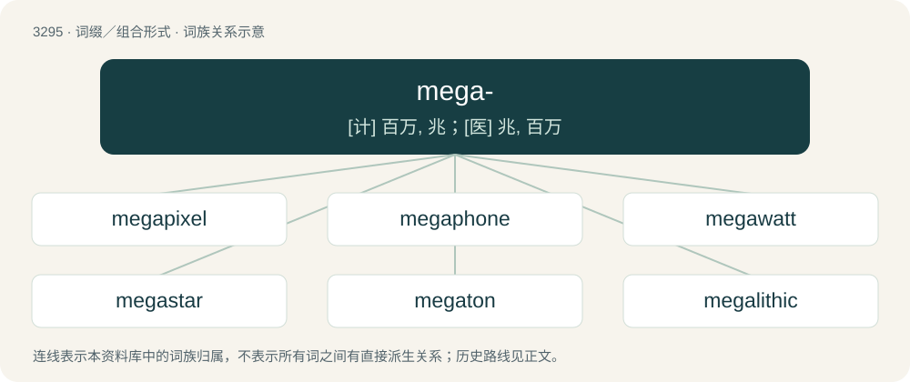

# 3381 · mega- — \[计\] 百万, 兆；\[医\] 兆, 百万

[总目录](../00_总目录_按常用程度.md)

**类型**：词缀／组合形式　｜　**来源语言**：见词源记录

## 核心含义与来源

- 核心含义：\[计\] 百万, 兆；\[医\] 兆, 百万
- 英文含义：Very large, great.
- 词形：mega-

**来源记录 1**（前缀／前置成分；Very large, great.）

From Ancient Greek μέγας (mégas, “great, large, mighty”), from Proto-Indo-European \*meǵh₂s (“great”). Cognate with Latin magnus, Sanskrit मह (maha, “great, massive, large-scale, epic”), and with Germanic words: Gothic 𐌼𐌹𐌺𐌹𐌻𐍃 (mikils), Old English micel, Middle English muchel, English much, Old High German mihhil, Old Norse mikill, Danish meget.

## 词族图

## 单词速览（常用到不常用）

| 单词 | 音标 | 释义 |
|---|---|---|
| [megapixel](#w-1) | /ˈmeɡəpɪksl/ | n. 兆像素 |
| [megaphone](#w-2) | 英 /ˈmɛɡ.əˌfəʊn/；美 /ˈmɛɡəˌfoʊn/ | n. 扩音器；\[医\] 反射扩音器 |
| [megawatt](#w-3) | /ˈmegəwɒt/ | n. 兆瓦特；\[电\] 百万瓦 |
| [megastar](#w-4) | /ˈmegəstɑː(r)/ | n. 巨星, 演艺巨星 |
| [megaton](#w-5) | 美 /ˈmɛɡəˌtʌn/ | n. 兆吨 |
| [megalithic](#w-6) | 英 /ˌmɛɡəˈlɪθɪk/ | a. 巨石的 |
| [megabyte](#w-7) | /ˈmɛɡəˌbaɪt/ | n. \[计\]兆字节 |
| [megahertz](#w-8) | /ˈmegəhəːts/ | n. 兆赫；\[计\] 兆赫兹 |
| [megaman](#w-9) |  | 【英文】A very large or powerful man. |
| [megafauna](#w-10) | /meˈɡæfɔːnə/ | n. 巨型（土壤）动物 |
| [megachurch](#w-11) |  | n. 大教会 |
| [megamind](#w-12) |  | 【英文】A mind that is composed of other minds nested within it. |

## 逐词详解

### 1. megapixel

**词性**：名词　｜　**音标**：/ˈmeɡəpɪksl/

**中文释义**：n. 兆像素

**英文义项**：One million pixels, used as a unit of resolution of digital cameras.

**构词拆分**：mega- + pixel

**词源与演化**：

From mega- + pixel.

**例句**：

> This camera has a resolution of three megapixels.

该用例对应义项：One million pixels, used as a unit of resolution of digital cameras.

### 2. megaphone

**词性**：名词　｜　**音标**：英 /ˈmɛɡ.əˌfəʊn/；美 /ˈmɛɡəˌfoʊn/

**中文释义**：n. 扩音器；\[医\] 反射扩音器

**英文义项**：A portable, usually hand-held, funnel-shaped device that is used to amplify a person’s natural voice toward a targeted direction. / Mouthpiece or promoter; one who speaks for or publicizes on behalf of another.

**构词拆分**：mega- + -phone

**词源与演化**：

From mega- + -phone.

**例句**：

> Do you really need a megaphone?

### 3. megawatt

**词性**：名词　｜　**音标**：/ˈmegəwɒt/

**中文释义**：n. 兆瓦特；\[电\] 百万瓦

**英文义项**：One million (1 000 000) watts, an amount of power large enough to power such things as an entire commercial building or a small passenger aircraft. (Consuming 1 megawatt during a duration of 1 hour consumes 1 megawatt-hour of energy.)

**构词拆分**：mega- + watt

**词源与演化**：

From mega- + watt.

### 4. megastar

**词性**：名词　｜　**音标**：/ˈmegəstɑː(r)/

**中文释义**：n. 巨星, 演艺巨星

**英文义项**：A very famous or successful celebrity.

**构词拆分**：mega- + star

**词源与演化**：

From mega- + star.

### 5. megaton

**词性**：名词　｜　**音标**：美 /ˈmɛɡəˌtʌn/

**中文释义**：n. 兆吨

**英文义项**：A measure of the strength of an explosion or a bomb based on how many million tons of TNT would be needed to produce the same energy. (A derived unit for TNT equivalent.) / One million short tons (10⁶ × 2000 lb).

**构词拆分**：mega- + ton

**词源与演化**：

From mega- + ton.

### 6. megalithic

**词性**：形容词　｜　**音标**：英 /ˌmɛɡəˈlɪθɪk/

**中文释义**：a. 巨石的

**英文义项**：Of or pertaining to megaliths, to the people who made them, or to the period when they were made.

**构词拆分**：mega- (prefix meaning ‘very large, great’) + -lith (suffix meaning ‘stone’) + -ic (suffix meaning ‘of or pertaining to’, forming adjectives from nouns)；megalith + -ic

**词源与演化**：

From mega- (prefix meaning ‘very large, great’) + -lith (suffix meaning ‘stone’) + -ic (suffix meaning ‘of or pertaining to’, forming adjectives from nouns), probably modelled after monolithic; according to the Oxford English Dictionary the word is first attested earlier than megalith. It is analysable as megalith + -ic.

**例句**：

> Megalithic monuments like Stonehenge.

该用例对应义项：of or relating to megaliths or the people who erected megaliths

### 7. megabyte

**词性**：名词　｜　**音标**：/ˈmɛɡəˌbaɪt/

**中文释义**：n. \[计\]兆字节

**英文义项**：One million (10⁶, or 1,000,000) bytes or 1,000 kilobytes. / A mebibyte.

**构词拆分**：mega- + byte

**词源与演化**：

From mega- + byte.

### 8. megahertz

**词性**：名词　｜　**音标**：/ˈmegəhəːts/

**中文释义**：n. 兆赫；\[计\] 兆赫兹

**英文义项**：A unit equal to one million cycles per second.

**构词拆分**：mega- + hertz

**词源与演化**：

From mega- + hertz.

### 9. megaman

**词性**：名词

**英文义项**：A very large or powerful man.

**构词拆分**：mega- + man

**词源与演化**：

From mega- + man.

### 10. megafauna

**词性**：名词　｜　**音标**：/meˈɡæfɔːnə/

**中文释义**：n. 巨型（土壤）动物

**英文义项**：The large animals of a given region or time, considered as a group. / A treatise on such a group of large animals.

**构词拆分**：mega- + fauna

**词源与演化**：

From mega- + fauna.

**例句**：

> Giraffes are part of modern day megafauna.

### 11. megachurch

**词性**：名词

**中文释义**：n. 大教会

**英文义项**：A church with an atypically large congregation.

**构词拆分**：mega- + church

**词源与演化**：

From mega- + church.

**例句**：

> The pastor asked his megachurch to fund his third private jet.

### 12. megamind

**词性**：名词

**英文义项**：A mind that is composed of other minds nested within it.

**构词拆分**：mega- + mind

**词源与演化**：

From mega- + mind.

**例句**：

> Megamind is a bad guy, so he has to do some bad guy stuff.
