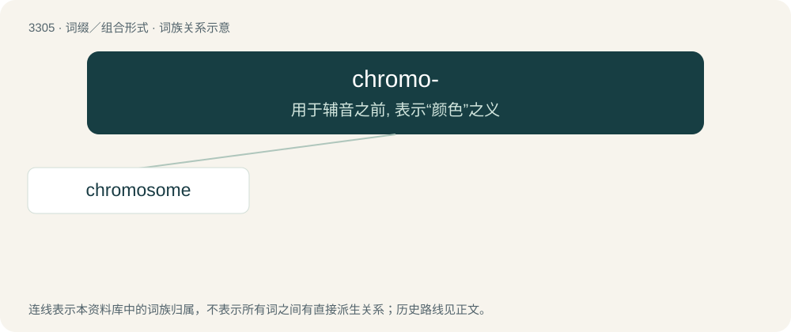

# 3400 · chromo- — 用于辅音之前, 表示“颜色”之义

[总目录](../00_总目录_按常用程度.md)

**类型**：词缀／组合形式　｜　**来源语言**：见词源记录

## 核心含义与来源

- 核心含义：用于辅音之前, 表示“颜色”之义
- 英文含义：color
- 词形：chromo-

**来源记录 1**（前缀／前置成分；color）

From Ancient Greek χρῶμα (khrôma, “color”).

## 词族图

## 单词速览（常用到不常用）

| 单词 | 音标 | 释义 |
|---|---|---|
| [chromosome](#w-1) | 英 /ˈkɹəʊ.məˌsəʊm/；美 /ˈkɹoʊməˌsoʊm/ | n. 染色体；\[化\] 染色体 |

## 逐词详解

### 1. chromosome

**词性**：名词　｜　**音标**：英 /ˈkɹəʊ.məˌsəʊm/；美 /ˈkɹoʊməˌsoʊm/

**中文释义**：n. 染色体；\[化\] 染色体

**英文义项**：A linear arrangement of condensed DNA and associated proteins (such as chaperone proteins) which contains the genetic material (genome) of an organism.

**构词拆分**：chromo- + -some

**词源与演化**：

19th century: from German Chromosom, ultimately from Ancient Greek χρῶμα (khrôma, “colour”) + σῶμα (sôma, “body”) (because they are stained under the microscope). Equivalent to chromo- + -some.

**例句**：

> Chromosomes store genetic information.

该用例对应义项：A linear arrangement of condensed DNA and associated proteins (such as chaperone proteins) which contains the genetic material (genome) of an organism.
