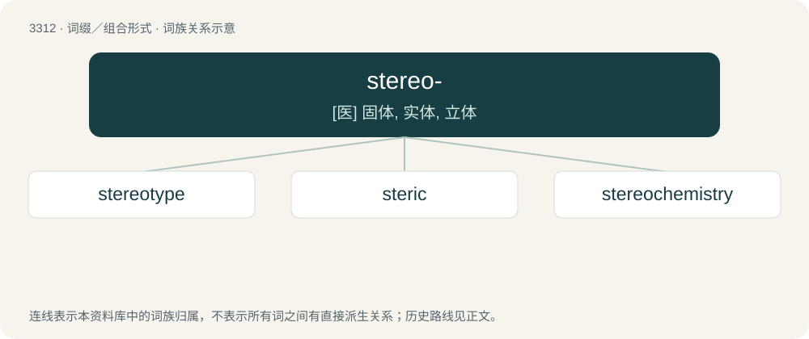

# 3405 · stereo- — \[医\] 固体, 实体, 立体

[总目录](../00_总目录_按常用程度.md)

**类型**：词缀／组合形式　｜　**来源语言**：见词源记录

## 核心含义与来源

- 核心含义：\[医\] 固体, 实体, 立体
- 英文含义：Solid, three-dimensional.
- 词形：stereo-

**来源记录 1**（前缀／前置成分；Solid, three-dimensional.）

Derived from Ancient Greek στερεο- (stereo-), combining form of στερεός (stereós, “firm, solid”).

## 词族图

## 单词速览（常用到不常用）

| 单词 | 音标 | 释义 |
|---|---|---|
| [stereotype](#w-1) | 英 /ˈstɛ.ɹi.əˌtaɪp/；美 /ˈstɛɹ.i.əˌtaɪp/ | n. 铅版, 陈规, 老套；vt. 使用铅版, 把...印制成盲文, 套用老套, 使一成不变 |
| [steric](#w-2) | /ˈstɛɹɪk/ | a. 空间的, 位的；\[医\] 空间的; 立体的; 立体化学的 |
| [stereochemistry](#w-3) | /.stiəriəˈkemistri/ | n. 立体化学；\[化\] 立体化学 |

## 逐词详解

### 1. stereotype

**词性**：名词　｜　**音标**：英 /ˈstɛ.ɹi.əˌtaɪp/；美 /ˈstɛɹ.i.əˌtaɪp/

**中文释义**：n. 铅版, 陈规, 老套；vt. 使用铅版, 把...印制成盲文, 套用老套, 使一成不变

**英文义项**：A conventional, formulaic, and often oversimplified or exaggerated conception, opinion, or image of (a person or a group of people). / A person who is regarded as embodying or conforming to a set image or type.

**构词拆分**：stereo- + type

**词源与演化**：

Borrowed from French stéréotype (adjective), equivalent to stereo- + type. Printing sense is from 1817; the “conventional, formulaic, and oversimplified conception, opinion, or image” sense is recorded from 1922 in Walter Lippmann’s book Public Opinion.

**例句**：

> Not all Zumbetonians wear plimsolls. That's just a stereotype.

该用例对应义项：A conventional, formulaic, and often oversimplified or exaggerated conception, opinion, or image of (a person or a group of people).

### 2. steric

**词性**：形容词　｜　**音标**：/ˈstɛɹɪk/

**中文释义**：a. 空间的, 位的；\[医\] 空间的; 立体的; 立体化学的

**英文义项**：Relating to or involving the arrangement of atoms in space. / of the repulsion of atoms due to closeness or arrangement

**构词拆分**：ster(eo)- (“3D”) + -ic

**词源与演化**：

From ster(eo)- (“3D”) + -ic.

### 3. stereochemistry

**词性**：名词　｜　**音标**：/.stiəriəˈkemistri/

**中文释义**：n. 立体化学；\[化\] 立体化学

**英文义项**：the branch of chemistry that involves the spatial arrangement of the atoms of molecules, and studies how this affects the physical and chemical properties of such species / the effect of such spatial arrangement on the chemistry of a particular compound

**构词拆分**：stereo- + chemistry

**词源与演化**：

From stereo- + chemistry.
