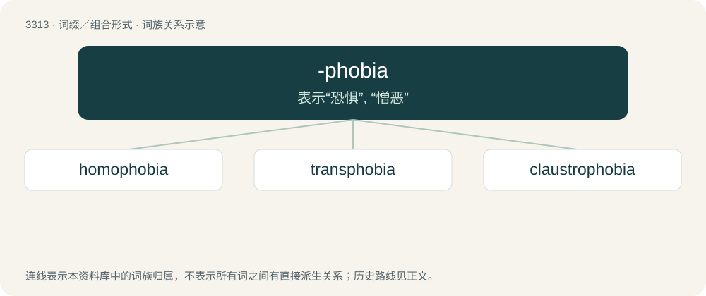

# 3406 · -phobia — 表示“恐惧”, “憎恶”

[总目录](../00_总目录_按常用程度.md)

**类型**：词缀／组合形式　｜　**来源语言**：见词源记录

## 核心含义与来源

- 核心含义：表示“恐惧”, “憎恶”
- 英文含义：Used to form nouns meaning fear of a specific thing.
- 词形：-phobia

**来源记录 1**（后缀／后置成分；Used to form nouns meaning fear of a specific thing.）

From New Latin, from Latin, from Ancient Greek -φοβία (-phobía), from φόβος (phóbos, “fear”).

## 词族图

## 单词速览（常用到不常用）

| 单词 | 音标 | 释义 |
|---|---|---|
| [homophobia](#w-1) | 英 /ˌhəʊ.məˈfəʊ.bi.ə/；美 /ˌhoʊ.məˈfoʊ.bi.ə/ | n. 对同性恋的憎恶（或恐惧） |
| [transphobia](#w-2) |  | 对变性者的恐惧 |
| [claustrophobia](#w-3) | 英 /ˌklɒs.trəˈfəʊ.bi.ə/；美 /ˌklɔː.strəˈfoʊ.bi.ə/ | n. 幽闭恐怖症；\[医\] 幽闭恐怖 |

## 逐词详解

### 1. homophobia

**词性**：名词　｜　**音标**：英 /ˌhəʊ.məˈfəʊ.bi.ə/；美 /ˌhoʊ.məˈfoʊ.bi.ə/

**中文释义**：n. 对同性恋的憎恶（或恐惧）

**英文义项**：Hatred, fear, aversion, or prejudice towards homosexuals. / Hatred, fear, aversion, or prejudice towards LGBTQ people in general.

**构词拆分**：homo- + -phobia；homo- (short for and prefix of homosexual) + -phobia

**词源与演化**：

From homo- (short for and prefix of homosexual) + -phobia. Coined by American psychologist George Weinberg in 1971 in Society and the Healthy Homosexual.

**例句**：

> Racism and homophobia are still major problems in professional football.

### 2. transphobia

**词性**：名词

**中文释义**：对变性者的恐惧

**英文义项**：Hatred or fear of, or prejudice against, transgender and transsexual people or transness in general, which may manifest in prejudice against people who do not conform to social gender roles (gender-nonconforming people) in general. / The preference of pairs of high-trans effect soft ligands to avoid being mutually trans by becoming cis and having other low-trans effect hard ligands trans to themselves.

**构词拆分**：trans- + -phobia + trans + -phobia；trans + -phobia

**词源与演化**：

From trans- + -phobia or trans + -phobia.

**例句**：

> The author let down a lot of her fans with her transphobia.

### 3. claustrophobia

**词性**：名词　｜　**音标**：英 /ˌklɒs.trəˈfəʊ.bi.ə/；美 /ˌklɔː.strəˈfoʊ.bi.ə/

**中文释义**：n. 幽闭恐怖症；\[医\] 幽闭恐怖

**英文义项**：The abnormal fear of closed, tight places.

**词源与演化**：

From Latin claustrum (“a shut-in place”), from Latin claudō (“to shut, close; to imprison, confine”) + -phobia. First attested in the British Medical Journal.

**例句**：

> Long elevator rides can be uncomfortable for those who suffer from claustrophobia.
