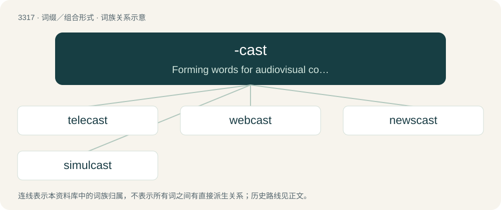

# 3408 · -cast — Forming words for audiovisual content distributed to an audience, usually in a manner denoted by the word stem.

[总目录](../00_总目录_按常用程度.md)

**类型**：词缀／组合形式　｜　**来源语言**：见词源记录

## 核心含义与来源

- 核心含义：Forming words for audiovisual content distributed to an audience, usually in a manner denoted by the word stem.
- 英文含义：Forming words for audiovisual content distributed to an audience, usually in a manner denoted by the word stem.
- 词形：-cast

**来源记录 1**（后缀／后置成分；Forming words for audiovisual content distributed to an audience, usually in a manner denoted by the word stem.）

Back-formation from broadcast.

## 词族图

## 单词速览（常用到不常用）

| 单词 | 音标 | 释义 |
|---|---|---|
| [telecast](#w-1) | /ˈtɛlɪkæst/ | v. 电视广播；n. 电视广播 |
| [webcast](#w-2) |  | n. 网路广播；网络广播；网络直播 |
| [newscast](#w-3) | /ˈnjuːzkɑːst/ | n. 新闻广播 |
| [simulcast](#w-4) | 英 /ˈsɪm.əlˌkæst/ | n. 同时联播；v. 同时联播 |

## 逐词详解

### 1. telecast

**词性**：动词　｜　**音标**：/ˈtɛlɪkæst/

**中文释义**：v. 电视广播；n. 电视广播

**英文义项**：To broadcast by television. / To broadcast a television program.

**构词拆分**：tele- + -cast

**词源与演化**：

From tele- + -cast, from broadcast.

**例句**：

> Next year’s Academy Awards telecast may be postponed because of the disruption to theatrical releases caused by the coronavirus pandemic.

### 2. webcast

**词性**：名词

**中文释义**：n. 网路广播；网络广播；网络直播

**英文义项**：A video and/or audio broadcast transmitted via the Internet

**构词拆分**：web + -cast

**词源与演化**：

From web + -cast, from broadcast.

**例句**：

> It’s not on television. It’s a webcast.

### 3. newscast

**词性**：名词　｜　**音标**：/ˈnjuːzkɑːst/

**中文释义**：n. 新闻广播

**英文义项**：A broadcast of the news; a news report that is transmitted over the air for television, radio, etc.

**构词拆分**：news + -cast

**词源与演化**：

From news + -cast, from broadcast.

**例句**：

> The TV newscast informs us of daily news.

### 4. simulcast

**词性**：名词　｜　**音标**：英 /ˈsɪm.əlˌkæst/

**中文释义**：n. 同时联播；v. 同时联播

**英文义项**：A program or event that is broadcast across more than one medium or service at the same time.

**构词拆分**：simul(taneous) + -cast

**词源与演化**：

From simul(taneous) + -cast, from broadcast.
