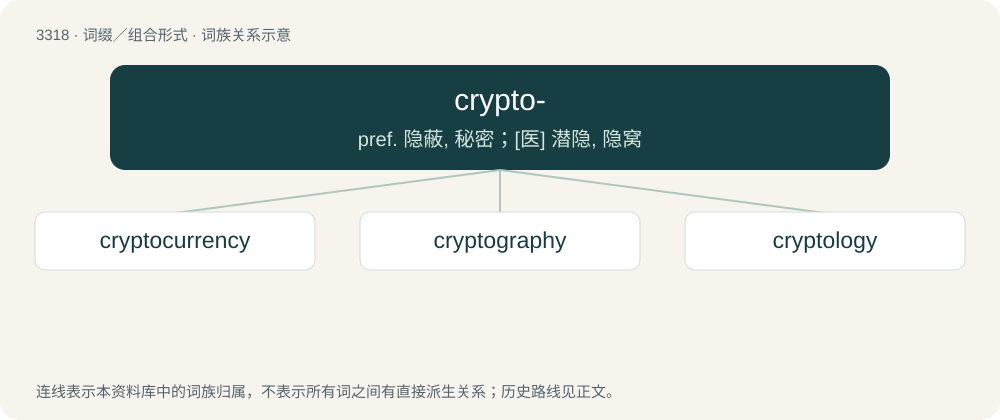

# 3409 · crypto- — pref. 隐蔽, 秘密；\[医\] 潜隐, 隐窝

[总目录](../00_总目录_按常用程度.md)

**类型**：词缀／组合形式　｜　**来源语言**：见词源记录

## 核心含义与来源

- 核心含义：pref. 隐蔽, 秘密；\[医\] 潜隐, 隐窝
- 英文含义：Hidden, invisible.
- 词形：crypto-

**来源记录 1**（前缀／前置成分；Hidden, invisible.）

Derived from Ancient Greek κρῠπτός (krŭptós, “hidden, secret”).

## 词族图

## 单词速览（常用到不常用）

| 单词 | 音标 | 释义 |
|---|---|---|
| [cryptocurrency](#w-1) | 美 /ˈkɹɪp.toʊˌkɝ.ən.si/ | 【英文】A digital currency based on a cryptographic system, usually having no central issuing or regulating authority. |
| [cryptography](#w-2) | /kɹɪpˈtɒɡ.ɹə.fi/ | n. 密码使用法, 密码学；\[计\] 密码学 |
| [cryptology](#w-3) | 英 /kɹɪpˈtɒl.ə.dʒi/；美 /kɹɪpˈtɑ.lə.d͡ʒi/ | n. 隐语, 密码术；\[计\] 密码术, 密码学 |

## 逐词详解

### 1. cryptocurrency

**词性**：名词　｜　**音标**：美 /ˈkɹɪp.toʊˌkɝ.ən.si/

**英文义项**：A digital currency based on a cryptographic system, usually having no central issuing or regulating authority.

**构词拆分**：crypto- + currency

**词源与演化**：

From crypto- (“cryptographic”) + currency.

**例句**：

> Bitcoin was the first decentralized cryptocurrency.

该用例对应义项：A digital currency based on a cryptographic system, usually having no central issuing or regulating authority.

### 2. cryptography

**词性**：名词　｜　**音标**：/kɹɪpˈtɒɡ.ɹə.fi/

**中文释义**：n. 密码使用法, 密码学；\[计\] 密码学

**英文义项**：The discipline that embodies the principles, means, and methods for transforming data to hide its semantic content, prevent unauthorized use, or detect modifications, while also ensuring information security through confidentiality, integrity, authentication, and nonrepudiation.

**构词拆分**：crypto- + -graphy

**词源与演化**：

From crypto- + -graphy.

**例句**：

> Nowadays, cryptography is often used to make online communications and transactions more secure.

### 3. cryptology

**词性**：名词　｜　**音标**：英 /kɹɪpˈtɒl.ə.dʒi/；美 /kɹɪpˈtɑ.lə.d͡ʒi/

**中文释义**：n. 隐语, 密码术；\[计\] 密码术, 密码学

**英文义项**：The science or study of mathematical, linguistic, and other coding patterns and histories. / The practice of analysing encoded messages, in order to decode them.

**构词拆分**：crypto- + -logy

**词源与演化**：

From crypto- + -logy, from Ancient Greek κρυπτός (kruptós, “hidden”) + λόγος (lógos, “word”); originally after Latin cryptologia, which is apparently first recorded in an English context.
