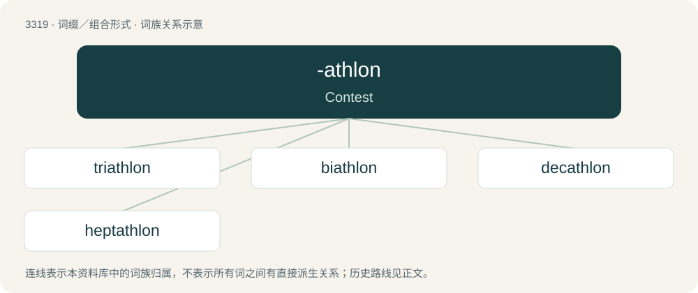

# 3412 · -athlon — Contest

[总目录](../00_总目录_按常用程度.md)

**类型**：词缀／组合形式　｜　**来源语言**：见词源记录

## 核心含义与来源

- 核心含义：Contest
- 英文含义：Contest
- 词形：-athlon

**来源记录 1**（后缀／后置成分；Contest）

Borrowed from Ancient Greek ἆθλον (âthlon, “contest”).

## 词族图

## 单词速览（常用到不常用）

| 单词 | 音标 | 释义 |
|---|---|---|
| [triathlon](#w-1) | 英 /tɹaɪˈæθlɒn/；美 /tɹaɪˈæθˌlɑn/ | n. 〈体〉三项全能运动 |
| [biathlon](#w-2) | 英 /baɪˈæθlən/；美 /baɪˈæθˌlɑn/ | n. 滑雪射击 |
| [decathlon](#w-3) | 英 /diːˈkæθlɒn/ | n. 十项运动 |
| [heptathlon](#w-4) | /hɛpˈtæθlɒn/ | n. 七项全能 |

## 逐词详解

### 1. triathlon

**词性**：名词　｜　**音标**：英 /tɹaɪˈæθlɒn/；美 /tɹaɪˈæθˌlɑn/

**中文释义**：n. 〈体〉三项全能运动

**英文义项**：An athletics event in which contestants compete in swimming, cycling and running in turn. / A former Olympic athletics event in which contestants compete in long jump, shot put, and 100-yard dash.

**构词拆分**：tri- + -athlon

**词源与演化**：

From tri- + -athlon.

**例句**：

> I don't think there is any way I can win this triathlon.

### 2. biathlon

**词性**：名词　｜　**音标**：英 /baɪˈæθlən/；美 /baɪˈæθˌlɑn/

**中文释义**：n. 滑雪射击

**英文义项**：Racing combining cross-country skiing and rifle shooting. / A particular instance of such a race.

**构词拆分**：bi- (prefix meaning ‘two; both’) + -athlon (suffix meaning ‘contest’)

**词源与演化**：

From bi- (prefix meaning ‘two; both’) + -athlon (suffix meaning ‘contest’), modelled after pentathlon.

**例句**：

> Ole Einar Bjoerndalen from Norway won the biathlon 10km sprint.

### 3. decathlon

**词性**：名词　｜　**音标**：英 /diːˈkæθlɒn/

**中文释义**：n. 十项运动

**英文义项**：An athletic contest consisting of ten events which includes sprinting, hurdling, jumping, and throwing over a span of two days. / A contest in science and math proving skill.

**构词拆分**：dec- + -athlon

**词源与演化**：

From dec- + -athlon, coined for the 1912 Summer Olympics in analogy to the word pentathlon.

**例句**：

> If you participate in a decathlon you'll be throwing a discus at some point.

### 4. heptathlon

**词性**：名词　｜　**音标**：/hɛpˈtæθlɒn/

**中文释义**：n. 七项全能

**英文义项**：An athletic contest comprising seven events; contested mostly by women, for whom this is an Olympic sport.

**构词拆分**：hepta- + -athlon

**词源与演化**：

From hepta- + -athlon.
