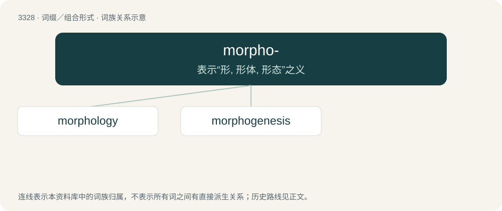

# 3419 · morpho- — 表示“形, 形体, 形态”之义

[总目录](../00_总目录_按常用程度.md)

**类型**：词缀／组合形式　｜　**来源语言**：见词源记录

## 核心含义与来源

- 核心含义：表示“形, 形体, 形态”之义
- 英文含义：shape, form, or morphology.
- 词形：morpho-

**来源记录 1**（前缀／前置成分；shape, form, or morphology.）

Representing combining form of Ancient Greek μορφή (morphḗ, “form”).

## 词族图

## 单词速览（常用到不常用）

| 单词 | 音标 | 释义 |
|---|---|---|
| [morphology](#w-1) | 英 /mɔːˈfɒl.ə.d͡ʒi/；美 /mɔɹˈfɑ.lə.d͡ʒi/ | n. 形态学, 词法, 形态；\[医\] 形态学 |
| [morphogenesis](#w-2) | 英 /ˌmɔː.fəˈd͡ʒɛn.ə.sɪs/；美 /ˌmɔɹ.foʊˈd͡ʒɛn.ə.sɪs/ | n. 形态发生, 形态形成, 器官发生, 器官形成；\[医\] 形态形成, 形态发生 |

## 逐词详解

### 1. morphology

**词性**：名词　｜　**音标**：英 /mɔːˈfɒl.ə.d͡ʒi/；美 /mɔɹˈfɑ.lə.d͡ʒi/

**中文释义**：n. 形态学, 词法, 形态；\[医\] 形态学

**英文义项**：The study of the internal structure of morphemes (words and their semantic building blocks). / The study of the form and structure of animals and plants.

**构词拆分**：By surface analysis, morpho- + -logy

**词源与演化**：

Borrowed from German Morphologie. By surface analysis, morpho- + -logy.

**例句**：

> Hebrew morphology is practicaly the same as that of Phoenician.

### 2. morphogenesis

**词性**：名词　｜　**音标**：英 /ˌmɔː.fəˈd͡ʒɛn.ə.sɪs/；美 /ˌmɔɹ.foʊˈd͡ʒɛn.ə.sɪs/

**中文释义**：n. 形态发生, 形态形成, 器官发生, 器官形成；\[医\] 形态形成, 形态发生

**英文义项**：The differentiation of tissues and subsequent growth of structures in an organism

**构词拆分**：morpho- + -genesis

**词源与演化**：

From morpho- + -genesis.

**例句**：

> Morphogenesis is the development, from the embryo, of the characteristic forms and structures of a species.
