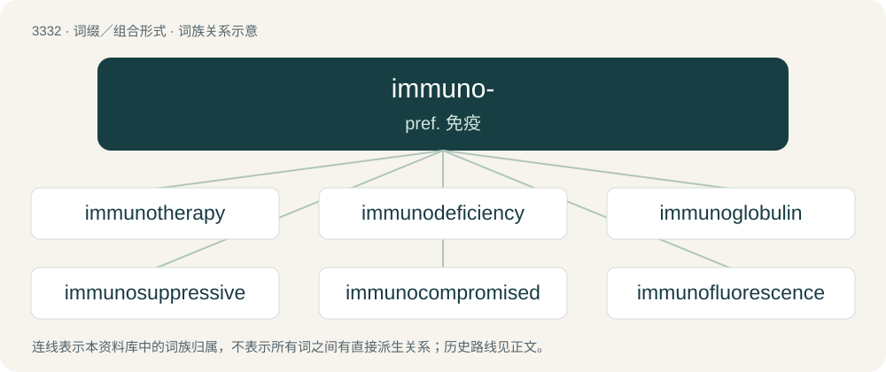

# 3423 · immuno- — pref. 免疫

[总目录](../00_总目录_按常用程度.md)

**类型**：词缀／组合形式　｜　**来源语言**：见词源记录

## 核心含义与来源

- 核心含义：pref. 免疫
- 英文含义：Relating to the immune systems and processes in a living organism.
- 词形：immuno-

**来源记录 1**（前缀／前置成分；Relating to the immune systems and processes in a living organism.）

From immune + -o-.

## 词族图

## 单词速览（常用到不常用）

| 单词 | 音标 | 释义 |
|---|---|---|
| [immunotherapy](#w-1) | /iˈmjuːnəuˈθerəpi/ | n. 免疫疗法；\[医\] 免疫疗法 |
| [immunodeficiency](#w-2) | /ɪˌmjuːnəʊdɪˈfɪʃənsi/ | n. 免疫缺陷, 免疫缺损 |
| [immunoglobulin](#w-3) | /iˈmjuːnəuˈ^lɔbjulin/ | n. 免疫球蛋白；\[化\] 免疫球蛋白 |
| [immunosuppressive](#w-4) | /,imjunəusəˈpresiv/ | a. 免疫抑制的 |
| [immunocompromised](#w-5) | /ɪmjʊnəʊˈkəmprəmɪst/ | a. 免疫系统受损伤\[削弱\]的 |
| [immunofluorescence](#w-6) | /iˈmjuːnəufluːəˈresəns/ | n. 免疫荧光, 免疫荧光法 |
| [immunosuppression](#w-7) | /,imjunəusəˈpreʃən/ | n. 免疫抑制 |
| [immunohistochemical](#w-8) | /ˈimjjnəj,histəjˈkemikəl/ | a. 免疫组织化学的 |
| [immunohistochemistry](#w-9) |  | 免疫组织化学 |
| [immunoassay](#w-10) | /,imjunəuˈæsei/ | \[化\] 免疫测定 |

## 逐词详解

### 1. immunotherapy

**词性**：名词　｜　**音标**：/iˈmjuːnəuˈθerəpi/

**中文释义**：n. 免疫疗法；\[医\] 免疫疗法

**英文义项**：The treatment of disease (especially cancers and autoimmune diseases) by adjusting the body's immune response. / The treatment of cancer by improving the ability of the host to reject a tumour immunologically: cancer immunotherapy.

**构词拆分**：immuno- + therapy

**词源与演化**：

From immuno- + therapy.

### 2. immunodeficiency

**词性**：名词　｜　**音标**：/ɪˌmjuːnəʊdɪˈfɪʃənsi/

**中文释义**：n. 免疫缺陷, 免疫缺损

**英文义项**：A depletion in the body's natural immune system, or in some component of it.

**构词拆分**：immuno- + deficiency

**词源与演化**：

From immuno- + deficiency.

**例句**：

> I am genetically predisposed to immunodeficiency.

### 3. immunoglobulin

**词性**：名词　｜　**音标**：/iˈmjuːnəuˈ^lɔbjulin/

**中文释义**：n. 免疫球蛋白；\[化\] 免疫球蛋白

**英文义项**：Any of the glycoproteins in blood serum that respond to invasion by foreign antigens and that protect the host by removing pathogens; an antibody.

**构词拆分**：immuno- + globulin

**词源与演化**：

From immuno- + globulin.

### 4. immunosuppressive

**词性**：形容词　｜　**音标**：/,imjunəusəˈpresiv/

**中文释义**：a. 免疫抑制的

**英文义项**：Having the capability to suppress the immune system, capable of immunosuppression.

**构词拆分**：immuno- + suppressive

**词源与演化**：

From immuno- + suppressive.

### 5. immunocompromised

**词性**：形容词　｜　**音标**：/ɪmjʊnəʊˈkəmprəmɪst/

**中文释义**：a. 免疫系统受损伤\[削弱\]的

**英文义项**：Having an immune system that has been impaired by disease or treatment.

**构词拆分**：immuno- + compromised

**词源与演化**：

From immuno- + compromised.

**例句**：

> Immunocompromised patients are at greater risk of a fungal infection.

### 6. immunofluorescence

**词性**：名词　｜　**音标**：/iˈmjuːnəufluːəˈresəns/

**中文释义**：n. 免疫荧光, 免疫荧光法

**英文义项**：A technique that uses a fluorochrome to indicate a specific antigen-antibody reaction.

**构词拆分**：immuno- + fluorescence

**词源与演化**：

From immuno- + fluorescence.

### 7. immunosuppression

**词性**：名词　｜　**音标**：/,imjunəusəˈpreʃən/

**中文释义**：n. 免疫抑制

**英文义项**：The suppression of the immune response, especially its active medical suppression by human agency (via immunosuppressant drugs) to treat autoimmune diseases or to prevent allograft rejection after transplant.

**构词拆分**：immuno- + suppression

**词源与演化**：

From immuno- + suppression.

### 8. immunohistochemical

**词性**：形容词　｜　**音标**：/ˈimjjnəj,histəjˈkemikəl/

**中文释义**：a. 免疫组织化学的

**英文义项**：Of, pertaining to, or by means of immunohistochemistry, the use of immunological techniques to study the chemistry of tissues.

**构词拆分**：immuno- + histochemical

**词源与演化**：

From immuno- + histochemical.

### 9. immunohistochemistry

**词性**：名词

**中文释义**：免疫组织化学

**英文义项**：The analytical process of finding proteins in cells of a tissue microtome section exploiting the principle of antibodies binding specifically to antigens in biological tissues.

**构词拆分**：immuno- + histochemistry

**词源与演化**：

From immuno- + histochemistry.

### 10. immunoassay

**词性**：名词　｜　**音标**：/,imjunəuˈæsei/

**中文释义**：\[化\] 免疫测定

**英文义项**：A test for the presence of a substance using the reaction of an antibody to its antigen, making use of the high selectivity of components of biological immune systems.

**构词拆分**：immuno- + assay

**词源与演化**：

From immuno- + assay.
