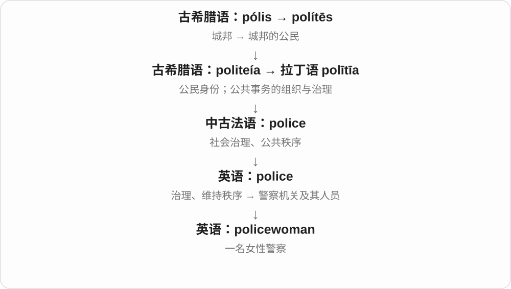
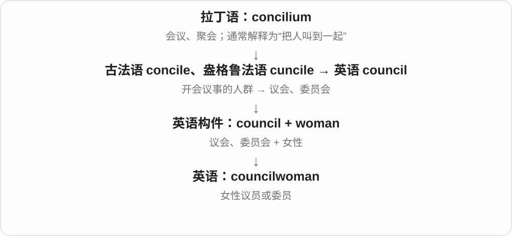

# 3425 · -woman — 某身份、职业中的女性

[逐词精讲目录](../00_逐词精讲目录.md) · [总目录](../00_总目录_按常用程度.md)

## 核心词根与来源

从独立名词 woman 的旧英语、中古英语形式延续，长期用于复合人物名称。各职业词形成时间、社会使用习惯不同。

**-WOMAN：前面给角色，后面明确女性**

saleswoman 是从事销售的女性，businesswoman 是从商的女性，chairwoman 则是担任主席的女性；前半部决定角色。

- **销售、商业与公共职务**：saleswoman · businesswoman · congresswoman · chairwoman · policewoman · councilwoman · assemblywoman
- **身份、传统称呼及描述**：noblewoman · gentlewoman · madwoman

## 词形与演化规律

sales + woman → saleswoman；police + woman → policewoman；复数通常 woman → women，前部保留。

## 单词速览（按词族由简到繁）

同一基础词的相关扩展放在一起，先读基础形式，再读扩展；各组之间优先读常用的。具体词源关系见各词讲解。

| 单词 | 音标 | 核心意思 |
|---|---|---|
| [businesswoman](#w-1) | /ˈbɪznəswʊmən/ | 女商人；商界女性人士 |
| [congresswoman](#w-2) | 英 /ˈkɒŋɡresˌwʊmən/；美 /ˈkɑːŋɡrəsˌwʊmən/ | 女国会议员；〔尤指美国〕众议院女议员 |
| [chairwoman](#w-3) | 英 /ˈtʃeəwʊmən/；美 /ˈtʃerwʊmən/ | 女主席；女董事长；女性会议主持人 |
| [policewoman](#w-4) | 英、美 /pəˈliːsˌwʊmən/ | 女警察 |
| [councilwoman](#w-5) | 英、美 /ˈkaʊnsəlwʊmən/ | 女性议员、委员会成员〔主要美式〕 |
| [saleswoman](#w-6) | 英 /ˈseɪlzwʊmən/；美 /ˈseɪlzwʊmən/ | 女销售员、女推销员 |
| [assemblywoman](#w-7) | /əˈsembliwʊmən/ | 女性议会成员、女议员〔特定议会名称中〕 |
| [noblewoman](#w-8) | 英 /ˈnəʊblwʊmən/；美 /ˈnoʊblwʊmən/ | 女性贵族 |
| [gentlewoman](#w-9) | /ˈdʒentəlwʊmən/ | 出身良好或有教养的女士〔较旧、正式〕 |
| [madwoman](#w-10) | 英 /ˈmædwʊmən/；美 /ˈmædwʊmən/ | 疯女人〔旧称、贬称或夸张〕 |

## 逐词讲解

### 1. businesswoman — 女商人；商界女性人士

**音标**：/ˈbɪznəswʊmən/

**先抓住这个画面**

职业在商业经营领域，称呼同时说明这是一位女性。

**怎么拆**

business + woman，复数 businesswomen，后半 woman /ˈwʊmən/ 与 women /ˈwɪmɪn/ 的元音不同。

**怎么变成今天的意思**

**英语 business；woman**  
并列组合的两部分

↓

**business + woman → businesswoman**  
从事商业活动的女性

a successful businesswoman 是事业有成的商界女性，a local businesswoman 是当地女商人；具体行业、职位须另说明。

**常见搭配与例句**

a successful businesswoman；a local businesswoman；an experienced businesswoman。

> She became a successful businesswoman in the fashion industry.

她在时装行业成为事业有成的商界女性。

> The panel included businesswomen from several cities.

小组嘉宾包括来自几个城市的商界女性。

**别混淆**

businesswoman 是商业身份，working woman 是有工作、在职女性更泛；学校教师也可能是 working woman，却不因此就是商人。

### 2. congresswoman — 女国会议员；〔尤指美国〕众议院女议员

**音标**：英 /ˈkɒŋɡresˌwʊmən/；美 /ˈkɑːŋɡrəsˌwʊmən/

**先抓住这个画面**

congress 是相关立法机构，woman 标明这位议员是女性。美国日常用法里常特指众议院议员，参议员通常称 senator。

**怎么拆**

congress + woman；congress 接拉丁 congressus 聚到一起、会议，与 con- 一起、gradi 行走相连。不是从 congressman 整词后再加 woman。

**怎么变成今天的意思**

**拉丁 congressus → 英语 congress**  
聚集、会议；立法机构名称

↓

**congress + woman → congresswoman**  
相关机构中的女性议员

a congresswoman from a particular state 某州的女众议员；复数 congresswomen，变化在 woman → women。正式称谓、具体机构依所在国家的制度和语境。

**常见搭配与例句**

a congresswoman；several congresswomen。

> A congresswoman visited the local library.

一位女国会议员参观了当地图书馆。

> The article interviewed three congresswomen about their early careers.

文章采访了三位女国会议员，谈她们早期的职业经历。

**别混淆**

congressman 与 congresswoman 标明性别；member of Congress 是不限定性别的说法。congress 不一定每次都指美国国会，也可指大型会议。

### 3. chairwoman — 女主席；女董事长；女性会议主持人

**音标**：英 /ˈtʃeəwʊmən/；美 /ˈtʃerwʊmən/

**先抓住这个画面**

由女性担任主持和领导职责，职位本身并没有因此变小。

**怎么拆**

chair + woman；对应 chairman 的女性称谓。复数 chairwomen 中 woman 变为 women。

**怎么变成今天的意思**

**希腊 hédra**  
座位、底座；几何立体的面

↓

**希腊 katá + hédra → kathédra → 拉丁 cathedra**  
向下 + 座位 → 椅子、席位

↓

**古法语 chaiere → 中古英语 chayere → 英语 chair**  
椅子 → 权威席位 → 主持人、主席等职务

↓

**英语 chair + woman → chairwoman**  
担任主席、主持等职务的女性

chairwoman of the board 是女董事长；committee chairwoman 是委员会女主席。今天也可以根据正式称谓使用 chair 或 chairperson。

**常见搭配与例句**

the chairwoman of；elect a chairwoman；serve as chairwoman。

> The chairwoman presented the board’s decision.

女董事长公布了董事会的决定。

> She became chairwoman of the local arts committee.

她成为当地艺术委员会的女主席。

**别混淆**

chairwoman 强调任职者是女性；chairperson 不强调性别。它不是 chairman 的助理或家属称呼。

### 4. policewoman — 女警察

**音标**：英、美 /pəˈliːsˌwʊmən/

**先抓住这个画面**

和 policeman 同样的组合方式，只是明确说这位警察是女性。

**怎么拆**

police + woman；复数 policewomen 中 women 读 /ˈwɪmɪn/，与单数不同。

**怎么变成今天的意思**

需要说明性别时可用；职业本身用 police officer 也能表达，不限性别。

**常见搭配与例句**

a uniformed policewoman；speak to a policewoman。

> A policewoman directed traffic near the school.

一名女警察在学校附近指挥交通。

> The policewoman wrote down the registration number.

这名女警察记下了车牌号。

**别混淆**

policewoman 的职责不会因为词里的 woman 而自动变成某一专门岗位；它只说明性别。

### 5. councilwoman — 女性议员、委员会成员〔主要美式〕

**音标**：英、美 /ˈkaʊnsəlwʊmən/

**先抓住这个画面**

把 council 的成员具体说成女性，常见于地方议会新闻。

**怎么拆**

council + woman；复数 councilwomen，后半读音随 women 改变。

**怎么变成今天的意思**

可以作职位名，也能放在姓氏前作头衔。与 councilman 一样，它说明成员身份，不说明其政治立场。

**常见搭配与例句**

a city councilwoman；Councilwoman Lee；a newly elected councilwoman。

> The councilwoman proposed a new pedestrian crossing.

这位女议员提议增设一处人行横道。

> Councilwoman Lee met local shop owners on Monday.

李议员周一会见了当地店主。

**别混淆**

councilwoman 明确指女性；councillor、councilmember 可以不说明性别。

### 6. saleswoman — 女销售员、女推销员

**音标**：英 /ˈseɪlzwʊmən/；美 /ˈseɪlzwʊmən/

**先抓住这个画面**

sales 是销售相关材料，woman 明确说从事这份工作的女性。她可以在店里卖商品，也可以负责对外推销。

**怎么拆**

sales + woman 复合，和 salesman、salesperson 对应。sales 的 s 已是前部固定材料，复数主要把 woman 变成 women。

**怎么变成今天的意思**

**sales + woman**  
销售 + 女性

↓

**saleswoman；复数 saleswomen**  
以女性身份明确的销售人员名称

a car saleswoman 女汽车销售员；a helpful saleswoman 热心的女售货员。复数 saleswomen 后半常读 /wɪmɪn/。

**常见搭配与例句**

an experienced saleswoman；ask the saleswoman。

> The saleswoman helped us choose a suitable jacket.

女售货员帮我们挑选了合适的夹克。

> She became the company’s top saleswoman.

她成了公司业绩最好的女销售员。

**别混淆**

salesperson、sales assistant 等可不强调性别；saleswoman 明确女性。词本身不限制销售发生在商店里。

### 7. assemblywoman — 女性议会成员、女议员〔特定议会名称中〕

**音标**：/əˈsembliwʊmən/

**先抓住这个画面**

相应议会中的女性成员，woman 说明人物，不是装配一位女性出来。

**怎么拆**

assembly 议会 + woman，和 assemblyman 并列；复数 assemblywomen 中 women 读音也会变化。

**怎么变成今天的意思**

**法语 assembler、assemblée 等 → assembly**  
聚在一起 → 集会；部件组合

↓

**assembly + woman → assemblywoman**  
议会中的女性成员

an assemblywoman’s proposal 女议员提案，a state assemblywoman 州议会女议员，meet the assemblywoman 会见女议员。

**常见搭配与例句**

an assemblywoman’s proposal；a state assemblywoman；meet the assemblywoman。

> The assemblywoman introduced the proposal.

女议员提出了提案。

> Students asked the assemblywoman about her work.

学生向女议员询问她的工作。

**别混淆**

assemblywoman 职位范围依相应机构，不等于所有女性政治人物；assemblywomen 是复数，不把末尾再直接加 s。

### 8. noblewoman — 女性贵族

**音标**：英 /ˈnəʊblwʊmən/；美 /ˈnoʊblwʊmən/

**先抓住这个画面**

身份属于贵族阶层的女人；重点是历史社会位置。

**怎么拆**

noble“贵族的” + woman；英语复合词，复数 noblewomen。

**怎么变成今天的意思**

**拉丁语：gnoscere / noscere；notus**  
开始认识、了解；已知的

↓

**拉丁语 nobilis → 古法语 noble → 英语 noble**  
可认识、著名 → 出身高贵；品格高尚

↓

**英语：noble + woman → noblewoman**  
女性贵族

并不说明她一定是君主，也不自动赞美她的品格。

**常见搭配与例句**

a wealthy noblewoman；a noblewoman’s portrait。

> The noblewoman financed the restoration of the chapel.

这位女贵族出资修复了小教堂。

> Her letters reveal the daily life of a seventeenth-century noblewoman.

她的信件展现了一位十七世纪女贵族的日常生活。

**别混淆**

queen 是女王或王后；noblewoman 可以属于更广的贵族阶层。

### 9. gentlewoman — 出身良好或有教养的女士〔较旧、正式〕

**音标**：/ˈdʒentəlwʊmən/

**先抓住这个画面**

与 gentleman 相配，早期看身份，后来也看举止。

**怎么拆**

中古英语 gentilwoman 仿 gentilman 构成，即当时的 gentle + woman。

**怎么变成今天的意思**

**拉丁 gignere、genitus；同族 genus、gener-**  
生出、产生；种类、出身

↓

**拉丁 gēns → gentīlis → 古法语 gentil**  
氏族 → 同族的；出身高贵的

↓

**中古英语 gentilwoman → gentlewoman**  
出身良好的女子；有教养的女士

阅读历史小说、旧信件或某些正式称呼时会遇到。普通对话中 woman 或 lady 更常见，不需要把每位客气的女士都叫 gentlewoman。

**常见搭配与例句**

a gentlewoman of the household；an elderly gentlewoman〔较旧〕。

> The diary describes a gentlewoman who managed the household.

日记描写了一位管理家务的有教养的女士。

> The novelist uses gentlewoman to establish the character’s social position.

小说家用 gentlewoman 来交代人物的社会身份。

**别混淆**

gentle woman 分开写可以只说性情温柔的女人；gentlewoman 是带历史和社会语体色彩的固定名词。

### 10. madwoman — 疯女人〔旧称、贬称或夸张〕

**音标**：英 /ˈmædwʊmən/；美 /ˈmædwʊmən/

**先抓住这个画面**

文学或台词里可能这样叫行为被认为失控的女人；很多时候反映说话人的敌意、时代偏见，不能当中性身份。

**怎么拆**

mad + woman，复数 madwomen。现代常见文学旧称、骂称或 like a madwoman 等夸张比较，不是规范医学名称。

**怎么变成今天的意思**

**古英语 ġemǣd、ġemǣded 等 → 中古英语 mad、madde → mad**  
愤怒、失去理智等旧用法

↓

**英语 mad**  
生气、狂热喜爱；荒唐、不理智等评价

↓

**mad + woman → madwoman**  
被叫作疯狂女性的人物称呼；语气需看时代和场景

like a madwoman 像疯了似的，the madwoman in the story 故事里被这样称呼的女子。

**常见搭配与例句**

like a madwoman；the madwoman in the story；portray a madwoman。

> She ran down the platform like a madwoman, trying to catch the train.

她像疯了似的沿站台奔跑，想赶上火车。

> The essay questions why the narrator calls her a madwoman.

文章质疑叙述者为什么称她为疯女人。

**别混淆**

madwoman 人物旧称、贬称，madness 抽象状态；用词不能据其标签认定人物真正患有什么疾病。

## 这一组要分清什么

是否强调性别依表达目的；salesperson、chair 等可作为部分职业的通用称呼。madwoman 等又含各自评价、时代色彩，不能只当职业名。

## 串起来练习

The businesswoman spoke with the saleswoman about a new product.

这位女商人与女销售员谈起了一款新产品。
