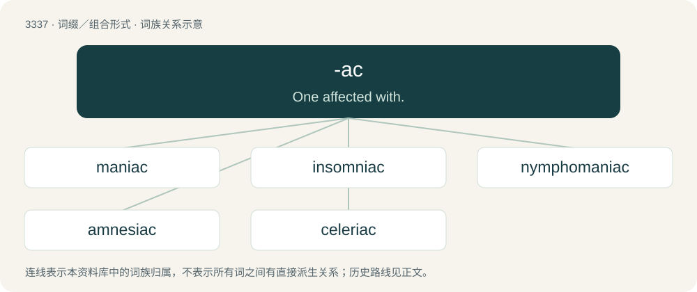

# 3426 · -ac — One affected with.

[总目录](../00_总目录_按常用程度.md)

**类型**：词缀／组合形式　｜　**来源语言**：见词源记录

## 核心含义与来源

- 核心含义：One affected with.
- 英文含义：One affected with.
- 词形：-ac

**多个词源／构词路径**：同一拼写可能有不同来源；以下按词性和含义分别列出。

**来源记录 1**（后缀／后置成分；One affected with.）

From French -acque, from New Latin -acus, from Ancient Greek -ακός (-akós, “-ic”). Related to -ic and -y.

**来源记录 2**（后缀／后置成分；Used to form the names of nonsteroidal anti-inflammatory drugs (NSAIDs) that are derivatives of acetic acid.）

From acetic acid, which is used in the synthesis of many of these compounds.

## 词族图

## 单词速览（常用到不常用）

| 单词 | 音标 | 释义 |
|---|---|---|
| [maniac](#w-1) | 英 /ˈmeɪ.niˌæk/ | a. 发狂的, 癫狂的, 疯狂的；n. 狂人, 疯子 |
| [insomniac](#w-2) | 英 /ɪnˈsɒm.ni.æk/ | n. 失眠症患者；\[医\] 失眠患者 |
| [nymphomaniac](#w-3) | /ˌnɪm.fəʊˈmeɪ.niˌæk/ | n. 性欲强烈的女人 |
| [amnesiac](#w-4) | /æmˈniːzi,æk/ | \[医\] 遗忘者 |
| [celeriac](#w-5) | /səˈlɛəɹiæk/ | n. 块根芹 |

## 逐词详解

### 1. maniac

**词性**：名词　｜　**音标**：英 /ˈmeɪ.niˌæk/

**中文释义**：a. 发狂的, 癫狂的, 疯狂的；n. 狂人, 疯子

**英文义项**：An insane person, especially one who suffers from a mania. / A fanatic, a person with an obsession.

**构词拆分**：mania + -ac

**词源与演化**：

From mania + -ac. Borrowed from French maniaque, from Late Latin maniacus, from Ancient Greek μανιακός (maniakós), adjectival form of μανία (manía, “madness”). Compare manic.

**例句**：

> She was driving like a maniac.

该用例对应义项：An insane person, especially one who suffers from a mania.

### 2. insomniac

**词性**：名词　｜　**音标**：英 /ɪnˈsɒm.ni.æk/

**中文释义**：n. 失眠症患者；\[医\] 失眠患者

**英文义项**：One who suffers an inability or difficulty sleeping; a sufferer from insomnia.

**构词拆分**：From insomnia + -ac.

**词源与演化**：

From insomnia + -ac.

**例句**：

> Yanni has been a bit of an insomniac lately.

### 3. nymphomaniac

**词性**：名词　｜　**音标**：/ˌnɪm.fəʊˈmeɪ.niˌæk/

**中文释义**：n. 性欲强烈的女人

**英文义项**：A woman who has an excessive libido.

**构词拆分**：nymphomania + -ac

**词源与演化**：

From nymphomania + -ac. By surface analysis, nympho- + -maniac.

**例句**：

> Xenia's such a nymphomaniac that she's not even satisfied with three lovers.

该用例对应义项：A woman who has an excessive libido.

### 4. amnesiac

**词性**：名词　｜　**音标**：/æmˈniːzi,æk/

**中文释义**：\[医\] 遗忘者

**英文义项**：A person who suffers from amnesia.

**构词拆分**：From amnesia + -ac.

**词源与演化**：

From amnesia + -ac.

### 5. celeriac

**词性**：名词　｜　**音标**：/səˈlɛəɹiæk/

**中文释义**：n. 块根芹

**英文义项**：A form of celery, Apium graveolens, having an aromatic taproot eaten as a vegetable.

**构词拆分**：celery + -ac

**词源与演化**：

From celery + -ac.

**例句**：

> A variety of celery, called celeriac, is cultivated in certain European countries, notably Germany, the root only, which is large and fleshy, being eaten.
