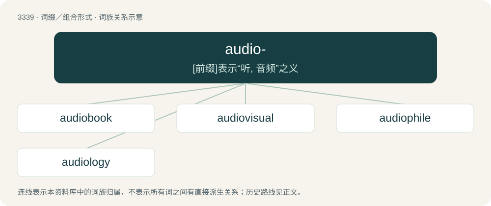

# 3428 · audio- — \[前缀\]表示“听, 音频”之义

[总目录](../00_总目录_按常用程度.md)

**类型**：词缀／组合形式　｜　**来源语言**：见词源记录

## 核心含义与来源

- 核心含义：\[前缀\]表示“听, 音频”之义
- 英文含义：Sound.
- 词形：audio-

**来源记录 1**（前缀／前置成分；Sound.）

From the root audi of Latin audiō (“to hear; to listen”) + -o-. Cognates include Proto-Germanic \*awiz (“obvious”), Sanskrit आविस् (āvís, “manifestly, evidently”) and Ancient Greek αἰσθάνομαι (aisthánomai, “perceive, notice”) whence English aesthetic.

## 词族图

## 单词速览（常用到不常用）

| 单词 | 音标 | 释义 |
|---|---|---|
| [audiobook](#w-1) | 英 /ˈɔːdi.əʊbʊk/；美 /ˈɔdi.oʊbʊk/ | n. 有声读物（把文字录制成语音的“有声书”） |
| [audiovisual](#w-2) | 英 /ˌɔː.di.əʊˈvɪ.zjʊ.əl/；美 /ˌɔ.di.oʊˈvɪ.ʒu.əl/ | a. 视听的, 视听教学的；\[计\] 视听的 |
| [audiophile](#w-3) | 英 /ˈɔː.di.əʊˌfaɪl/ | n. 高保真音响爱好者 |
| [audiology](#w-4) | 英 /ɔːdiˈɒləd͡ʒi/；美 /ˌɔdiˈɑlədʒi/ | n. 听力学；\[医\] 听力学 |

## 逐词详解

### 1. audiobook

**词性**：名词　｜　**音标**：英 /ˈɔːdi.əʊbʊk/；美 /ˈɔdi.oʊbʊk/

**中文释义**：n. 有声读物（把文字录制成语音的“有声书”）

**英文义项**：A recording, usually made available for sale, of a reading of the full text or of an abridgement of a book.

**构词拆分**：audio- + book

**词源与演化**：

From audio- + book.

**例句**：

> Can you recommend me a good audiobook to fall asleep to?

### 2. audiovisual

**词性**：形容词　｜　**音标**：英 /ˌɔː.di.əʊˈvɪ.zjʊ.əl/；美 /ˌɔ.di.oʊˈvɪ.ʒu.əl/

**中文释义**：a. 视听的, 视听教学的；\[计\] 视听的

**英文义项**：Containing both aural and visual elements.

**构词拆分**：audio- + visual

**词源与演化**：

From audio- + visual.

**例句**：

> They put together a stunning audiovisual presentation, with movies and music as well as plenty of information.

该用例对应义项：Containing both aural and visual elements.

### 3. audiophile

**词性**：名词　｜　**音标**：英 /ˈɔː.di.əʊˌfaɪl/

**中文释义**：n. 高保真音响爱好者

**英文义项**：A person with an interest in high fidelity music and/or sound reproduction and its associated technology.

**构词拆分**：audio- + -phile

**词源与演化**：

From audio- + -phile.

### 4. audiology

**词性**：名词　｜　**音标**：英 /ɔːdiˈɒləd͡ʒi/；美 /ˌɔdiˈɑlədʒi/

**中文释义**：n. 听力学；\[医\] 听力学

**英文义项**：The study of the auditory and vestibular systems, and associated disorders. / An allied health profession pertaining to the assessment and rehabilitation of hearing and balance disorders.

**构词拆分**：audio- + -logy

**词源与演化**：

From audio- + -logy.
