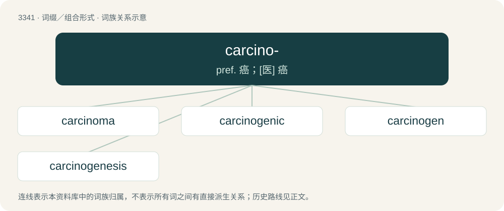

# 3429 · carcino- — pref. 癌；\[医\] 癌

[总目录](../00_总目录_按常用程度.md)

**类型**：词缀／组合形式　｜　**来源语言**：见词源记录

## 核心含义与来源

- 核心含义：pref. 癌；\[医\] 癌
- 英文含义：Cancer.
- 词形：carcino-

**来源记录 1**（前缀／前置成分；Cancer.）

From Ancient Greek καρκίνος (karkínos, “crab”). By surface analysis, carcin- + -o-.

## 词族图

## 单词速览（常用到不常用）

| 单词 | 音标 | 释义 |
|---|---|---|
| [carcinoma](#w-1) | 英 /ˌkɑːsɪˈnəʊmə/；美 /ˌkɑɹsɪˈnoʊmə/ | n. 癌；\[医\] 癌 |
| [carcinogenic](#w-2) | /ˌkɑː(ɹ)sɪnəˈd͡ʒɛnɪk/ | a. 致癌作用, 癌发生；\[医\] 致癌的 |
| [carcinogen](#w-3) | /kɑɹˈsɪnəd͡ʒən/ | n. 致癌物质；\[化\] 致癌物 |
| [carcinogenesis](#w-4) | /,kɑːsinəjˈdʒenisis/ | n. 致癌作用, 癌发生；\[医\] 致癌作用, 癌发生 |

## 逐词详解

### 1. carcinoma

**词性**：名词　｜　**音标**：英 /ˌkɑːsɪˈnəʊmə/；美 /ˌkɑɹsɪˈnoʊmə/

**中文释义**：n. 癌；\[医\] 癌

**英文义项**：An invasive malignant tumour derived from epithelial tissue that tends to metastasize to other areas of the body. / A form of cancer; (uncountable) cancer in general as a disease.

**构词拆分**：carcino- + -oma

**词源与演化**：

Learned borrowing from Latin carcinōma (“tumour; ulcer; carcinoma”), from Ancient Greek κᾰρκῐ́νωμᾰ (kărkĭ́nōmă, “sore, ulcer; cancer”), from καρκινόω (karkinóō, “to make (something) resemble a crab”, in the mediopassive "to become cancerous; to suffer from cancer") + -μᾰ (-mă, action noun suffix). Καρκινόω is derived from καρκῐ́νος (karkĭ́nos, “crab; the zodiac sign Cancer; sore, ulcer; cancer”) (according to Paul of Aegina (c. 625 – c. 690) in his Medical Compendium in Seven Books, because the veins surrounding a cancerous tumour resemble a crab’s legs). The English word is a doublet of cancer, and may be analysed as carcino- + -oma. The plural form carcinomata is a learned borrowing from Latin carcinōmata, from Ancient Greek κᾰρκῐνώμᾰτᾰ (kărkĭnṓmătă).

### 2. carcinogenic

**词性**：形容词　｜　**音标**：/ˌkɑː(ɹ)sɪnəˈd͡ʒɛnɪk/

**中文释义**：a. 致癌作用, 癌发生；\[医\] 致癌的

**英文义项**：Causing or tending to cause cancer.

**构词拆分**：carcino- + -genic

**词源与演化**：

From carcino- + -genic.

**例句**：

> The carcinogenic action of certain chemicals.

该用例对应义项：causing or tending to cause cancer

### 3. carcinogen

**词性**：名词　｜　**音标**：/kɑɹˈsɪnəd͡ʒən/

**中文释义**：n. 致癌物质；\[化\] 致癌物

**英文义项**：A substance or agent that can cause cancer.

**构词拆分**：carcino- + -gen

**词源与演化**：

From carcino- + -gen.

**例句**：

> The remedy has come under fire lately as a possible carcinogen.

### 4. carcinogenesis

**词性**：名词　｜　**音标**：/,kɑːsinəjˈdʒenisis/

**中文释义**：n. 致癌作用, 癌发生；\[医\] 致癌作用, 癌发生

**英文义项**：The creation of cancer cells.

**构词拆分**：carcino- + -genesis

**词源与演化**：

From carcino- + -genesis.
