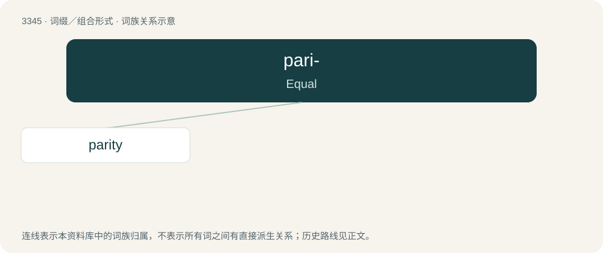

# 3430 · pari- — Equal

[总目录](../00_总目录_按常用程度.md)

**类型**：词缀／组合形式　｜　**来源语言**：见词源记录

## 核心含义与来源

- 核心含义：Equal
- 英文含义：Equal
- 词形：pari-

**来源记录 1**（前缀／前置成分；Equal）

From Latin par, paris (“equal”).

## 词族图

## 单词速览（常用到不常用）

| 单词 | 音标 | 释义 |
|---|---|---|
| [parity](#w-1) | 英 /ˈpæɹɪti/；/ˈpæɹɪti/ | n. 同等, 同位, 平价, 奇偶性；\[计\] 奇偶性 |

## 逐词详解

### 1. parity

**词性**：名词　｜　**音标**：英 /ˈpæɹɪti/；/ˈpæɹɪti/

**中文释义**：n. 同等, 同位, 平价, 奇偶性；\[计\] 奇偶性

**英文义项**：Equality; comparability of strength or intensity. / A set with the property of having all of its elements belonging to one of two disjoint subsets, especially a set of integers split in subsets of even and odd elements.

**构词拆分**：pari- + -ty

**词源与演化**：

From Middle French parité, from Late Latin paritās, from Latin pār (“equal”). Equivalent to pari- + -ty.

**例句**：

> Parity is often used to check the integrity of transmitted data.

该用例对应义项：(mathematics) a relation between a pair of integers: if both integers are odd or both are even they have the same parity; if one is odd and the other is even they have different parity
