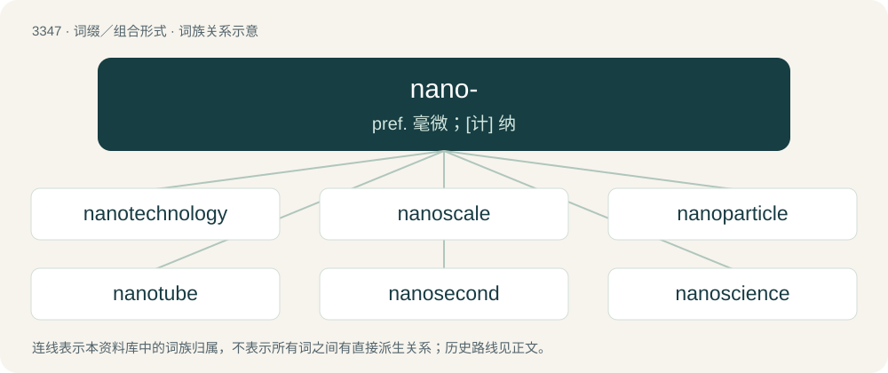

# 3434 · nano- — pref. 毫微；\[计\] 纳

[总目录](../00_总目录_按常用程度.md)

**类型**：词缀／组合形式　｜　**来源语言**：见词源记录

## 核心含义与来源

- 核心含义：pref. 毫微；\[计\] 纳
- 英文含义：In the International System of Units and other metric systems of units, multiplying the unit to which it is attached by 10⁻⁹ (short scale billionth or long scale milliardth). Symbol: n
- 词形：nano-

**来源记录 1**（前缀／前置成分；In the International System of Units and other metric systems of units, multiplying the unit to which it is attached by 10⁻⁹ (short scale billionth or long scale milliardth). Symbol: n）

Borrowed from Latin nānus (“dwarf”), borrowed from Ancient Greek νᾶνος (nânos, “dwarf”).

## 词族图

## 单词速览（常用到不常用）

| 单词 | 音标 | 释义 |
|---|---|---|
| [nanotechnology](#w-1) | 美 /ˌnænoʊtɛkˈnɑləd͡ʒi/ | n. 纳米技术, 毫微技术; 纤技术 |
| [nanoscale](#w-2) |  | n. 纳米级 |
| [nanoparticle](#w-3) | /ˈnænəʊpɑːtɪkl/ | 纳米粒 |
| [nanotube](#w-4) | /neɪnəʊtjʊb/ | n. 毫微管（富勒烯中的圆柱形分子） |
| [nanosecond](#w-5) | /ˈnænəusekənd/ | n. 毫微秒；\[计\] 毫微秒, 纳秒 |
| [nanoscience](#w-6) |  | 纳米科学 |
| [nanite](#w-7) |  | 【英文】Synonym of nanorobot. |

## 逐词详解

### 1. nanotechnology

**词性**：名词　｜　**音标**：美 /ˌnænoʊtɛkˈnɑləd͡ʒi/

**中文释义**：n. 纳米技术, 毫微技术; 纤技术

**英文义项**：The science and technology of creating nanoparticles and of manufacturing machines which have sizes within the range of nanometres (1–100 nm).

**构词拆分**：nano- + technology

**词源与演化**：

From nano- + technology. Popularized in 1986 by Eric Drexler.

**例句**：

> Benedito's work has implications for the future of nanotechnology.

### 2. nanoscale

**词性**：形容词

**中文释义**：n. 纳米级

**英文义项**：On a scale measured in nanometers.

**构词拆分**：nano- + scale

**词源与演化**：

From nano- + scale.

### 3. nanoparticle

**词性**：名词　｜　**音标**：/ˈnænəʊpɑːtɪkl/

**中文释义**：纳米粒

**英文义项**：Any microscopic particle less than about 100 nanometers (nm) in diameter.

**构词拆分**：nano- + particle

**词源与演化**：

From nano- + particle.

**例句**：

> The ingredients in this thermoelectric recipe include carbon nanotubes, polymers and a carbon material called graphene, which is a nanoparticle.

### 4. nanotube

**词性**：名词　｜　**音标**：/neɪnəʊtjʊb/

**中文释义**：n. 毫微管（富勒烯中的圆柱形分子）

**英文义项**：Shortening of carbon nanotube; A carbon molecule, in the shape of a tube, having a fullerene structure and a diameter of about 1 or 2 nanometers. / any nanotech tubular structure with a characteristic diameter measured in a few nanometres, such as titanium nanotubes

**构词拆分**：nano- + tube

**词源与演化**：

From nano- + tube.

**例句**：

> Further research is needed before a carbon nanotube biosensor for salmonella is available commercially.

### 5. nanosecond

**词性**：名词　｜　**音标**：/ˈnænəusekənd/

**中文释义**：n. 毫微秒；\[计\] 毫微秒, 纳秒

**英文义项**：An SI unit of time equal to 10⁻⁹ seconds. Symbol: ns / An extremely short period of time; an instant.

**构词拆分**：nano- + second

**词源与演化**：

From nano- + second.

**例句**：

> I just know that the nanosecond I take my eyes off my phone, somebody's going to steal it.

该用例对应义项：An extremely short period of time; an instant.

### 6. nanoscience

**词性**：名词

**中文释义**：纳米科学

**英文义项**：The underlying science of nanotechnology.

**构词拆分**：nano- + science

**词源与演化**：

From nano- + science.

### 7. nanite

**词性**：名词

**英文义项**：Synonym of nanorobot.

**构词拆分**：nano- + -ite

**词源与演化**：

From nano- + -ite.
