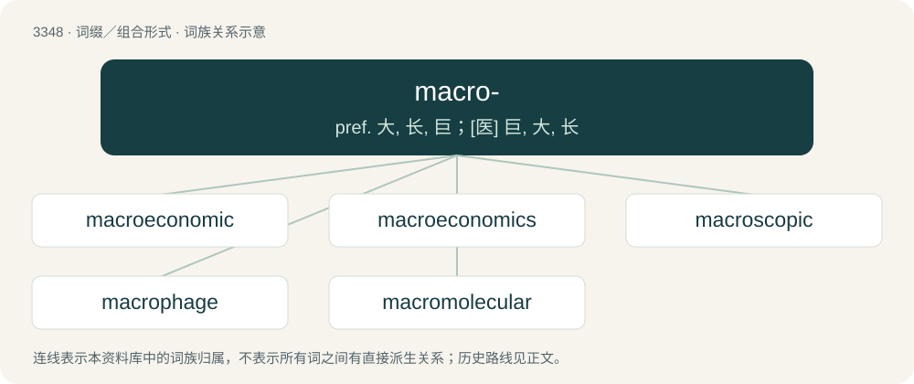

# 3435 · macro- — pref. 大, 长, 巨；\[医\] 巨, 大, 长

[总目录](../00_总目录_按常用程度.md)

**类型**：词缀／组合形式　｜　**来源语言**：见词源记录

## 核心含义与来源

- 核心含义：pref. 大, 长, 巨；\[医\] 巨, 大, 长
- 英文含义：large
- 词形：macro-

**来源记录 1**（前缀／前置成分；large）

From French, from Latin, from Ancient Greek μακρο- (makro-), combinging form of μακρός (makrós, “long”). By surface analysis, macr- + -o-.

## 词族图

## 单词速览（常用到不常用）

| 单词 | 音标 | 释义 |
|---|---|---|
| [macroeconomic](#w-1) | 英 /ˌmækɹəʊˌiːkəˈnɒmɪk/；美 /ˌmækɹoʊˌɛkəˈnɑːmɪk/ | n. 整体经济 |
| [macroeconomics](#w-2) | /ˌmæk.ɹoʊˌiː.kəˈnɒ.mɪks/ | n. 整体经济学, 宏观经济学；\[经\] 宏观经济学 |
| [macroscopic](#w-3) | /ˌmæ.kɹəˈskɒ.pɪk/ | a. 肉眼可见的, 宏观的, 目视的；\[医\] 肉眼\[检查\]的, 目视的 |
| [macrophage](#w-4) | 美 /ˈmækɹɔʊː.feɪd͡ʒ/ | n. 巨噬细胞；\[化\] 巨噬细胞 |
| [macromolecular](#w-5) |  | \[医\] 大分子的, 巨分子的 |

## 逐词详解

### 1. macroeconomic

**词性**：形容词　｜　**音标**：英 /ˌmækɹəʊˌiːkəˈnɒmɪk/；美 /ˌmækɹoʊˌɛkəˈnɑːmɪk/

**中文释义**：n. 整体经济

**英文义项**：Relating to macroeconomics. / Relating to the entire economy, including the growth rate, money and credit, exchange rates, the total amount of goods and services produced, total income earned, the level of employment of productive resources, and the general behavior of prices.

**构词拆分**：macro- + economic

**词源与演化**：

From macro- + economic.

**例句**：

> Algeria needs to implement macroeconomic policies to protect its economy.

### 2. macroeconomics

**词性**：名词　｜　**音标**：/ˌmæk.ɹoʊˌiː.kəˈnɒ.mɪks/

**中文释义**：n. 整体经济学, 宏观经济学；\[经\] 宏观经济学

**英文义项**：The study of the entire economy in terms of the total amount of goods and services produced, total income earned, the level of employment of productive resources, and the general behavior of prices.

**构词拆分**：macro- (“large scale”) + economics

**词源与演化**：

From macro- (“large scale”) + economics. The first published use of the term was by the Norwegian economist Ragnar Frisch (1895–1973) in 1933.

### 3. macroscopic

**词性**：形容词　｜　**音标**：/ˌmæ.kɹəˈskɒ.pɪk/

**中文释义**：a. 肉眼可见的, 宏观的, 目视的；\[医\] 肉眼\[检查\]的, 目视的

**英文义项**：Visible to the unassisted eye. / Having an appreciable mass.

**构词拆分**：macro- + -scopic

**词源与演化**：

From macro- + -scopic.

**例句**：

> The assumption that macroscopic objects can remain, if not observed, in a state of superposition is false.

### 4. macrophage

**词性**：名词　｜　**音标**：美 /ˈmækɹɔʊː.feɪd͡ʒ/

**中文释义**：n. 巨噬细胞；\[化\] 巨噬细胞

**英文义项**：A white blood cell that phagocytizes necrotic cell debris and foreign material, including viruses, bacteria, and tattoo ink. It presents foreign antigens on MHC II to lymphocytes. Part of the innate immune system.

**构词拆分**：macro- + -phage

**词源与演化**：

From macro- + -phage, both from Ancient Greek.

### 5. macromolecular

**词性**：形容词

**中文释义**：\[医\] 大分子的, 巨分子的

**英文义项**：Of or relating to a macromolecule

**构词拆分**：macro- + molecular

**词源与演化**：

From macro- + molecular.
