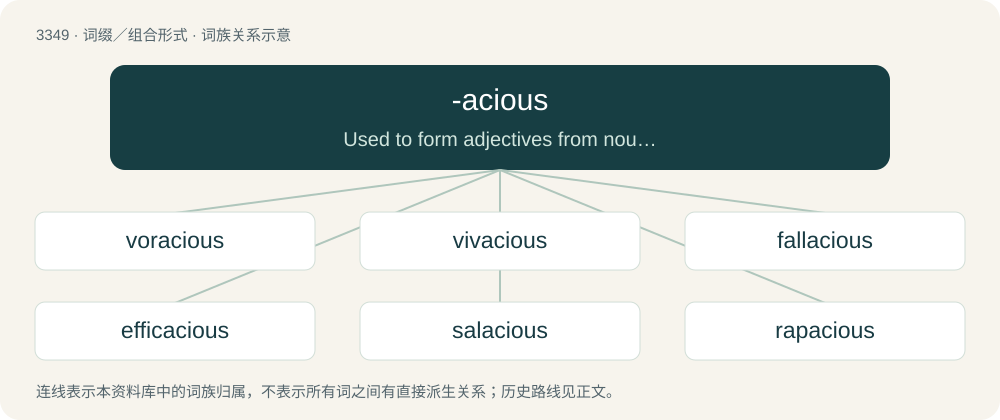

# 3436 · -acious — Used to form adjectives from nouns and verb stems.

[总目录](../00_总目录_按常用程度.md)

**类型**：词缀／组合形式　｜　**来源语言**：见词源记录

## 核心含义与来源

- 核心含义：Used to form adjectives from nouns and verb stems.
- 英文含义：Used to form adjectives from nouns and verb stems.
- 词形：-acious

**来源记录 1**（后缀／后置成分；Used to form adjectives from nouns and verb stems.）

From (1) -aci(ty) + -ous and (2) from Old French -acieux, both ultimately from Latin -ācitās.

## 词族图

## 单词速览（常用到不常用）

| 单词 | 音标 | 释义 |
|---|---|---|
| [voracious](#w-1) | /vɔːˈɹeɪ.ʃəs/ | a. 贪吃的, 狼吞虎咽的, 贪婪的 |
| [vivacious](#w-2) | /vaɪˈveɪ.ʃəs/ | a. 活泼的, 快活的, 多年生的 |
| [fallacious](#w-3) | /fəˈleɪ.ʃəs/ | a. 使人误解的, 谬误的, 不合理的, 骗人的 |
| [efficacious](#w-4) | 英 /ˌɛf.ɪˈkeɪ.ʃəs/；美 /ˌɛf.əˈkeɪ.ʃəs/ | a. 有效的, 灵验的 |
| [salacious](#w-5) | /səˈleɪ.ʃəs/ | a. 好色的, 猥亵的, 黄色的；\[法\] 淫秽的, 黄色的, 淫荡的 |
| [rapacious](#w-6) | 英 /ɹəˈpeɪ.ʃəs/ | a. 强夺的, 贪欲的, 贪婪的 |
| [loquacious](#w-7) | 英 /ləʊˈkweɪʃəs/；美 /loʊˈkweɪʃəs/ | a. 多嘴的, 好辩的, 吵闹的, 潺潺的 |

## 逐词详解

### 1. voracious

**词性**：形容词　｜　**音标**：/vɔːˈɹeɪ.ʃəs/

**中文释义**：a. 贪吃的, 狼吞虎咽的, 贪婪的

**英文义项**：Wanting or devouring great quantities of food. / Having a great appetite for anything; eager.

**词源与演化**：

From Latin vorāx + English -acious. First attested in the 17th century.

**例句**：

> His appetite is voracious by suppertime.

该用例对应义项：Wanting or devouring great quantities of food.

### 2. vivacious

**词性**：形容词　｜　**音标**：/vaɪˈveɪ.ʃəs/

**中文释义**：a. 活泼的, 快活的, 多年生的

**英文义项**：Lively and animated; full of life and energy. / Long-lived.

**词源与演化**：

From Latin vīvāx (“lively, vigorous”) + -acious, from vīvere (“to live”).

**例句**：

> A charming and vivacious hostess.

该用例对应义项：vigorous and animated

### 3. fallacious

**词性**：形容词　｜　**音标**：/fəˈleɪ.ʃəs/

**中文释义**：a. 使人误解的, 谬误的, 不合理的, 骗人的

**英文义项**：Characterized by fallacy; false or mistaken. / Deceptive or misleading.

**词源与演化**：

From Old French fallacieux (whence -acious), from Latin fallācia, from fallāx, from fallere.

**例句**：

> Tom messaged Mary a fallacious article on margarine and regretted it afterwards.

### 4. efficacious

**词性**：形容词　｜　**音标**：英 /ˌɛf.ɪˈkeɪ.ʃəs/；美 /ˌɛf.əˈkeɪ.ʃəs/

**中文释义**：a. 有效的, 灵验的

**英文义项**：Effective; possessing efficacy.

**词源与演化**：

From Old French efficacieux (whence -acious), from Latin efficāx (“efficacious”) + -ous, from efficere (“to effect, to accomplish”); see effect.

**例句**：

> This medicine is efficacious.

该用例对应义项：Effective; possessing efficacy.

### 5. salacious

**词性**：形容词　｜　**音标**：/səˈleɪ.ʃəs/

**中文释义**：a. 好色的, 猥亵的, 黄色的；\[法\] 淫秽的, 黄色的, 淫荡的

**英文义项**：Promoting sexual desire or lust. / Lascivious, bawdy, obscene, lewd.

**词源与演化**：

Derived from Latin salāx, salācis (“provocative, lustful”) + -ious, ultimately from saliō + -acious.

**例句**：

> The newspaper published a salacious story about the scandal.

该用例对应义项：Lascivious, bawdy, obscene, lewd.

### 6. rapacious

**词性**：形容词　｜　**音标**：英 /ɹəˈpeɪ.ʃəs/

**中文释义**：a. 强夺的, 贪欲的, 贪婪的

**英文义项**：Voracious; avaricious. / Given to taking by force or plundering; aggressively greedy.

**词源与演化**：

Perhaps from rapacity + -ous, in any case ultimately from Latin rapāx (“grasping, greedy”) + -acious.

**例句**：

> A rapacious divorcee on the prowl.

该用例对应义项：excessively greedy and grasping

### 7. loquacious

**词性**：形容词　｜　**音标**：英 /ləʊˈkweɪʃəs/；美 /loʊˈkweɪʃəs/

**中文释义**：a. 多嘴的, 好辩的, 吵闹的, 潺潺的

**英文义项**：Talkative; chatty.

**构词拆分**：Latin loquāx, loquācis (“talkative”) + -ous；loquacity + -ous

**词源与演化**：

From Latin loquāx, loquācis (“talkative”) + -ous or from loquacity + -ous, ultimately from Latin loquor + -acious.

**例句**：

> Her loquacious new beau was there, talking everyone's heads off.
