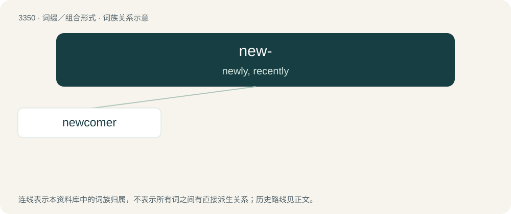

# 3438 · new- — newly, recently

[总目录](../00_总目录_按常用程度.md)

**类型**：词缀／组合形式　｜　**来源语言**：见词源记录

## 核心含义与来源

- 核心含义：newly, recently
- 英文含义：newly, recently
- 词形：new-

## 词族图

## 单词速览（常用到不常用）

| 单词 | 音标 | 释义 |
|---|---|---|
| [newcomer](#w-1) | 英 /ˈnjuːkʌmə/；美 /ˈn(j)uˌkʌmɚ/ | n. 新来者 |

## 逐词详解

### 1. newcomer

**词性**：名词　｜　**音标**：英 /ˈnjuːkʌmə/；美 /ˈn(j)uˌkʌmɚ/

**中文释义**：n. 新来者

**英文义项**：One who has recently come to a community; a recent arrival. / A new participant in some activity; a neophyte.

**构词拆分**：new- + comer

**词源与演化**：

From Middle English newe-comere, equivalent to new- + comer. Compare Old English nīwcumen (“new comer, neophyte, novice”).

**例句**：

> He's a newcomer to Boston.

该用例对应义项：a recent arrival
