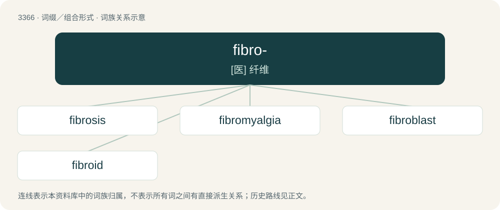

# 3457 · fibro- — \[医\] 纤维

[总目录](../00_总目录_按常用程度.md)

**类型**：词缀／组合形式　｜　**来源语言**：见词源记录

## 核心含义与来源

- 核心含义：\[医\] 纤维
- 英文含义：fibre/fiber; fibrous
- 词形：fibro-

## 词族图

## 单词速览（常用到不常用）

| 单词 | 音标 | 释义 |
|---|---|---|
| [fibrosis](#w-1) | 美 /faɪˈbɹoʊsɪs/ | n. 纤维变性, 纤维化；\[医\] 纤维变性, 纤维化 |
| [fibromyalgia](#w-2) | /ˌfaɪbroʊmaɪˈældʒə/ | \[医\]纤维肌痛 |
| [fibroblast](#w-3) | 英 /ˈfaɪ.brəˌblɑːst/；美 /ˈfaɪ.brəˌblæst/ | n. 成纤维细胞；\[医\] 成纤维细胞, 纤维细胞 |
| [fibroid](#w-4) | /ˈfaɪ.brɔɪd/ | a. 纤维性的, 纤维状的；n. 纤维瘤 |

## 逐词详解

### 1. fibrosis

**词性**：名词　｜　**音标**：美 /faɪˈbɹoʊsɪs/

**中文释义**：n. 纤维变性, 纤维化；\[医\] 纤维变性, 纤维化

**英文义项**：The formation of (excess) fibrous connective tissue in an organ.

**构词拆分**：fibro- + -osis

**词源与演化**：

From fibro- + -osis.

**例句**：

> Cystic fibrosis is a genetic disease.

### 2. fibromyalgia

**词性**：名词　｜　**音标**：/ˌfaɪbroʊmaɪˈældʒə/

**中文释义**：\[医\]纤维肌痛

**英文义项**：A condition characterized by chronic pain, stiffness, and tenderness of the muscles, tendons, and joints.

**构词拆分**：fibro- (“tissue”) + my- (“muscle”) + -algia (“pain”)

**词源与演化**：

From fibro- (“tissue”) + my- (“muscle”) + -algia (“pain”).

**例句**：

> Gail Cawkwell is a rheumatologist who treats children and young people with arthritis and fibromyalgia. She is also a Vice President at Pfizer.

### 3. fibroblast

**词性**：名词　｜　**音标**：英 /ˈfaɪ.brəˌblɑːst/；美 /ˈfaɪ.brəˌblæst/

**中文释义**：n. 成纤维细胞；\[医\] 成纤维细胞, 纤维细胞

**英文义项**：A cell found in connective tissue that produces fibers, such as collagen.

**构词拆分**：fibro- + -blast

**词源与演化**：

From fibro- + -blast.

### 4. fibroid

**词性**：名词　｜　**音标**：/ˈfaɪ.brɔɪd/

**中文释义**：a. 纤维性的, 纤维状的；n. 纤维瘤

**英文义项**：A benign tumour of the uterus that is composed of either fibrous connective tissue or muscle. / A fibroma.

**构词拆分**：fibro- + -oid

**词源与演化**：

From fibro- + -oid.

**例句**：

> I have fibroid tumours. Is there a way to stop them getting large?
