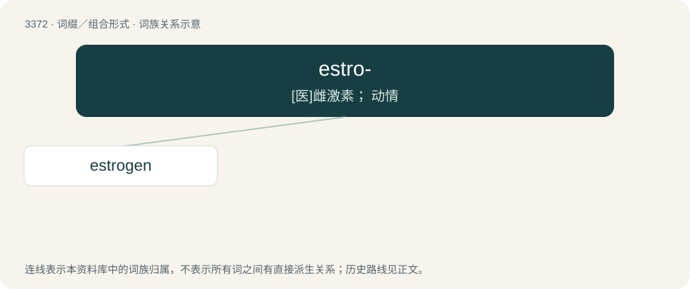

# 3462 · estro- — \[医\]雌激素； 动情

[总目录](../00_总目录_按常用程度.md)

**类型**：词缀／组合形式　｜　**来源语言**：见词源记录

## 核心含义与来源

- 核心含义：\[医\]雌激素； 动情
- 英文含义：Estrus.
- 词形：estro-

**来源记录 1**（前缀／前置成分；Estrus.）

From estrus + -o-.

## 词族图

## 单词速览（常用到不常用）

| 单词 | 音标 | 释义 |
|---|---|---|
| [estrogen](#w-1) | 英 /ˈiːstɹəd͡ʒən/；美 /ˈɛstɹəd͡ʒən/ | n. 雌激素；\[化\] 雌激素 |

## 逐词详解

### 1. estrogen

**词性**：名词　｜　**音标**：英 /ˈiːstɹəd͡ʒən/；美 /ˈɛstɹəd͡ʒən/

**中文释义**：n. 雌激素；\[化\] 雌激素

**英文义项**：Any of a group of steroids that are secreted by the ovaries and function as female sex hormones.

**构词拆分**：estro- + -gen；estro- (estrus) + -gen (“a producer of”)

**词源与演化**：

From estro- (estrus) + -gen (“a producer of”).

**例句**：

> Declining estrogen levels can lead to thinning of the vaginal walls.
