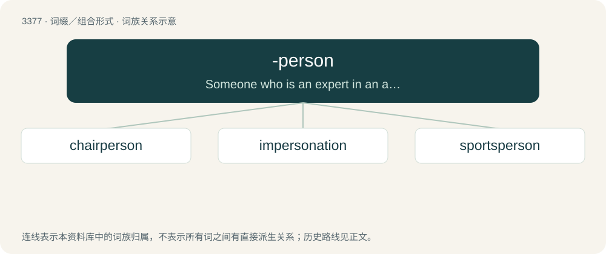

# 3465 · -person — Someone who is an expert in an area.

[总目录](../00_总目录_按常用程度.md)

**类型**：词缀／组合形式　｜　**来源语言**：见词源记录

## 核心含义与来源

- 核心含义：Someone who is an expert in an area.
- 英文含义：Someone who is an expert in an area.
- 词形：-person

## 词族图

## 单词速览（常用到不常用）

| 单词 | 音标 | 释义 |
|---|---|---|
| [chairperson](#w-1) | /ˈtʃeəp\\\\ːs(e)n/ | n. 主席 |
| [impersonation](#w-2) | /im.pəːsəˈneiʃən/ | n. 扮演, 装扮, 模仿；\[计\] 模仿 |
| [sportsperson](#w-3) | 英 /spɔːtspɜːsən/；美 /spɔɹtspɝsən/ | n. 运动员 |

## 逐词详解

### 1. chairperson

**词性**：名词　｜　**音标**：/ˈtʃeəp\\\\ːs(e)n/

**中文释义**：n. 主席

**英文义项**：A chairman or chairwoman, someone who presides over a meeting, board, etc.

**构词拆分**：chair + -person；chair + person

**词源与演化**：

From chair + person, after chairman and chairwoman.

**例句**：

> She was the chairperson of the board and she presided over the meeting.

该用例对应义项：A chairman or chairwoman, someone who presides over a meeting, board, etc.

### 2. impersonation

**词性**：名词　｜　**音标**：/im.pəːsəˈneiʃən/

**中文释义**：n. 扮演, 装扮, 模仿；\[计\] 模仿

**英文义项**：the act of impersonating

**构词拆分**：im- + person + -ation；impersonate + -ion

**词源与演化**：

From im- + person + -ation or impersonate + -ion.

**例句**：

> I was doing an impersonation of my boss when he showed up.

### 3. sportsperson

**词性**：名词　｜　**音标**：英 /spɔːtspɜːsən/；美 /spɔɹtspɝsən/

**中文释义**：n. 运动员

**英文义项**：Someone who plays sport, regardless of gender.

**构词拆分**：sports + -person

**词源与演化**：

From sports + -person.
