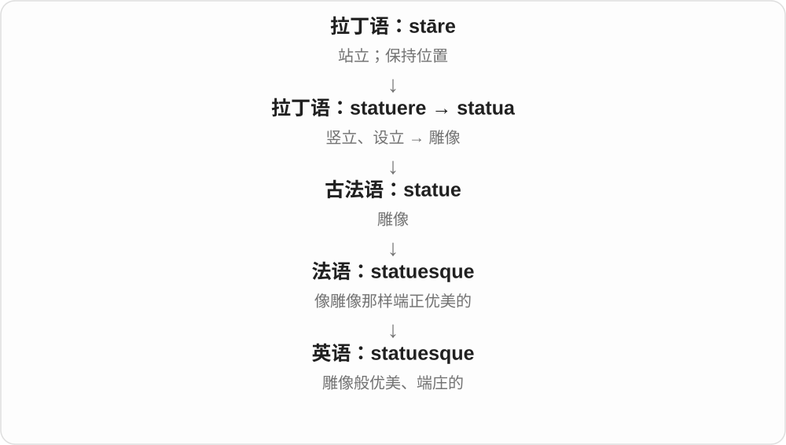

# 3466 · -esque — 具有某种艺术风格、外观特征

[逐词精讲目录](../00_逐词精讲目录.md) · [总目录](../00_总目录_按常用程度.md)

## 核心词根与来源

经法语 -esque、意大利语 -esco 等进入英语，远接与 -ish 同族的古老构词材料。很多整词有具体法语、意大利语借入历史。

**-ESQUE：像某种风格，或带着某种画面感**

picturesque 像画一样好看，statuesque 像雕像一样高挑端庄；它不只是随便相似，常带风格、审美感觉。

- **如画的景色**：picturesque
- **雕像般的形态**：statuesque

## 词形与演化规律

picturesque 依英语 picture 改造、仿法语 pittoresque，后者接意大利画家词族；statuesque 借法语相关词，可对应 statue + -esque。

## 单词速览（按词族由简到繁）

同一基础词的相关扩展放在一起，先读基础形式，再读扩展；各组之间优先读常用的。具体词源关系见各词讲解。

| 单词 | 音标 | 核心意思 |
|---|---|---|
| [picturesque](#w-1) | /ˌpɪktʃəˈresk/ | 风景如画的；富有画意的 |
| [statuesque](#w-2) | 英 /ˌstætʃuˈesk/；美 /ˌstætʃuˈesk/ | 雕像般优美的；高挑端庄的 |

## 逐词讲解

### 1. picturesque — 风景如画的；富有画意的

**音标**：/ˌpɪktʃəˈresk/

**先抓住这个画面**

不只是能拍成照片，而是景色的形状、颜色和布局让人觉得很适合入画。

**怎么拆**

英语依 picture 的形式改造、仿造法语 pittoresque；法语又来自意大利语 pittoresco，接 pittore“画家”，远接拉丁 pictor。不能画成法语词从现代英语 picture 派生。

**怎么变成今天的意思**

**拉丁 pingere，过去分词 pictus**  
绘画、着色；用图像表现

↓

**拉丁 pictor → 意大利语 pittore → pittoresco**  
画家 → 绘画般的

↓

**法语 pittoresque → 英语 picturesque**  
借入时与英语 picture 的形式相联系

常形容村庄、港口、风景等有画面美感的地方。日常主要是赞美视觉效果，不是在证明那里生活一定轻松。

**常见搭配与例句**

a picturesque village；picturesque scenery；a picturesque harbour。

> A narrow bridge leads to the picturesque village.

一座窄桥通向那个风景如画的村庄。

> The guidebook shows the town’s most picturesque streets.

指南展示了镇上最有画意的几条街道。

**别混淆**

beautiful 范围很广；picturesque 更突出可入画的景致。pictorial 则只说与图画有关，不自带好看。

### 2. statuesque — 雕像般优美的；高挑端庄的

**音标**：英 /ˌstætʃuˈesk/；美 /ˌstætʃuˈesk/

**先抓住这个画面**

一个人高挑、姿态优雅，像精心雕出的像一样引人注目，可以形容为 statuesque。

**怎么拆**

借自法语 statuesque；形式上是 statue + -esque（像……的）。

**怎么变成今天的意思**

这是外形和姿态的比喻，不表示人真的僵住不动。经常用于人物描写，带审美评价。

**常见搭配与例句**

a statuesque figure；a statuesque dancer；statuesque elegance。

> The statuesque dancer held the final pose.

这位高挑优雅的舞者保持着最后的姿势。

> The portrait emphasizes her statuesque elegance.

这幅肖像突出了她雕像般的端庄优美。

**别混淆**

statuary 指雕像或雕像艺术；statuesque 是形容外观的词。tall 只说身高，不包含优美气质。

## 这一组要分清什么

不能画成法语 pittoresque 从英语 picture 派生；学习对应可以帮助记忆，实际借入方向仍需分清。

## 串起来练习

A statuesque figure stood in the picturesque courtyard.

一个高挑端庄的身影站在如画的庭院中。
