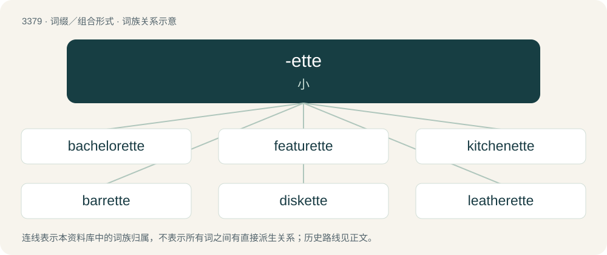

# 3466 · -ette — 小

[总目录](../00_总目录_按常用程度.md)

**类型**：词缀／组合形式　｜　**来源语言**：见词源记录

## 核心含义与来源

- 核心含义：小
- 英文含义：Used to form nouns meaning a smaller form of something.
- 词形：-ette

**多个词源／构词路径**：同一拼写可能有不同来源；以下按词性和含义分别列出。

**来源记录 1**（后缀／后置成分；Used to form nouns meaning a smaller form of something.）

Inherited from Middle English -ette, borrowed from Old French -ette, from Latin -ittus.

**来源记录 2**（后缀／后置成分；Used to form nouns and adjectives signifying a person, especially a woman, with the specified hair color.）

Back-formation from brunette.

## 词族图

## 单词速览（常用到不常用）

| 单词 | 音标 | 释义 |
|---|---|---|
| [bachelorette](#w-1) | 英 /ˌbatʃləˈɹɛt/；美 /ˌbætʃləˈɹɛt/ | n. 未婚女子 |
| [featurette](#w-2) | /,fiːtʃəˈret/ | n. 短故事片, 短艺术片 |
| [kitchenette](#w-3) | /ˌkɪt͡ʃəˈnɛt/ | n. 小厨房, 房间内用作厨房的一部分 |
| [barrette](#w-4) | /bəˈɹɛt/ | n. 条状发夹 |
| [diskette](#w-5) | 英 /dɪsˈkɛt/ | n. 磁盘；\[计\] 软磁盘 |
| [leatherette](#w-6) | 英 /ˌlɛðəˈɹɛt/ | n. 人造革；\[化\] 人造革 |

## 逐词详解

### 1. bachelorette

**词性**：名词　｜　**音标**：英 /ˌbatʃləˈɹɛt/；美 /ˌbætʃləˈɹɛt/

**中文释义**：n. 未婚女子

**英文义项**：An unmarried woman. / A very small bachelor (single room) apartment.

**构词拆分**：bachelor + -ette

**词源与演化**：

From bachelor + -ette. Displaced maid.

**例句**：

> She will remain a bachelorette, if she keeps waiting for her Prince Charming.

### 2. featurette

**词性**：名词　｜　**音标**：/,fiːtʃəˈret/

**中文释义**：n. 短故事片, 短艺术片

**英文义项**：A relatively short feature film. / A short film of bonus material, companion to the main feature, frequently part of additional material in a home video release on LaserDisc, DVD, Blu-Ray.

**构词拆分**：feature + -ette

**词源与演化**：

From feature + -ette.

**例句**：

> The Blu-ray contains a 20-minute behind-the-scenes featurette.

### 3. kitchenette

**词性**：名词　｜　**音标**：/ˌkɪt͡ʃəˈnɛt/

**中文释义**：n. 小厨房, 房间内用作厨房的一部分

**英文义项**：A small kitchen or area for preparing food, often just a part of a room.

**构词拆分**：kitchen + -ette

**词源与演化**：

From kitchen + -ette (diminutive suffix).

### 4. barrette

**词性**：名词　｜　**音标**：/bəˈɹɛt/

**中文释义**：n. 条状发夹

**英文义项**：A clasp or clip for gathering and holding the hair. / A bar used to mount medals of chivalric orders.

**词源与演化**：

Borrowed from French barrette, from barre (“a bar”) + -ette, literally a small bar.

### 5. diskette

**词性**：名词　｜　**音标**：英 /dɪsˈkɛt/

**中文释义**：n. 磁盘；\[计\] 软磁盘

**英文义项**：A small, flexible, magnetic disk for storage and retrieval of data. / An 8-inch floppy disk.

**构词拆分**：disk + -ette + cassette；disk + -ette

**词源与演化**：

From disk + -ette, by analogy with cassette.

**例句**：

> The menu will display the option to boot from the diskette drive.

### 6. leatherette

**词性**：名词　｜　**音标**：英 /ˌlɛðəˈɹɛt/

**中文释义**：n. 人造革；\[化\] 人造革

**英文义项**：A type of fabric, often plastic, made to imitate the appearance of leather.

**构词拆分**：leather + -ette (suffix forming nouns meaning an imitation or substitute of something)

**词源与演化**：

From leather + -ette (suffix forming nouns meaning an imitation or substitute of something); originally a trademark that has since been genericized.
