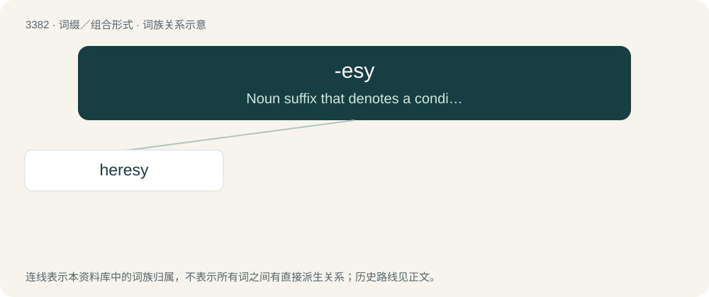

# 3468 · -esy — Noun suffix that denotes a condition, action, or process.

[总目录](../00_总目录_按常用程度.md)

**类型**：词缀／组合形式　｜　**来源语言**：见词源记录

## 核心含义与来源

- 核心含义：Noun suffix that denotes a condition, action, or process.
- 英文含义：Noun suffix that denotes a condition, action, or process.
- 词形：-esy

**来源记录 1**（后缀／后置成分；Noun suffix that denotes a condition, action, or process.）

French form of -esis, from Late Latin -esia, from -ēsis, from Ancient Greek -ησις (-ēsis), from -σις (-sis).

## 词族图

## 单词速览（常用到不常用）

| 单词 | 音标 | 释义 |
|---|---|---|
| [heresy](#w-1) | /ˈhɛɹəsi/ | n. 异端, 异教；\[法\] 异端邪说, 异教, 信奉异教 |

## 逐词详解

### 1. heresy

**词性**：名词　｜　**音标**：/ˈhɛɹəsi/

**中文释义**：n. 异端, 异教；\[法\] 异端邪说, 异教, 信奉异教

**英文义项**：A doctrine held by a member of a religion at variance or conflict with established religious beliefs. / A controversial or unorthodox opinion held by a member of a group, as in politics, philosophy or science.

**词源与演化**：

From Middle English heresie (Middle English her(esie) + -esy), from Old French heresie (modern hérésie), from Latin haeresis, from Ancient Greek αἵρεσις (haíresis, “choice, system of principles”), from αἱρέομαι (hairéomai, “to take for oneself, to choose”), the middle voice of αἱρέω (hairéō, “to take”), possibly from Proto-Indo-European \*ser-; see also Welsh herw (“theft, raid”), Ancient Greek στερέω (steréō, “to deprive of”). Displaced native Old English dwild.

**例句**：

> As for the accusations of heresy, here the evidence is much weaker.
