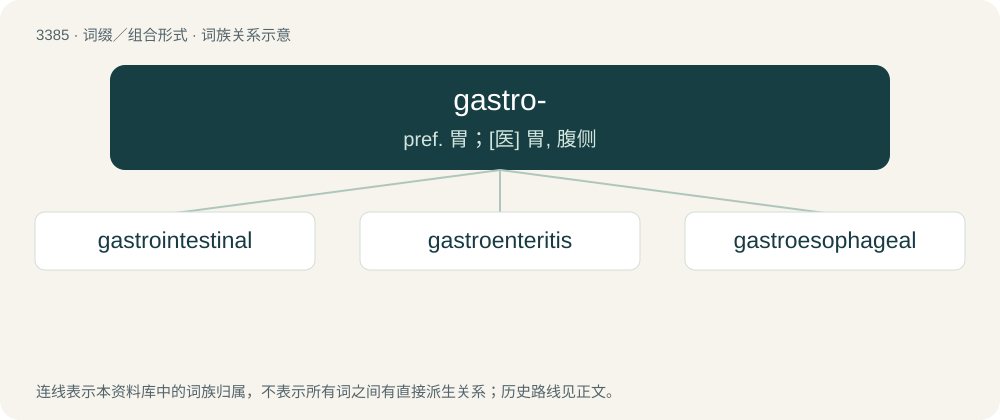

# 3472 · gastro- — pref. 胃；\[医\] 胃, 腹侧

[总目录](../00_总目录_按常用程度.md)

**类型**：词缀／组合形式　｜　**来源语言**：见词源记录

## 核心含义与来源

- 核心含义：pref. 胃；\[医\] 胃, 腹侧
- 英文含义：Of or relating to the stomach.
- 词形：gastro-

**来源记录 1**（前缀／前置成分；Of or relating to the stomach.）

Coined based on Ancient Greek γαστήρ (gastḗr, “stomach”).

## 词族图

## 单词速览（常用到不常用）

| 单词 | 音标 | 释义 |
|---|---|---|
| [gastrointestinal](#w-1) | 美 /ˌɡæstɹoʊɪnˈtɛstɪnəl/；/ˌɡæstɹəʊɪnˈtɛstɪnəl/ | a. 胃肠的, 肠胃的；\[医\] 胃肠的 |
| [gastroenteritis](#w-2) | /ˌɡæstɹəʊˌɛntəˈɹaɪtəs/ | n. 肠胃炎；\[医\] 胃肠炎 |
| [gastroesophageal](#w-3) | /ˈ^æstrəji,sɔfəˈdʒiːəl/ | \[医\] 胃食管的 |

## 逐词详解

### 1. gastrointestinal

**词性**：形容词　｜　**音标**：美 /ˌɡæstɹoʊɪnˈtɛstɪnəl/；/ˌɡæstɹəʊɪnˈtɛstɪnəl/

**中文释义**：a. 胃肠的, 肠胃的；\[医\] 胃肠的

**英文义项**：Of or pertaining to the stomach and intestines, and thus to digestion.

**构词拆分**：gastro- + intestinal

**词源与演化**：

From gastro- + intestinal.

**例句**：

> Headaches, stomachaches and infertility are all symptoms of celiac disease, an immune system disorder that affects the gastrointestinal tract.

### 2. gastroenteritis

**词性**：名词　｜　**音标**：/ˌɡæstɹəʊˌɛntəˈɹaɪtəs/

**中文释义**：n. 肠胃炎；\[医\] 胃肠炎

**英文义项**：Inflammation of the mucous membranes of the stomach and small intestine; often caused by an infection.

**构词拆分**：gastro- + enteritis

**词源与演化**：

From gastro- + enteritis.

**例句**：

> I got gastroenteritis the other day, so I went to the hospital.

### 3. gastroesophageal

**词性**：形容词　｜　**音标**：/ˈ^æstrəji,sɔfəˈdʒiːəl/

**中文释义**：\[医\] 胃食管的

**英文义项**：Of or relating to the stomach and to the esophagus.

**构词拆分**：gastro- + esophageal

**词源与演化**：

From gastro- + esophageal.
