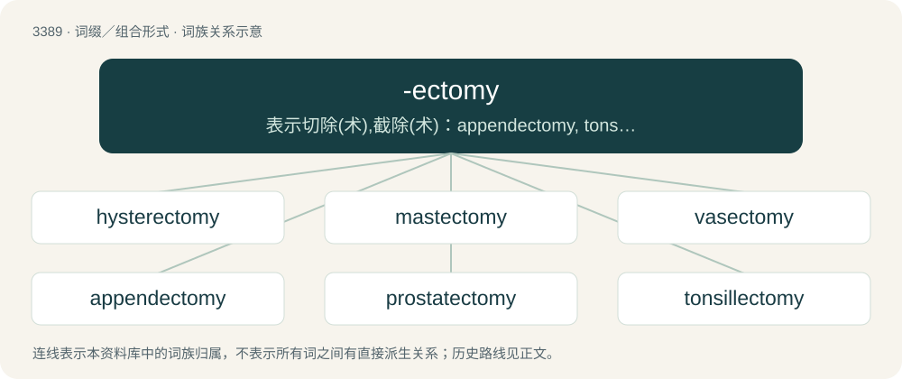

# 3477 · -ectomy — 表示切除(术),截除(术)：appendectomy, tonsillectomy

[总目录](../00_总目录_按常用程度.md)

**类型**：词缀／组合形式　｜　**来源语言**：见词源记录

## 核心含义与来源

- 核心含义：表示切除(术),截除(术)：appendectomy, tonsillectomy
- 英文含义：The surgical removal of.
- 词形：-ectomy

**来源记录 1**（后缀／后置成分；The surgical removal of.）

From Ancient Greek ἐκτομή (ektomḗ, “a cutting out of”), from ἐκτέμνω (ektémnō, “to cut out”), from ἐκ (ek, “out”) + τέμνω (témnō, “to cut”).

## 词族图

## 单词速览（常用到不常用）

| 单词 | 音标 | 释义 |
|---|---|---|
| [hysterectomy](#w-1) | /hɪstəˈɹɛktəmi/ | n. 子宫切除；\[医\] 子宫切除术 |
| [mastectomy](#w-2) | /ˌmæsˈtɛktəmi/ | n. 乳房切除术；\[医\] 乳房切除术 |
| [vasectomy](#w-3) | /vəˈsɛktəmi/ | n. 输精管切除术；\[医\] 输精管切除术 |
| [appendectomy](#w-4) | /.æpenˈdektəmi/ | n. 阑尾切除术；\[医\] 阑尾切除术; 附件切除术 |
| [prostatectomy](#w-5) | /prɔstəˈtektəmi/ | \[医\] 前列腺切除术 |
| [tonsillectomy](#w-6) | /.tɒnsiˈlektəmi/ | n. 扁桃体切除术；\[医\] 扁桃体切除术 |
| [gastrectomy](#w-7) | /^æsˈtrektəmi/ | n. 胃切除术；\[医\] 胃切除术 |

## 逐词详解

### 1. hysterectomy

**词性**：名词　｜　**音标**：/hɪstəˈɹɛktəmi/

**中文释义**：n. 子宫切除；\[医\] 子宫切除术

**英文义项**：The surgical procedure to remove all of or part of the uterus.

**构词拆分**：hyster- + -ectomy

**词源与演化**：

From hyster- + -ectomy.

**例句**：

> Hysterectomy is the surgical removal of part or all of the uterus.

### 2. mastectomy

**词性**：名词　｜　**音标**：/ˌmæsˈtɛktəmi/

**中文释义**：n. 乳房切除术；\[医\] 乳房切除术

**英文义项**：The surgical procedure to remove all or part of a breast and sometimes nearby tissues.

**构词拆分**：mast- + -ectomy

**词源与演化**：

From mast- + -ectomy.

**例句**：

> In comparison to mastectomy, lumpectomy removes a smaller percentage of breast tissue.

### 3. vasectomy

**词性**：名词　｜　**音标**：/vəˈsɛktəmi/

**中文释义**：n. 输精管切除术；\[医\] 输精管切除术

**英文义项**：The surgical incision of all or part of the vas deferens as a means of male sterilization.

**构词拆分**：vas- (“vas deferens”) + -ectomy (“surgery involving the excision or removal of a body part”)

**词源与演化**：

From vas- (“vas deferens”) + -ectomy (“surgery involving the excision or removal of a body part”).

**例句**：

> A vasectomy is a life-changing decision.

### 4. appendectomy

**词性**：名词　｜　**音标**：/.æpenˈdektəmi/

**中文释义**：n. 阑尾切除术；\[医\] 阑尾切除术; 附件切除术

**英文义项**：The surgical procedure for the removal of the vermiform appendix.

**构词拆分**：appendix + -ectomy

**词源与演化**：

From appendix + -ectomy.

### 5. prostatectomy

**词性**：名词　｜　**音标**：/prɔstəˈtektəmi/

**中文释义**：\[医\] 前列腺切除术

**英文义项**：The surgical removal of part or all of the prostate gland.

**构词拆分**：prostato- + -ectomy

**词源与演化**：

From prostato- + -ectomy.

### 6. tonsillectomy

**词性**：名词　｜　**音标**：/.tɒnsiˈlektəmi/

**中文释义**：n. 扁桃体切除术；\[医\] 扁桃体切除术

**英文义项**：The surgical removal of the tonsils, especially the palatine tonsils. Frequently accompanied by an adenoidectomy.

**构词拆分**：tonsil + -ectomy

**词源与演化**：

From tonsil + -ectomy.

**例句**：

> A tonsillectomy is a very simple procedure.

### 7. gastrectomy

**词性**：名词　｜　**音标**：/^æsˈtrektəmi/

**中文释义**：n. 胃切除术；\[医\] 胃切除术

**英文义项**：A surgery in which part or all of the stomach is removed to treat conditions such as stomach cancer, severe ulcers, or obesity.

**构词拆分**：gastr- + -ectomy

**词源与演化**：

From international scientific vocabulary, reflecting New Latin combining forms: gastr- + -ectomy, from Ancient Greek γαστήρ (gastḗr).
