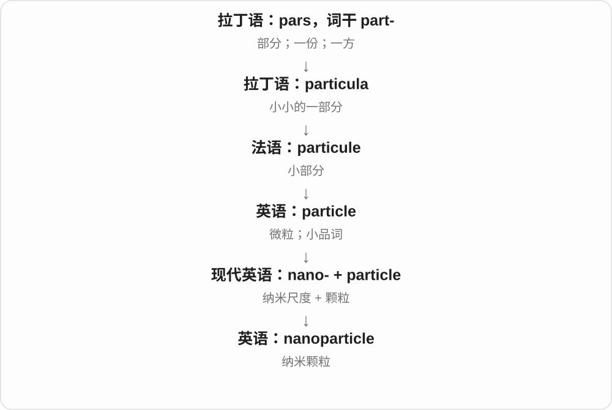

# 3478 · nano- — 单位中的十亿分之一；纳米尺度

[逐词精讲目录](../00_逐词精讲目录.md) · [总目录](../00_总目录_按常用程度.md)

## 核心词根与来源

来自希腊 nanos 小个子、矮小的等材料，经拉丁、科学构词进入近代单位命名，现代公制约定为十亿分之一。

**NANO-：把单位缩到十亿分之一，再用于极小结构**

长度单位是一纳米，时间单位是一纳秒；纳米材料、纳米技术则用这组极小尺度来命名研究对象、活动。

- **长度、时间单位**：nanometre · nanometer · nanosecond
- **尺度和科学技术**：nanoscale · nanotechnology · nanoscience
- **小结构名称**：nanoparticle · nanotube
- **nano-：十亿份里的一份**：nanoseconds · nanometers

## 词形与演化规律

nano- + metre／meter → nanometre／nanometer；nano- + second → nanosecond；nano- + scale → nanoscale。

nano- 接希腊 nanos 小个子、侏儒的材料，现代单位前表示十亿分之一；纳秒和纳米分别是时间、长度，不因共用 nano- 而变成同一种量。

## 单词速览（按词族由简到繁）

同一基础词的相关扩展放在一起，先读基础形式，再读扩展；各组之间优先读常用的。具体词源关系见各词讲解。

| 单词 | 音标 | 核心意思 |
|---|---|---|
| [nanotechnology](#w-1) | 英 /ˌnænəʊtekˈnɒlədʒi/；美 /ˌnænoʊtekˈnɑːlədʒi/ | 纳米技术 |
| [nanometre](#w-9) | 英 /ˈnænəʊmiːtə/；美 /ˈnænoʊmiːtər/ | 纳米〔英式常用拼法〕 |
| [nanometer](#w-8) | 英 /ˈnænəʊmiːtə/；美 /ˈnænoʊmiːtər/ | 纳米〔美式常用拼法〕 |
| [nanoscale](#w-2) | 英 /ˈnænəʊskeɪl/；美 /ˈnænoʊskeɪl/ | 纳米尺度；纳米尺度的 |
| [nanometers](#w-10) | 美 /ˈnænoʊˌmiːtɚz/ | 纳米〔美式复数〕 |
| [nanoparticle](#w-3) | 英 /ˈnænəʊˌpɑːtɪkəl/；美 /ˈnænoʊˌpɑːrtəkəl/ | 纳米颗粒 |
| [nanotube](#w-4) | 英 /ˈnænəʊtjuːb/；美 /ˈnænoʊtuːb/ | 纳米管 |
| [nanosecond](#w-5) | 英 /ˈnænəʊsekənd/；美 /ˈnænoʊsekənd/ | 纳秒；十亿分之一秒；一瞬间〔夸张〕 |
| [nanoseconds](#w-11) | 英 /ˈnænəʊˌsekəndz/；美 /ˈnænoʊˌsɛkəndz/ | 纳秒；极短的一瞬间〔夸张〕 |
| [nanoscience](#w-6) | 英 /ˈnænəʊsaɪəns/；美 /ˈnænoʊsaɪəns/ | 纳米科学 |

## 逐词讲解

### 1. nanotechnology — 纳米技术

**音标**：英 /ˌnænəʊtekˈnɒlədʒi/；美 /ˌnænoʊtekˈnɑːlədʒi/

**先抓住这个画面**

把材料的结构控制到极小尺度，利用这个尺度带来的不同性质。

**怎么拆**

nano- + technology；nano- 在计量中表示十亿分之一。现代术语采用已有古典成分组合，不是希腊人已经有这个完整学科。

**怎么变成今天的意思**

**希腊语 tekhnē**  
技艺、手艺、掌握方法的实践能力

↓

**希腊语 tekhnologia → 拉丁化词形 → 英语 technology**  
对技艺的系统论述；后来指工业技术及技术体系

↓

**英语 nano- + technology → nanotechnology**  
纳米尺度上理解、控制并应用物质的技术

通常关注约1至100纳米的尺度。重点不仅是把东西缩小，还在于利用尺寸和结构改变后出现的性质，例如光学或导电特性。

**常见搭配与例句**

nanotechnology research；nanotechnology applications；a nanotechnology laboratory。

> The project uses nanotechnology to alter the properties of the coating.

项目利用纳米技术改变涂层的性质。

> Nanotechnology research often combines physics, chemistry and engineering.

纳米技术研究常把物理、化学和工程结合起来。

**别混淆**

nanoscience 偏重研究现象；nanotechnology 偏重控制与应用，两者工作经常交叉。

### 2. nanometre — 纳米〔英式常用拼法〕

**音标**：英 /ˈnænəʊmiːtə/；美 /ˈnænoʊmiːtər/

**先抓住这个画面**

一米切成十亿份，每份就是一纳米；它是长度单位，常用于微小结构、光的波长等描述。

**怎么拆**

nano- 十亿分之一 + metre 米。nano- 远接希腊 nanos 小个子等材料，在公制中固定为极小分数倍率。

**怎么变成今天的意思**

**nano- + metre**  
十亿分之一米

↓

**nanometre，符号 nm**  
长度单位；与 nanometer 同义

a few nanometres 几纳米；a wavelength of five hundred nanometres 五百纳米波长。1 nm = 0.000000001 m。

**常见搭配与例句**

measure in nanometres；nanometre dimensions。

> The coating is only a few nanometres thick.

这层涂层只有几纳米厚。

> The diagram shows a scale measured in nanometres.

图示给出了以纳米计的尺度。

**别混淆**

nanometre 是长度，nanosecond 是时间；相同 nano- 指相同比率，不表示相同物理量。

### 3. nanometer — 纳米〔美式常用拼法〕

**音标**：英 /ˈnænəʊmiːtə/；美 /ˈnænoʊmiːtər/

**先抓住这个画面**

与 nanometre 是同一长度单位；看到最后是 meter，先把它当成拼写习惯变化，不要想成另一个不同尺寸的单位。

**怎么拆**

nano- 十亿分之一 + meter 米。meter、metre 是单位名的两种常见英文拼写，带进复合词后形成 nanometer、nanometre。

**怎么变成今天的意思**

**nano- + meter**  
按美式常见单位拼法组合

↓

**nanometer = nanometre**  
同一纳米长度单位，符号均为 nm

ten nanometers 十纳米；nanometer scale 纳米尺度；nanometer measurements 纳米量级测量。

**常见搭配与例句**

a nanometer in length；a few nanometers wide。

> The layer is ten nanometers thick.

这层材料厚十纳米。

> The article uses the American spelling “nanometer”.

这篇文章采用美式拼写 nanometer。

**别混淆**

meter 在这里是米的单位名；它在别的词里也可指测量仪器，不能把 nanometer 直接理解成某种纳米仪。

### 4. nanoscale — 纳米尺度；纳米尺度的

**音标**：英 /ˈnænəʊskeɪl/；美 /ˈnænoʊskeɪl/

**先抓住这个画面**

把尺寸放到以纳米来描述的极小层面，谈材料表面、小结构，就会用 nanoscale；scale 在这里是尺度。

**怎么拆**

nano- 纳米、极小尺度材料 + scale 尺度，形成名词及形容词用法。nano- 在计量单位中是十亿分之一，长度对应纳米。

**怎么变成今天的意思**

**nano- 的微小、纳米尺度材料 + scale**  
按纳米量级观察尺寸

↓

**nanoscale**  
纳米尺度，或在此尺度上的

at the nanoscale 在纳米尺度上；nanoscale structures 纳米尺度结构；nanoscale imaging 纳米尺度成像。

**常见搭配与例句**

nanoscale materials；study something at the nanoscale。

> The microscope reveals structures at the nanoscale.

显微镜显示了纳米尺度的结构。

> The team studies nanoscale changes on the surface.

团队研究表面在纳米尺度上的变化。

**别混淆**

nano- 在单位中有精确倍率，nanoscale 作为范围描述则看学科语境；它不表示每个对象都恰好只有一纳米。

### 5. nanometers — 纳米〔美式复数〕

**音标**：美 /ˈnænoʊˌmiːtɚz/

**先抓住这个画面**

把一米分成十亿份，每份是一纳米。讨论很薄的膜、光的波长时，nanometers 能把极小长度写成好读的数字。

**怎么拆**

nano- 十亿分之一 + meter 米 → nanometer；加 -s → nanometers，词尾 /z/。nano- 的命名材料远接希腊 nanos 小个子。

**怎么变成今天的意思**

**希腊 nanos 小个子 → 科学 nano- 十亿分之一**  
与长度单位 meter 结合

↓

**nanometer + -s → nanometers**  
1000000000 nanometers = 1 meter

a thickness in nanometers 是以纳米表示的厚度；a wavelength of five hundred nanometers 是五百纳米的波长。

**常见搭配与例句**

a few nanometers thick；wavelengths in nanometers；hundreds of nanometers。

> The coating is only a few nanometers thick.

这层涂层只有几纳米厚。

> The graph gives wavelengths in nanometers.

这张图用纳米标出波长。

**别混淆**

1000 nanometers = 1 micrometer。nanometers 是美式拼写，英式常写 nanometres，长度相同。

### 6. nanoparticle — 纳米颗粒

**音标**：英 /ˈnænəʊˌpɑːtɪkəl/；美 /ˈnænoʊˌpɑːrtəkəl/

**先抓住这个画面**

particle 已经很小，nano- 再把尺度拉到纳米层面：这种颗粒要用远比普通眼光更细的尺度来看。

**怎么拆**

nano-（纳米尺度）+ particle（颗粒），是现代科学组合词。

**怎么变成今天的意思**

nano- 在单位中表示十亿分之一；nanoparticle 描述纳米尺度颗粒，并不意味着每一颗直径都恰好一纳米。

**常见搭配与例句**

metal nanoparticles；a nanoparticle coating；nanoparticle size。

> The researchers measured the size of each nanoparticle.

研究人员测量了每个纳米颗粒的大小。

> The coating contains silver nanoparticles.

这种涂层含有银纳米颗粒。

**别混淆**

nanoparticle 是大小类别，不是固定材料；金、碳等不同材料都可能制成纳米颗粒。

### 7. nanotube — 纳米管

**音标**：英 /ˈnænəʊtjuːb/；美 /ˈnænoʊtuːb/

**先抓住这个画面**

把空心管的形状缩到纳米尺度；常见碳纳米管，但管状微结构不只用碳做。

**怎么拆**

nano- 纳米尺度 + tube 管。nano- 在单位中表示十亿分之一，名称强调尺度，不要求所有纳米管的直径都恰好一纳米。

**怎么变成今天的意思**

**拉丁 tubus → 法语 tube → 英语 tube**  
空心圆管，联系 tuba 号管等词

↓

**英语具体形状和命名**  
软管包装、地铁隧道、器材等

↓

**nano- + tube → nanotube**  
纳米尺度的管状结构

a carbon nanotube 碳纳米管，nanotube structures 纳米管结构，a nanotube sample 纳米管样品。

**常见搭配与例句**

a carbon nanotube；nanotube structures；a nanotube sample。

> The diagram shows a carbon nanotube.

图中展示了一根碳纳米管。

> Researchers compared nanotubes made from different materials.

研究人员比较了不同材料制成的纳米管。

**别混淆**

nanotube 不等于缩小版普通塑料水管；微观材料和结构决定其性质。nano- 说量级，不说明材料、长度或用途都一样。

### 8. nanosecond — 纳秒；十亿分之一秒；一瞬间〔夸张〕

**音标**：英 /ˈnænəʊsekənd/；美 /ˈnænoʊsekənd/

**先抓住这个画面**

把一秒切成十亿份，每份就是一纳秒；日常夸张说“连一瞬间都没犹豫”，也能用 nanosecond。

**怎么拆**

nano- 十亿分之一 + second 秒，形成计量单位名称。极短时间的精确义又有一瞬间的夸张用法。

**怎么变成今天的意思**

**nano- + second**  
10 的负九次方秒，符号 ns

↓

**日常夸张表达**  
极短的一瞬间

a pulse lasting ten nanoseconds 持续十纳秒的脉冲；not for a nanosecond 连一瞬间也不〔夸张〕。

**常见搭配与例句**

a nanosecond pulse；within nanoseconds。

> The pulse lasted only a few nanoseconds.

这个脉冲只持续了几纳秒。

> I did not doubt her for a nanosecond.

我连一瞬间也没怀疑过她。

**别混淆**

millisecond 是千分之一秒，nanosecond 是十亿分之一秒；一毫秒是一百万纳秒。

### 9. nanoseconds — 纳秒；极短的一瞬间〔夸张〕

**音标**：英 /ˈnænəʊˌsekəndz/；美 /ˈnænoʊˌsɛkəndz/

**先抓住这个画面**

一纳秒只有十亿分之一秒。技术文章真在计时；日常说 in nanoseconds，也可能只是在夸张“快得几乎没间隔”。

**怎么拆**

nano- 十亿分之一 + second 秒 → nanosecond；加 -s → nanoseconds，词尾 /ndz/。nano- 名称远接希腊 nanos 小个子的材料。

**怎么变成今天的意思**

**希腊 nanos 小个子 → 科学 nano- 十亿分之一**  
旧词义帮助记住微小，精确倍率由现代约定

↓

**nanosecond + -s → nanoseconds**  
技术计时，也可夸张说极短时间

measured in nanoseconds 是以纳秒测量；felt like nanoseconds 是主观觉得一瞬间。写科学结果时按精确数值理解。

**常见搭配与例句**

a few nanoseconds；a delay of ten nanoseconds；in nanoseconds。

> The instrument measures delays in nanoseconds.

这台仪器用纳秒测量延迟。

> The tickets seemed to disappear in nanoseconds.

那些票好像一瞬间就没了。

**别混淆**

这里 nano- 精确表示十亿分之一；宣传里泛泛说 nano 的“小”，不能直接充当一项测量结果。

### 10. nanoscience — 纳米科学

**音标**：英 /ˈnænəʊsaɪəns/；美 /ˈnænoʊsaɪəns/

**先抓住这个画面**

把观察尺度缩到极小，研究材料在这种尺度下为什么会表现出不同性质。

**怎么拆**

nano- + science；nano- 远源为希腊语 nanos“小人、侏儒”，现代计量中表示十亿分之一。

**怎么变成今天的意思**

**拉丁语 scire**  
知道、认识

↓

**拉丁语 sciens → scientia → 古法语 science / escience → 中古英语 science**  
知识、学问

↓

**英语 science**  
从广义知识逐步发展出科学、各门系统研究的现代用法

↓

**英语 nano- + science → nanoscience**  
纳米尺度上的物质与现象研究

通常关注约1至100纳米尺度的结构与现象；研究重点不仅是“小”，还包括这个尺度出现的性质和效应。

**常见搭配与例句**

nanoscience research；a nanoscience laboratory；advances in nanoscience。

> The nanoscience team studies how particle size affects colour.

纳米科学团队研究颗粒尺寸如何影响颜色。

> Her course connects nanoscience with chemistry and physics.

她的课程把纳米科学与化学、物理学联系起来。

**别混淆**

nanotechnology 偏重纳米尺度的控制和应用；nanoscience 偏重理解相关现象，两者紧密联系。

## 这一组要分清什么

单位前缀有精确倍率，技术名称中的 nano- 通常指研究的尺度范围；不是所有含 nano- 的对象都恰好等于一纳米。

## 串起来练习

The researchers studied the nanoparticle at the nanoscale.

研究人员在纳米尺度上研究了这种纳米颗粒。
