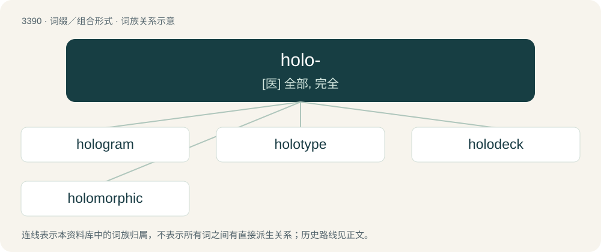

# 3480 · holo- — \[医\] 全部, 完全

[总目录](../00_总目录_按常用程度.md)

**类型**：词缀／组合形式　｜　**来源语言**：见词源记录

## 核心含义与来源

- 核心含义：\[医\] 全部, 完全
- 英文含义：Whole, entire.
- 词形：holo-

**来源记录 1**（前缀／前置成分；Whole, entire.）

Derived from Ancient Greek ὅλος (hólos, “whole, entire”).

## 词族图

## 单词速览（常用到不常用）

| 单词 | 音标 | 释义 |
|---|---|---|
| [hologram](#w-1) | 英 /ˈhɒləɡɹæm/；美 /ˈhɑləˌɡɹæm/ | n. 全息照相图；\[计\] 全息照相, 全息图 |
| [holotype](#w-2) | /ˈhɔləu,taip/ | n. \[生\]正模标本, 全型 |
| [holodeck](#w-3) |  | 【英文】A room that provides holographic simulations for recreation, training, etc. |
| [holomorphic](#w-4) | /,hɔləuˈmɔːfik/ | a. \[物\](晶体)对当的 |

## 逐词详解

### 1. hologram

**词性**：名词　｜　**音标**：英 /ˈhɒləɡɹæm/；美 /ˈhɑləˌɡɹæm/

**中文释义**：n. 全息照相图；\[计\] 全息照相, 全息图

**英文义项**：A three-dimensional image of an object created by holography.

**构词拆分**：holo- + -gram

**词源与演化**：

From holo- + -gram, from Ancient Greek ὅλος (hólos, “whole”) + γρᾰ́μμᾰ (grắmmă, “that which is written or drawn”), coined by Hungarian-born British scientist Dennis Gabor in 1948, the Nobel prize winner in physics in 1971 for his work in holography.

**例句**：

> Tom wasn't really performing at the concert. That was just his hologram.

### 2. holotype

**词性**：名词　｜　**音标**：/ˈhɔləu,taip/

**中文释义**：n. \[生\]正模标本, 全型

**英文义项**：The single physical example (or illustration) of an organism used to formally describe the species (or lower-order taxon), subsequently to be kept as a reference.

**构词拆分**：holo- + -type

**词源与演化**：

From holo- + -type.

### 3. holodeck

**词性**：名词

**英文义项**：A room that provides holographic simulations for recreation, training, etc.

**构词拆分**：holo- + deck

**词源与演化**：

From holo- + deck, coined in the television series Star Trek: The Next Generation.

### 4. holomorphic

**词性**：形容词　｜　**音标**：/,hɔləuˈmɔːfik/

**中文释义**：a. \[物\](晶体)对当的

**英文义项**：Complex-differentiable on an open set around every point in its domain. / Having holohedral symmetry.

**构词拆分**：holo- + -morphic

**词源与演化**：

From holo- + -morphic.

**例句**：

> Holomorphic functions have several agreeable properties, making them easy to work with.
