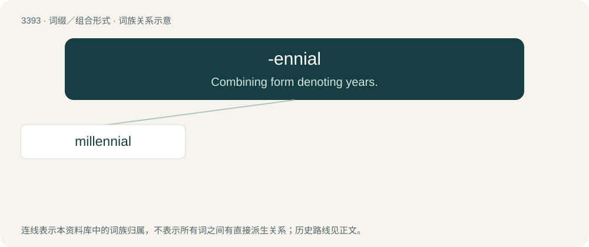

# 3483 · -ennial — Combining form denoting years.

[总目录](../00_总目录_按常用程度.md)

**类型**：词缀／组合形式　｜　**来源语言**：见词源记录

## 核心含义与来源

- 核心含义：Combining form denoting years.
- 英文含义：Combining form denoting years.
- 词形：-ennial

**来源记录 1**（后缀／后置成分；Combining form denoting years.）

From Latin -enniālis, from annus + -ium + -ālis.

## 词族图

## 单词速览（常用到不常用）

| 单词 | 音标 | 释义 |
|---|---|---|
| [millennial](#w-1) | 英 /mɪˈlɛn.ɪ.əl/；美 /məˈlɛn.i.əl/ | a. 一千年的, 千福年的 |

## 逐词详解

### 1. millennial

**词性**：形容词　｜　**音标**：英 /mɪˈlɛn.ɪ.əl/；美 /məˈlɛn.i.əl/

**中文释义**：a. 一千年的, 千福年的

**英文义项**：Thousand-year-old; also (by extension, loosely) thousands of years old. / Occurring every thousand years.

**构词拆分**：millennium + -al；milli- (prefix meaning ‘thousand’) + -ennial (suffix meaning ‘years’)

**词源与演化**：

The adjective is a learned borrowing from Late Latin mīllennium (“millennium”) + English -al (suffix meaning ‘of or pertaining to’ forming adjectives; and forming nouns). The English word may be analysed as millennium + -al or milli- (prefix meaning ‘thousand’) + -ennial (suffix meaning ‘years’). Adjective sense 5 (“of or relating to, or characteristic of, people born in the last two decades of the 20th century”) was coined by the American authors William Strauss (1947–2007) and Neil Howe (born 1951) in their book Generations (1991): see the quotations. The noun is derived from the adjective.

**用法示例／搭配（非完整句）**：

> the millennial judgment

该用例对应义项：Synonym of millenarian (“pertaining to the belief in an impending period of one thousand years of peace and righteousness associated with the Second Coming of Christ and his reign on earth”).
