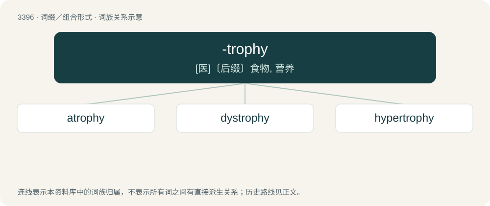

# 3484 · -trophy — \[医\]〔后缀〕食物, 营养

[总目录](../00_总目录_按常用程度.md)

**类型**：词缀／组合形式　｜　**来源语言**：见词源记录

## 核心含义与来源

- 核心含义：\[医\]〔后缀〕食物, 营养
- 英文含义：nutrition
- 词形：-trophy

**来源记录 1**（后缀／后置成分；nutrition）

From Ancient Greek τροφή (trophḗ, “food, nourishment”), from τρέφω (tréphō, “I congeal, thicken”).

## 词族图

## 单词速览（常用到不常用）

| 单词 | 音标 | 释义 |
|---|---|---|
| [atrophy](#w-1) | 英 /ˈæt.ɹə.fi/ | n. 萎缩, 萎缩症；\[医\] 萎缩 |
| [dystrophy](#w-2) | /ˈdɪstɹəfi/ | n. 营养障碍, 营养不良；\[医\] 营养不良, 营养障碍 |
| [hypertrophy](#w-3) | 英 /haɪˈpɜː.tɹə.fi/；美 /haɪˈpɜɹ.tɹə.fi/ | n. 肥大, 过度增大, 过度膨胀；\[医\] 肥大 |

## 逐词详解

### 1. atrophy

**词性**：名词　｜　**音标**：英 /ˈæt.ɹə.fi/

**中文释义**：n. 萎缩, 萎缩症；\[医\] 萎缩

**英文义项**：A reduction in the functionality of an organ caused by disease, injury or lack of use.

**构词拆分**：a- + -trophy

**词源与演化**：

Borrowed from French atrophie, from Latin atrophia, from Ancient Greek ἀτροφία (atrophía, “a wasting away”), from ἄτροφος (átrophos, “ill-fed, un-nourished”), from ἀ- (a-, “not”) + τροφή (trophḗ, “nourishment”), from τρέφω (tréphō, “to fatten”). Equivalent to a- + -trophy.

**例句**：

> Astronauts' muscles atrophy when they spend a long time in zero gravity.

### 2. dystrophy

**词性**：名词　｜　**音标**：/ˈdɪstɹəfi/

**中文释义**：n. 营养障碍, 营养不良；\[医\] 营养不良, 营养障碍

**英文义项**：A wasting of body tissues, of either genetic origin or due to inadequate or defective nutrition.

**构词拆分**：dys- + -trophy, literally “bad growth”

**词源与演化**：

From dys- + -trophy, literally “bad growth”, as in the opposite of growth.

**例句**：

> Muscular dystrophy is an incredibly rare, but extremely serious disease.

### 3. hypertrophy

**词性**：名词　｜　**音标**：英 /haɪˈpɜː.tɹə.fi/；美 /haɪˈpɜɹ.tɹə.fi/

**中文释义**：n. 肥大, 过度增大, 过度膨胀；\[医\] 肥大

**英文义项**：An increase in the size of an organ or tissue due to the enlargement of its individual cells. / Increase in muscle size through increased size of individual muscle cells; a result of weightlifting, and other exercise. It differs from muscle hyperplasia, which is the formation of new muscle cells.

**构词拆分**：hyper- + -trophy

**词源与演化**：

From French hypertrophie, from Ancient Greek ὑπέρ (hupér, “over, excessive”) + τροφή (trophḗ, “nourishment”), equivalent to hyper- + -trophy.
