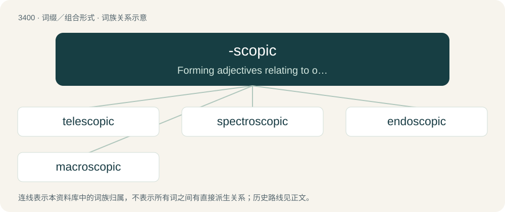

# 3486 · -scopic — Forming adjectives relating to observation or viewing.

[总目录](../00_总目录_按常用程度.md)

**类型**：词缀／组合形式　｜　**来源语言**：见词源记录

## 核心含义与来源

- 核心含义：Forming adjectives relating to observation or viewing.
- 英文含义：Forming adjectives relating to observation or viewing.
- 词形：-scopic

**来源记录 1**（后缀／后置成分；Forming adjectives relating to observation or viewing.）

From -scope + -ic.

## 词族图

## 单词速览（常用到不常用）

| 单词 | 音标 | 释义 |
|---|---|---|
| [telescopic](#w-1) | 英 /tɛlɪˈskɒpɪk/ | a. 望远镜的, 用望远镜看到的, 套管式的, 伸缩的；\[医\] 望远\[镜\]的 |
| [spectroscopic](#w-2) | /.spektrəˈskɒpik/ | a. 分光镜的, 光谱学的；\[医\] 分光镜检查的; 分光镜的 |
| [endoscopic](#w-3) | /en,dɔsˈkɔpik/ | a. 内窥镜的, 用内窥镜检查的 |
| [macroscopic](#w-4) | /ˌmæ.kɹəˈskɒ.pɪk/ | a. 肉眼可见的, 宏观的, 目视的；\[医\] 肉眼\[检查\]的, 目视的 |

## 逐词详解

### 1. telescopic

**词性**：形容词　｜　**音标**：英 /tɛlɪˈskɒpɪk/

**中文释义**：a. 望远镜的, 用望远镜看到的, 套管式的, 伸缩的；\[医\] 望远\[镜\]的

**英文义项**：Pertaining to, or carried out by means of, a telescope. / Seen by means of a telescope; only visible through a telescope.

**构词拆分**：tele- + -scopic

**词源与演化**：

From tele- + -scopic, after telescope.

**用法示例／搭配（非完整句）**：

> telescopic baton

该用例对应义项：Able to be extended or retracted by the use of parts that slide over one another.

### 2. spectroscopic

**词性**：形容词　｜　**音标**：/.spektrəˈskɒpik/

**中文释义**：a. 分光镜的, 光谱学的；\[医\] 分光镜检查的; 分光镜的

**英文义项**：Of or relating to spectroscopy or to a spectroscope.

**构词拆分**：spectro- + -scopic

**词源与演化**：

From spectro- + -scopic, or borrowed from French spectroscopique.

### 3. endoscopic

**词性**：形容词　｜　**音标**：/en,dɔsˈkɔpik/

**中文释义**：a. 内窥镜的, 用内窥镜检查的

**英文义项**：Of, or relating to endoscopy or an endoscope.

**构词拆分**：endo- + -scopic

**词源与演化**：

From endo- + -scopic.

**例句**：

> We hope the doctors can find the cause of Tom's chest pain with an endoscopic ultrasound.

### 4. macroscopic

**词性**：形容词　｜　**音标**：/ˌmæ.kɹəˈskɒ.pɪk/

**中文释义**：a. 肉眼可见的, 宏观的, 目视的；\[医\] 肉眼\[检查\]的, 目视的

**英文义项**：Visible to the unassisted eye. / Having an appreciable mass.

**构词拆分**：macro- + -scopic

**词源与演化**：

From macro- + -scopic.

**例句**：

> The assumption that macroscopic objects can remain, if not observed, in a state of superposition is false.
