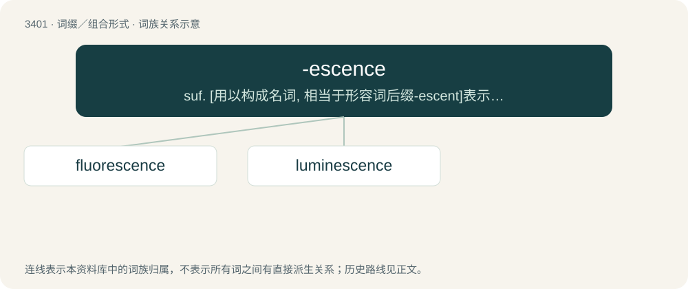

# 3487 · -escence — suf. \[用以构成名词, 相当于形容词后缀-escent\]表示变化, 状态, 动作, 过程

[总目录](../00_总目录_按常用程度.md)

**类型**：词缀／组合形式　｜　**来源语言**：见词源记录

## 核心含义与来源

- 核心含义：suf. \[用以构成名词, 相当于形容词后缀-escent\]表示变化, 状态, 动作, 过程
- 英文含义：A process of becoming (growing or increasing in the trait specified by the prefixed stem).
- 词形：-escence

**来源记录 1**（后缀／后置成分；A process of becoming (growing or increasing in the trait specified by the prefixed stem).）

From Latin -escens, form of -ēscō (“I become”). By surface analysis, -esce + -ence.

## 词族图

## 单词速览（常用到不常用）

| 单词 | 音标 | 释义 |
|---|---|---|
| [fluorescence](#w-1) | 美 /flʊˈɹɛsəns/ | n. 荧光, 发荧光, 荧光性；\[化\] 荧光 |
| [luminescence](#w-2) | /ˌluː.məˈnɛs.əns/ | n. 无热光, 冷光, 发冷光；\[化\] 发光; 冷光 |

## 逐词详解

### 1. fluorescence

**词性**：名词　｜　**音标**：美 /flʊˈɹɛsəns/

**中文释义**：n. 荧光, 发荧光, 荧光性；\[化\] 荧光

**英文义项**：The emission of light (or other electromagnetic radiation) by a material when stimulated by the absorption of radiation or of a subatomic particle. / The light so emitted.

**构词拆分**：fluorspar + -escence

**词源与演化**：

Coined by British physicist George Stokes in 1852 from fluorspar + -escence.

### 2. luminescence

**词性**：名词　｜　**音标**：/ˌluː.məˈnɛs.əns/

**中文释义**：n. 无热光, 冷光, 发冷光；\[化\] 发光; 冷光

**英文义项**：Any emission of light that cannot be attributed merely to the temperature of the emitting body.

**词源与演化**：

From Latin lumen + English -escence.
