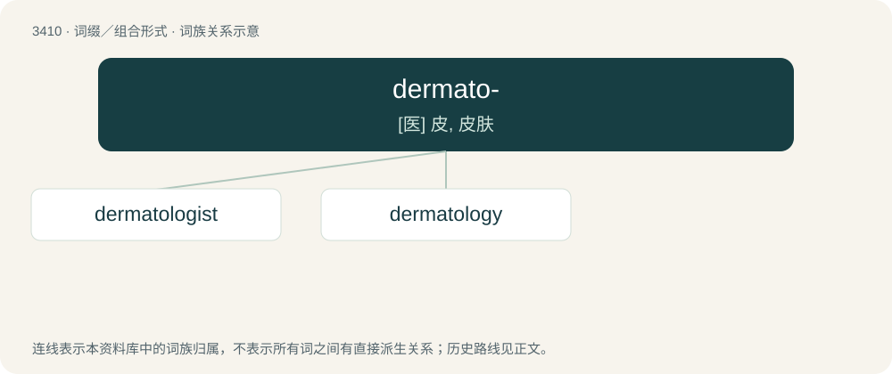

# 3492 · dermato- — \[医\] 皮, 皮肤

[总目录](../00_总目录_按常用程度.md)

**类型**：词缀／组合形式　｜　**来源语言**：见词源记录

## 核心含义与来源

- 核心含义：\[医\] 皮, 皮肤
- 英文含义：Dermal: dermis, but also often, broadly, skin or epidermis.
- 词形：dermato-

**来源记录 1**（前缀／前置成分；Dermal: dermis, but also often, broadly, skin or epidermis.）

From Ancient Greek δερματο- (dermato-), combining form of δέρμα (dérma, “skin”).

## 词族图

## 单词速览（常用到不常用）

| 单词 | 音标 | 释义 |
|---|---|---|
| [dermatologist](#w-1) | 英 /ˌdɜːməˈtɒlədʒɪst/；美 /ˌdɝ.məˈtɑ.lə.d͡ʒɪst/ | n. 皮肤学者, 皮肤科医生；\[医\] 皮肤病学家, 皮肤科医师 |
| [dermatology](#w-2) | 英 /ˌdɜːməˈtɒləd͡ʒi/；美 /ˌdɝməˈtɑləd͡ʒi/ | n. 皮肤医学, 皮肤病学；\[医\] 皮肤病学 |

## 逐词详解

### 1. dermatologist

**词性**：名词　｜　**音标**：英 /ˌdɜːməˈtɒlədʒɪst/；美 /ˌdɝ.məˈtɑ.lə.d͡ʒɪst/

**中文释义**：n. 皮肤学者, 皮肤科医生；\[医\] 皮肤病学家, 皮肤科医师

**英文义项**：A person who is skilled in, professes or practices dermatology.

**构词拆分**：dermatology + -ist；dermato- + -logist

**词源与演化**：

From dermatology + -ist or dermato- + -logist.

**例句**：

> I didn't know that Tom was a dermatologist.

### 2. dermatology

**词性**：名词　｜　**音标**：英 /ˌdɜːməˈtɒləd͡ʒi/；美 /ˌdɝməˈtɑləd͡ʒi/

**中文释义**：n. 皮肤医学, 皮肤病学；\[医\] 皮肤病学

**英文义项**：The study of the skin and its diseases.

**构词拆分**：dermato- + -logy

**词源与演化**：

From Ancient Greek δέρμα (dérma, “skin, hide”) + -logy. Analysable as dermato- + -logy.
