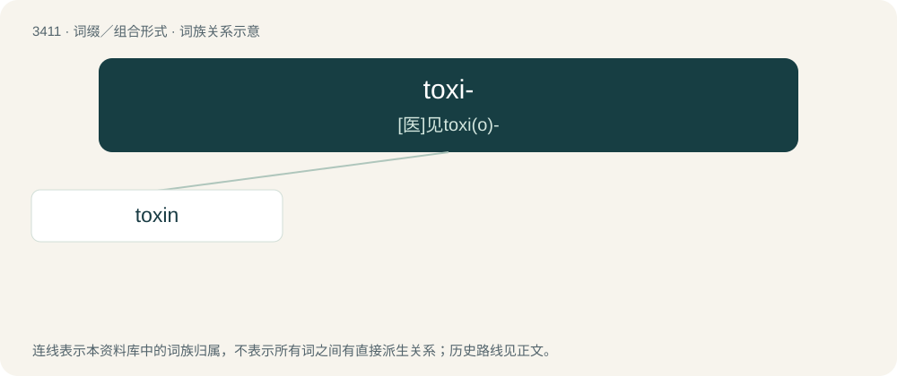

# 3494 · toxi- — \[医\]见toxi(o)-

[总目录](../00_总目录_按常用程度.md)

**类型**：词缀／组合形式　｜　**来源语言**：见词源记录

## 核心含义与来源

- 核心含义：\[医\]见toxi(o)-
- 英文含义：poison
- 词形：toxi-

## 词族图

## 单词速览（常用到不常用）

| 单词 | 音标 | 释义 |
|---|---|---|
| [toxin](#w-1) | 英 /ˈtɒksɪn/；美 /ˈtɑksɪn/ | n. 毒素；\[化\] 毒素 |

## 逐词详解

### 1. toxin

**词性**：名词　｜　**音标**：英 /ˈtɒksɪn/；美 /ˈtɑksɪn/

**中文释义**：n. 毒素；\[化\] 毒素

**英文义项**：A toxic substance, specifically a poison produced by the biological processes of organisms. / Synonym of toxicant: a toxic substance in a body requiring removal.

**构词拆分**：toxi- + -in

**词源与演化**：

From Latin toxicum, equivalent to toxi- + -in.

**例句**：

> The neurological system is compromised by this toxin.
