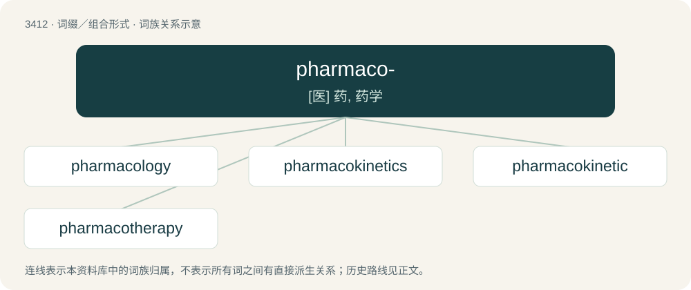

# 3496 · pharmaco- — \[医\] 药, 药学

[总目录](../00_总目录_按常用程度.md)

**类型**：词缀／组合形式　｜　**来源语言**：见词源记录

## 核心含义与来源

- 核心含义：\[医\] 药, 药学
- 英文含义：medication
- 词形：pharmaco-

**来源记录 1**（前缀／前置成分；medication）

From Ancient Greek φάρμακον (phármakon, “drug”).

## 词族图

## 单词速览（常用到不常用）

| 单词 | 音标 | 释义 |
|---|---|---|
| [pharmacology](#w-1) | /ˌfɑɹməˈkɒləd͡ʒi/ | n. 药理学, 药物学；\[化\] 药理学 |
| [pharmacokinetics](#w-2) | /ˌfɑː(ɹ)məkəʊkɪˈnɛtɪks/ | \[化\] 药动学 |
| [pharmacokinetic](#w-3) | /ˌfɑː(ɹ)məkəʊkɪˈnɛtɪk/ | \[医\]药物代谢动力学 |
| [pharmacotherapy](#w-4) | /,fɑːməkəˈθerəpi/ | \[医\] 药物疗法 |

## 逐词详解

### 1. pharmacology

**词性**：名词　｜　**音标**：/ˌfɑɹməˈkɒləd͡ʒi/

**中文释义**：n. 药理学, 药物学；\[化\] 药理学

**英文义项**：The science of drugs, including their origin, composition, pharmacokinetics, therapeutic use, and toxicology. / The properties and reactions of a given drug, especially with relation to its therapeutic value.

**构词拆分**：pharmaco- + -logy

**词源与演化**：

From pharmaco- + -logy.

**例句**：

> I don't really know anything about the pharmacology of venlafaxine.

### 2. pharmacokinetics

**词性**：名词　｜　**音标**：/ˌfɑː(ɹ)məkəʊkɪˈnɛtɪks/

**中文释义**：\[化\] 药动学

**英文义项**：A branch of pharmacology concerned with the rate at which drugs are absorbed, distributed, metabolized, and eliminated by the body. / The particular rates at which drugs are absorbed, distributed, metabolized, and eliminated by the body.

**构词拆分**：pharmaco- + kinetics

**词源与演化**：

From pharmaco- + kinetics.

### 3. pharmacokinetic

**词性**：形容词　｜　**音标**：/ˌfɑː(ɹ)məkəʊkɪˈnɛtɪk/

**中文释义**：\[医\]药物代谢动力学

**英文义项**：Of or relating to pharmacokinetics.

**构词拆分**：pharmaco- + kinetic

**词源与演化**：

From pharmaco- + kinetic.

**用法示例／搭配（非完整句）**：

> the pharmacokinetic properties of a drug

该用例对应义项：Of or relating to pharmacokinetics.

### 4. pharmacotherapy

**词性**：名词　｜　**音标**：/,fɑːməkəˈθerəpi/

**中文释义**：\[医\] 药物疗法

**英文义项**：The use of pharmaceuticals to treat disease

**构词拆分**：pharmaco- + therapy

**词源与演化**：

From pharmaco- + therapy.
