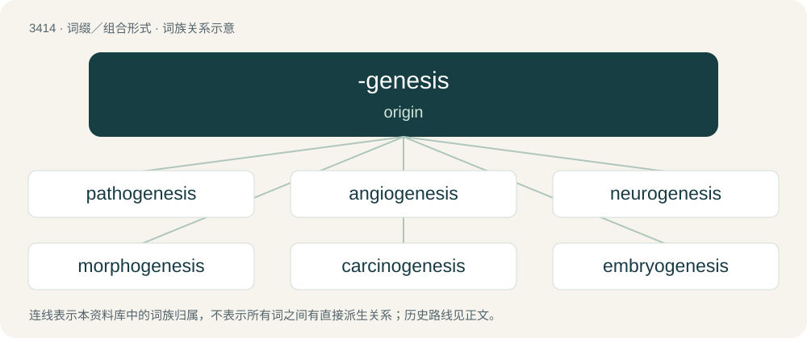

# 3497 · -genesis — origin

[总目录](../00_总目录_按常用程度.md)

**类型**：词缀／组合形式　｜　**来源语言**：见词源记录

## 核心含义与来源

- 核心含义：origin
- 英文含义：origin
- 词形：-genesis

## 词族图

## 单词速览（常用到不常用）

| 单词 | 音标 | 释义 |
|---|---|---|
| [pathogenesis](#w-1) | 英 /ˌpæθ.ə(ʊ)ˈd͡ʒɛn.ə.sɪs/；美 /ˌpæθ.oʊˈd͡ʒɛn.ə.sɪs/ | n. 致病, 发病；\[医\] 发病机理 |
| [angiogenesis](#w-2) | 英 /andʒɪə(ʊ)ˈdʒɛnɪsɪs/ | \[医\] 血管生成, 血管发生 |
| [neurogenesis](#w-3) | /,njuərəˈdʒenisis/ | n. \[生\]神经发生,神经形成 |
| [morphogenesis](#w-4) | 英 /ˌmɔː.fəˈd͡ʒɛn.ə.sɪs/；美 /ˌmɔɹ.foʊˈd͡ʒɛn.ə.sɪs/ | n. 形态发生, 形态形成, 器官发生, 器官形成；\[医\] 形态形成, 形态发生 |
| [carcinogenesis](#w-5) | /,kɑːsinəjˈdʒenisis/ | n. 致癌作用, 癌发生；\[医\] 致癌作用, 癌发生 |
| [embryogenesis](#w-6) | /,embriəjˈdʒenisis/ | \[医\] 胚胎发生 |
| [spermatogenesis](#w-7) | /,spəːmətəuˈdʒenisis/ | n. 精子发生；\[医\] 精子发生 |
| [osteogenesis](#w-8) | /,ɔstiəˈdʒenisis/ | n. 骨生成, 成骨, 骨发生；\[医\] 骨生成, 骨发生 |
| [tumorigenesis](#w-9) | /,tuːməriˈdʒenisis/ | 肿瘤发生 |

## 逐词详解

### 1. pathogenesis

**词性**：名词　｜　**音标**：英 /ˌpæθ.ə(ʊ)ˈd͡ʒɛn.ə.sɪs/；美 /ˌpæθ.oʊˈd͡ʒɛn.ə.sɪs/

**中文释义**：n. 致病, 发病；\[医\] 发病机理

**英文义项**：The origin and development of a disease. / The mechanism whereby something causes a disease.

**构词拆分**：patho- + -genesis

**词源与演化**：

From patho- + -genesis.

**例句**：

> Dr. Birx attended the recent International AIDS Society Conference on Pathogenesis, Prevention and Treatment in Vancouver, Canada.

### 2. angiogenesis

**词性**：名词　｜　**音标**：英 /andʒɪə(ʊ)ˈdʒɛnɪsɪs/

**中文释义**：\[医\] 血管生成, 血管发生

**英文义项**：The formation and development of new blood vessels.

**构词拆分**：angio- + -genesis

**词源与演化**：

From angio- + -genesis.

### 3. neurogenesis

**词性**：名词　｜　**音标**：/,njuərəˈdʒenisis/

**中文释义**：n. \[生\]神经发生,神经形成

**英文义项**：The creation and development of neurons

**构词拆分**：neuro- + -genesis

**词源与演化**：

From neuro- + -genesis.

### 4. morphogenesis

**词性**：名词　｜　**音标**：英 /ˌmɔː.fəˈd͡ʒɛn.ə.sɪs/；美 /ˌmɔɹ.foʊˈd͡ʒɛn.ə.sɪs/

**中文释义**：n. 形态发生, 形态形成, 器官发生, 器官形成；\[医\] 形态形成, 形态发生

**英文义项**：The differentiation of tissues and subsequent growth of structures in an organism

**构词拆分**：morpho- + -genesis

**词源与演化**：

From morpho- + -genesis.

**例句**：

> Morphogenesis is the development, from the embryo, of the characteristic forms and structures of a species.

### 5. carcinogenesis

**词性**：名词　｜　**音标**：/,kɑːsinəjˈdʒenisis/

**中文释义**：n. 致癌作用, 癌发生；\[医\] 致癌作用, 癌发生

**英文义项**：The creation of cancer cells.

**构词拆分**：carcino- + -genesis

**词源与演化**：

From carcino- + -genesis.

### 6. embryogenesis

**词性**：名词　｜　**音标**：/,embriəjˈdʒenisis/

**中文释义**：\[医\] 胚胎发生

**英文义项**：The process by which an embryo is formed and develops.

**构词拆分**：embryo + -genesis

**词源与演化**：

From embryo + -genesis.

### 7. spermatogenesis

**词性**：名词　｜　**音标**：/,spəːmətəuˈdʒenisis/

**中文释义**：n. 精子发生；\[医\] 精子发生

**英文义项**：The process of sperm production in the testes. / The development of the male elements of a plant, such as antherozoids and pollen grains.

**构词拆分**：spermato- + -genesis

**词源与演化**：

From spermato- + -genesis.

### 8. osteogenesis

**词性**：名词　｜　**音标**：/,ɔstiəˈdʒenisis/

**中文释义**：n. 骨生成, 成骨, 骨发生；\[医\] 骨生成, 骨发生

**英文义项**：The formation and development of bone.

**构词拆分**：osteo- + -genesis

**词源与演化**：

From osteo- + -genesis.

### 9. tumorigenesis

**词性**：名词　｜　**音标**：/,tuːməriˈdʒenisis/

**中文释义**：肿瘤发生

**英文义项**：Production of a new tumor or tumors. / The process involved in the production of a new tumor or tumors.

**构词拆分**：tumor + -i- + -genesis

**词源与演化**：

From tumor + -i- + -genesis.
