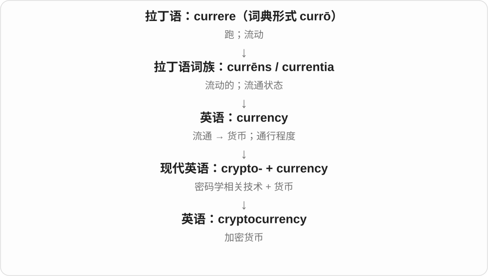

# 3499 · crypto- — 隐藏、秘密

[逐词精讲目录](../00_逐词精讲目录.md) · [总目录](../00_总目录_按常用程度.md)

## 核心词根与来源

来自希腊 kryptos 隐藏的，现代进入密码学、信息安全及其他词汇。独立 crypto 的常见用法也可由长词缩短。

**CRYPTO-：让内容或机制带有隐藏、保密关系**

cryptography 研究把信息处理成不易直接读懂的形式；cryptocurrency 的命名则借用了密码技术，不是说货币凭空消失。

- **密码技术与学科**：cryptography · cryptology
- **相关数字资产名称**：cryptocurrency

## 词形与演化规律

crypto- + -graphy → cryptography；crypto- + -logy → cryptology；crypto- + currency → cryptocurrency。各词的学科、技术范围分别理解。

## 单词速览（按词族由简到繁）

同一基础词的相关扩展放在一起，先读基础形式，再读扩展；各组之间优先读常用的。具体词源关系见各词讲解。

| 单词 | 音标 | 核心意思 |
|---|---|---|
| [cryptocurrency](#w-1) | 英 /ˈkrɪptəʊˌkʌrənsi/；美 /ˌkrɪptoʊˈkɜːrənsi/ | 加密货币 |
| [cryptography](#w-2) | 英 /krɪpˈtɒɡrəfi/；美 /krɪpˈtɑːɡrəfi/ | 密码学；密码技术 |
| [cryptology](#w-3) | 英 /krɪpˈtɒlədʒi/；美 /krɪpˈtɑːlədʒi/ | 密码学〔广义，含设计与分析〕 |

## 逐词讲解

### 1. cryptocurrency — 加密货币

**音标**：英 /ˈkrɪptəʊˌkʌrənsi/；美 /ˌkrɪptoʊˈkɜːrənsi/

**先抓住这个画面**

它也是在用户之间转移的数字资产，但记录和验证依靠密码学相关技术；crypto- 点出了这项技术特征。

**怎么拆**

crypto-（这里指密码学相关）+ currency（货币），现代技术组合词。

**怎么变成今天的意思**

crypto- 更早有隐藏的意思，但现代词不是“把现金藏起来”。具体系统的运行方式各异，词义也不保证交易匿名。

**常见搭配与例句**

a cryptocurrency exchange；cryptocurrency transactions；a cryptocurrency wallet。

> The article explains how cryptocurrency transactions are recorded.

这篇文章解释了加密货币交易如何被记录。

> She is comparing the terminology used by different cryptocurrency projects.

她正在比较不同加密货币项目使用的术语。

**别混淆**

digital currency 的范围更广，不能把所有电子账户余额都称作 cryptocurrency。

### 2. cryptography — 密码学；密码技术

**音标**：英 /krɪpˈtɒɡrəfi/；美 /krɪpˈtɑːɡrəfi/

**先抓住这个画面**

最直观的起点是把消息变得别人看不懂；现代还包括让接收者能核验消息有没有被改、来自谁等。

**怎么拆**

希腊 kryptos 隐藏 + 写画构件，形成近代拉丁 cryptographia，经法语 cryptographie 或直接借入英语。

**怎么变成今天的意思**

**希腊 graphein／graphē**  
刻画、写；文字、图画

↓

**希腊 kryptos 隐藏 + 写画构件 → 近代拉丁 cryptographia**  
秘密书写

↓

**法语 cryptographie／直接近代拉丁 → 英语 cryptography**  
密码学、密码技术

不只研究加密，也涵盖数字签名、消息完整性等技术。名称里的“秘密书写”是历史出发点，不能据此把所有密码技术都缩成藏文字。

**常见搭配与例句**

modern cryptography；public key cryptography；a cryptography course。

> The course explains how cryptography protects digital messages.

课程解释密码技术怎样保护数字消息。

> Digital signatures are one application of cryptography.

数字签名是密码技术的一种应用。

**别混淆**

encryption 是密码技术中的加密过程；cryptography 是更广的领域。cryptocurrency 只是可能使用这些技术的一类应用。

### 3. cryptology — 密码学〔广义，含设计与分析〕

**音标**：英 /krɪpˈtɒlədʒi/；美 /krɪpˈtɑːlədʒi/

**先抓住这个画面**

既研究怎样把信息保护起来，也研究这种保护能不能被分析突破。

**怎么拆**

希腊 kryptós“隐藏的” + -logia，近代拉丁 cryptologia 等形式进入英语；crypto- 在这里不是专指加密货币。

**怎么变成今天的意思**

**希腊 légō / lógos**  
选取、收集 → 讲述；话语、说明、道理、计算

↓

**希腊 kryptós〔隐藏〕+ -logia → 近代拉丁 cryptologia**  
围绕隐秘信息的学术构词

↓

**英语 cryptology**  
密码设计与密码分析的综合领域

设计一个密码系统属于 cryptography；研究它的安全性和可能的破解方法属于 cryptanalysis。cryptology 常把这两面合起来说。

**常见搭配与例句**

the history of cryptology；modern cryptology；a course in cryptology。

> The museum traces the history of cryptology from handwritten ciphers to digital systems.

博物馆追溯了密码学从手写密码到数字系统的历史。

> The course in cryptology covers both designing ciphers and analysing their weaknesses.

密码学课程既讲密码设计，也讲弱点分析。

**别混淆**

cryptocurrency 是加密货币；cryptology 是更广且历史更早的密码研究领域。

## 这一组要分清什么

cryptocurrency 的词名不能保证交易匿名，也不代表具体投资性质；本页抓命名线索和词义，不用隐藏的字面代替技术定义。

## 串起来练习

The course introduces cryptography before discussing cryptocurrency.

课程先介绍密码技术，再讨论加密货币。
