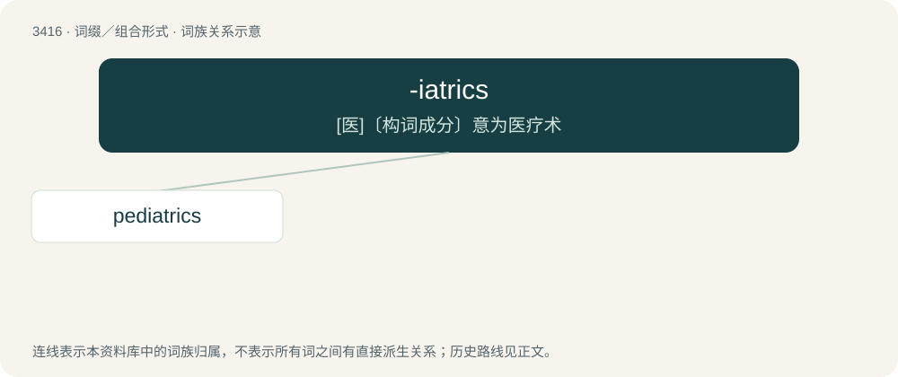

# 3501 · -iatrics — \[医\]〔构词成分〕意为医疗术

[总目录](../00_总目录_按常用程度.md)

**类型**：词缀／组合形式　｜　**来源语言**：见词源记录

## 核心含义与来源

- 核心含义：\[医\]〔构词成分〕意为医疗术
- 英文含义：Forms a noun meaning a specialty medical field of practice.
- 词形：-iatrics

**来源记录 1**（后缀／后置成分；Forms a noun meaning a specialty medical field of practice.）

From Ancient Greek ἰατρός (iatrós, “doctor”) + -ics.

## 词族图

## 单词速览（常用到不常用）

| 单词 | 音标 | 释义 |
|---|---|---|
| [pediatrics](#w-1) | 英 /ˌpiːdɪˈætɹɪks/；美 /ˌpidiˈætɹɪks/ | n. 小儿科；\[医\] 儿科学 |

## 逐词详解

### 1. pediatrics

**词性**：名词　｜　**音标**：英 /ˌpiːdɪˈætɹɪks/；美 /ˌpidiˈætɹɪks/

**中文释义**：n. 小儿科；\[医\] 儿科学

**英文义项**：The branch of medicine that deals with the treatment of children and adolescents.

**构词拆分**：ped + -iatrics

**词源与演化**：

From Ancient Greek παῖς (paîs, “child”) ped + -iatrics.
