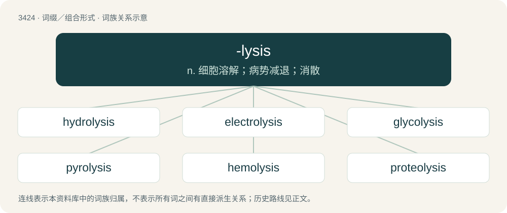

# 3505 · -lysis — n. 细胞溶解；病势减退；消散

[总目录](../00_总目录_按常用程度.md)

**类型**：词缀／组合形式　｜　**来源语言**：见词源记录

## 核心含义与来源

- 核心含义：n. 细胞溶解；病势减退；消散
- 英文含义：decomposition or breakdown
- 词形：-lysis

**来源记录 1**（后缀／后置成分；decomposition or breakdown）

From Ancient Greek λύσις (lúsis, “a loosening”). Compare lysis.

## 词族图

## 单词速览（常用到不常用）

| 单词 | 音标 | 释义 |
|---|---|---|
| [hydrolysis](#w-1) | 英 /haɪˈdɹɒlɪsɪs/；美 /haɪˈdɹɑləsəs/ | n. 水解(作用)；\[计\] 水解作用 |
| [electrolysis](#w-2) | 英 /ɪlɛkˈtɹɒləsɪs/ | n. 电分解, 电解, 以电针除痣；\[化\] 电解 |
| [glycolysis](#w-3) | /ɡlaɪˈkɒlɪsɪs/ | n. 糖酵解(作用)；\[化\] 糖酵解 |
| [pyrolysis](#w-4) | 英 /paɪˈɹɒlɪsɪs/；美 /paɪˈɹɑləsɪs/ | n. 高温分解；\[化\] 热解; 裂解 |
| [hemolysis](#w-5) | /hiˈmɒlisis/ | n. 溶血；\[医\] 溶血, 血细胞溶解 |
| [proteolysis](#w-6) | /,prəutiˈɔlisis/ | n. 解朊作用, 蛋白水解作用；\[化\] 蛋白水解; 蛋白水解作用 |

## 逐词详解

### 1. hydrolysis

**词性**：名词　｜　**音标**：英 /haɪˈdɹɒlɪsɪs/；美 /haɪˈdɹɑləsəs/

**中文释义**：n. 水解(作用)；\[计\] 水解作用

**英文义项**：A chemical process of decomposition involving the splitting of a bond and the addition of the hydrogen cation and the hydroxide anion of water.

**构词拆分**：hydro- + -lysis

**词源与演化**：

From hydro- + -lysis.

### 2. electrolysis

**词性**：名词　｜　**音标**：英 /ɪlɛkˈtɹɒləsɪs/

**中文释义**：n. 电分解, 电解, 以电针除痣；\[化\] 电解

**英文义项**：The chemical change produced by passing an electric current through a conducting solution or a molten salt. / The destruction of hair roots by means of an electric current.

**构词拆分**：electro- + -lysis (“a loosening”)

**词源与演化**：

Coined by English polymath William Whewell in 1834 for Michael Faraday. From electro- + -lysis (“a loosening”). Originally of tumors, later (1909) of hair removal.

**例句**：

> People with dark hair would benefit more from laser hair removal than electrolysis.

### 3. glycolysis

**词性**：名词　｜　**音标**：/ɡlaɪˈkɒlɪsɪs/

**中文释义**：n. 糖酵解(作用)；\[化\] 糖酵解

**英文义项**：The cellular degradation of the simple sugar glucose to yield pyruvic acid (pyruvate), and ATP as an energy source

**构词拆分**：glyco- + -lysis

**词源与演化**：

From glyco- + -lysis.

### 4. pyrolysis

**词性**：名词　｜　**音标**：英 /paɪˈɹɒlɪsɪs/；美 /paɪˈɹɑləsɪs/

**中文释义**：n. 高温分解；\[化\] 热解; 裂解

**英文义项**：The decomposition of a material or compound by heat, in the absence of oxygen or other reagents.

**构词拆分**：pyro- + -lysis

**词源与演化**：

From pyro- + -lysis.

### 5. hemolysis

**词性**：名词　｜　**音标**：/hiˈmɒlisis/

**中文释义**：n. 溶血；\[医\] 溶血, 血细胞溶解

**英文义项**：The destruction of red blood cells, and subsequent release of hemoglobin, at the normal end of the cell's life.

**构词拆分**：hemo- + -lysis

**词源与演化**：

From hemo- + -lysis, from Ancient Greek αἷμα (haîma, “blood”) + λύσις (lúsis, “loosening”).

### 6. proteolysis

**词性**：名词　｜　**音标**：/,prəutiˈɔlisis/

**中文释义**：n. 解朊作用, 蛋白水解作用；\[化\] 蛋白水解; 蛋白水解作用

**英文义项**：The hydrolysis of proteins into peptides and amino acids, especially as part of the digestion of food.

**构词拆分**：proteo- + -lysis

**词源与演化**：

From proteo- + -lysis.
