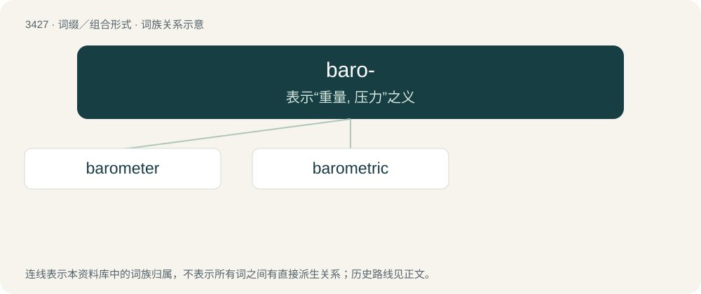

# 3508 · baro- — 表示“重量, 压力”之义

[总目录](../00_总目录_按常用程度.md)

**类型**：词缀／组合形式　｜　**来源语言**：见词源记录

## 核心含义与来源

- 核心含义：表示“重量, 压力”之义
- 英文含义：pressure
- 词形：baro-

**来源记录 1**（前缀／前置成分；pressure）

From Ancient Greek βάρος (báros, “weight”), from βαρύς (barús, “heavy”).

## 词族图

## 单词速览（常用到不常用）

| 单词 | 音标 | 释义 |
|---|---|---|
| [barometer](#w-1) | 英 /bəˈɹɒm.ɪ.tə(ɹ)/；美 /bəˈɹɑ.mə.tɚ/ | n. 气压计；\[化\] 气压计 |
| [barometric](#w-2) | 英 /ˌbæɹəˈmɛtɹɪk/ | a. 气压的；\[机\] 气压的, 测定气压的 |

## 逐词详解

### 1. barometer

**词性**：名词　｜　**音标**：英 /bəˈɹɒm.ɪ.tə(ɹ)/；美 /bəˈɹɑ.mə.tɚ/

**中文释义**：n. 气压计；\[化\] 气压计

**英文义项**：An instrument for measuring atmospheric pressure. / Anything used as a gauge or indicator.

**构词拆分**：baro- + -meter

**词源与演化**：

From baro- + -meter. Coined in 1665 by Robert Boyle as a name for the instrument invented by Torricelli some 20 years earlier; soon thereafter borrowed from English into various languages.

**例句**：

> The retail price index is a barometer of economic activity.

### 2. barometric

**词性**：形容词　｜　**音标**：英 /ˌbæɹəˈmɛtɹɪk/

**中文释义**：a. 气压的；\[机\] 气压的, 测定气压的

**英文义项**：Of or pertaining to atmospheric pressure. / Made or done with a barometer.

**构词拆分**：baro- + -metric

**词源与演化**：

From baro- + -metric.

**例句**：

> A low barometric pressure is characteristic of hurricanes.

该用例对应义项：Of or pertaining to atmospheric pressure.
