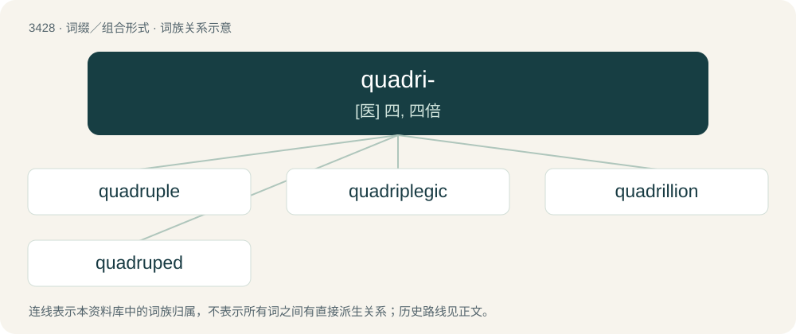

# 3509 · quadri- — \[医\] 四, 四倍

[总目录](../00_总目录_按常用程度.md)

**类型**：词缀／组合形式　｜　**来源语言**：见词源记录

## 核心含义与来源

- 核心含义：\[医\] 四, 四倍
- 英文含义：Four.
- 词形：quadri-

**来源记录 1**（前缀／前置成分；Four.）

From Latin quadri- (“four”), from quattuor (“four”). Doublet of tetra-.

## 词族图

## 单词速览（常用到不常用）

| 单词 | 音标 | 释义 |
|---|---|---|
| [quadruple](#w-1) | 英 /ˈkwɒd.ɹʊ.pəl/；美 /kwɑˈdɹu.pəl/ | a. 四倍的, 四重的, 四部分组成的；n. 四倍；vt. 使成四倍 |
| [quadriplegic](#w-2) | 英 /ˌkwɒd.ɹɪˈp(ə)liː.dʒɪk/；美 /ˌkwɑdɹɪˈp(ə)lid͡ʒɪk/ | n. 四肢瘫痪者；a. 四肢瘫痪的 |
| [quadrillion](#w-3) | 英 /kwɒˈdɹɪl.jən/；美 /kwɑˈdɹɪl.i.ən/ | n. 千的五次方, 百万之四次方；a. 千之五次方的 |
| [quadruped](#w-4) | 英 /ˈkwɒdɹəpɛd/；美 /ˈkwɑdɹəˌpɛd/ | n. 四足动物；\[医\] 四足的, 四足动物 |

## 逐词详解

### 1. quadruple

**词性**：形容词　｜　**音标**：英 /ˈkwɒd.ɹʊ.pəl/；美 /kwɑˈdɹu.pəl/

**中文释义**：a. 四倍的, 四重的, 四部分组成的；n. 四倍；vt. 使成四倍

**英文义项**：Being four times as long, as big or as many of something.

**构词拆分**：quadri- + -ple

**词源与演化**：

From Middle English quadruple, from Latin quadruplus. Can be analyzed as quadri- + -ple.

**例句**：

> He's quite an athlete and can do quadruple jumps with ease.

该用例对应义项：Being four times as long, as big or as many of something.

### 2. quadriplegic

**词性**：形容词　｜　**音标**：英 /ˌkwɒd.ɹɪˈp(ə)liː.dʒɪk/；美 /ˌkwɑdɹɪˈp(ə)lid͡ʒɪk/

**中文释义**：n. 四肢瘫痪者；a. 四肢瘫痪的

**英文义项**：Of, related to, or suffering from quadriplegia.

**词源与演化**：

From quadri- (of Latin origins) and -plegic, from Ancient Greek πλήσσειν (plḗssein, “to strike”); probably patterned after paraplegic from the Ancient Greek παραπληγή (paraplēgḗ, “the paralysis of half of the body”).

### 3. quadrillion

**词性**：名词　｜　**音标**：英 /kwɒˈdɹɪl.jən/；美 /kwɑˈdɹɪl.i.ən/

**中文释义**：n. 千的五次方, 百万之四次方；a. 千之五次方的

**英文义项**：Any very large number, exceeding normal description.

**构词拆分**：quadri- (“four”) + -illion

**词源与演化**：

From French quadrillion, from quadri- (“four”) + -illion. By surface analysis, quadr- + -illion.

**例句**：

> In England they call a septillion a quadrillion.

该用例对应义项：the number that is represented as a one followed by 24 zeros

### 4. quadruped

**词性**：名词　｜　**音标**：英 /ˈkwɒdɹəpɛd/；美 /ˈkwɑdɹəˌpɛd/

**中文释义**：n. 四足动物；\[医\] 四足的, 四足动物

**英文义项**：A four-footed or four-legged animal. / A mammal ambulating on all fours.

**构词拆分**：quadru- + -ped

**词源与演化**：

Borrowed from French quadrupède, from Middle French, from Latin stem of quadrupēs (“four-footed, a four-footed animal”), from quadri- (“four-”) + stem of pes (“foot”). Alternatively analyzable as quadru- + -ped. Doublet of tetrapod.
