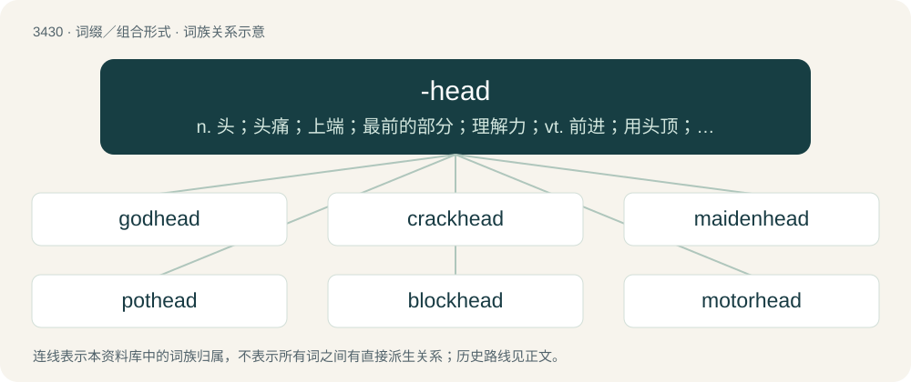

# 3512 · -head — n. 头；头痛；上端；最前的部分；理解力；vt. 前进；用头顶；作为…的首领；站在…的前头；给…加标题；vi. 出发；成头状物；船驶往

[总目录](../00_总目录_按常用程度.md)

**类型**：词缀／组合形式　｜　**来源语言**：见词源记录

## 核心含义与来源

- 核心含义：n. 头；头痛；上端；最前的部分；理解力；vt. 前进；用头顶；作为…的首领；站在…的前头；给…加标题；vi. 出发；成头状物；船驶往
- 英文含义：Used to create nouns indicating a state; -hood.
- 词形：-head

**来源记录 1**（后缀／后置成分；Used to create nouns indicating a state; -hood.）

From Middle English -hed, -hede, attested from the 12th century, continuing a hypothetical Old English \*-hǣdu (“-hood”), from Proto-Germanic \*haidį̄ (“state, condition”), related to Proto-Germanic \*haiduz (“manner, character, quality, state”). Doublet of -hood, which see.

## 词族图

## 单词速览（常用到不常用）

| 单词 | 音标 | 释义 |
|---|---|---|
| [godhead](#w-1) | /ˈɡɒd.hɛd/ | n. 神性 |
| [crackhead](#w-2) | /ˈkɹæk.hɛd/ | 强效可卡因瘾君子 |
| [maidenhead](#w-3) | /ˈmeid(ə)nhed/ | n. 处女膜, 处女时期, 处女性；\[医\] 处女膜 |
| [pothead](#w-4) | /ˈpɔt,hed/ | n. 吸大麻者 |
| [blockhead](#w-5) | /ˈblɒkhed/ | n. 笨蛋, 傻子 |
| [motorhead](#w-6) | 英 /ˈməʊtə(ɹ)ˌhɛd/；美 /ˈmoʊtɚˌhɛd/ | un. 发动机前端；\[网络\] 摩托头；摩托头乐队；摩托党 |

## 逐词详解

### 1. godhead

**词性**：名词　｜　**音标**：/ˈɡɒd.hɛd/

**中文释义**：n. 神性

**英文义项**：Divinity or godhood, divine essence or nature. / God.

**构词拆分**：god + -head (“-hood”)

**词源与演化**：

Inherited from Middle English godhede, equivalent to god + -head (“-hood”). First attested in the Ancrene Wisse (ca. 1225); compare godhood and Dutch godheid as well as German Gottheit.

**例句**：

> Krishna is the Supreme Personality of Godhead.

### 2. crackhead

**词性**：名词　｜　**音标**：/ˈkɹæk.hɛd/

**中文释义**：强效可卡因瘾君子

**英文义项**：A person who is addicted to or regularly uses crack cocaine. / Someone whose thinking makes no sense; a fool or an idiot; broadly, any contemptible person.

**构词拆分**：crack + -head

**词源与演化**：

From crack + -head. First sense appears c. 1978. Second sense appears c. 1977 in Best Canadian Stories.

**例句**：

> Sami pretended to be a crackhead.

### 3. maidenhead

**词性**：名词　｜　**音标**：/ˈmeid(ə)nhed/

**中文释义**：n. 处女膜, 处女时期, 处女性；\[医\] 处女膜

**英文义项**：The hymen. / Virginity.

**构词拆分**：maiden + -head

**词源与演化**：

From maiden + -head.

### 4. pothead

**词性**：名词　｜　**音标**：/ˈpɔt,hed/

**中文释义**：n. 吸大麻者

**英文义项**：A person who smokes cannabis frequently, or to excess. / An electric motor's terminal connection or wiring box.

**构词拆分**：pot + -head

**词源与演化**：

First sense appears c. 1957 in the writings of Jack Gelber. Third sense appears c. 1639.

**例句**：

> That pothead Shane has a nasty bong.

该用例对应义项：A person who smokes cannabis frequently, or to excess.

### 5. blockhead

**词性**：名词　｜　**音标**：/ˈblɒkhed/

**中文释义**：n. 笨蛋, 傻子

**英文义项**：A stupid person.

**构词拆分**：block (noun) + -head

**词源与演化**：

1532, block (noun) + -head.

### 6. motorhead

**词性**：名词　｜　**音标**：英 /ˈməʊtə(ɹ)ˌhɛd/；美 /ˈmoʊtɚˌhɛd/

**中文释义**：un. 发动机前端；\[网络\] 摩托头；摩托头乐队；摩托党

**英文义项**：A car, truck, or motorcycle enthusiast. / A heavy user of amphetamines.

**构词拆分**：motor + -head

**词源与演化**：

From motor + -head.
